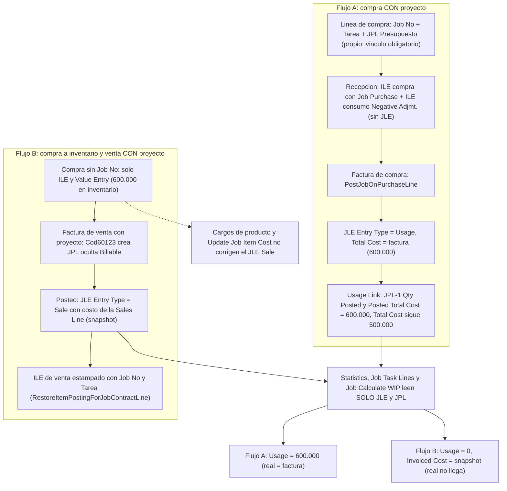
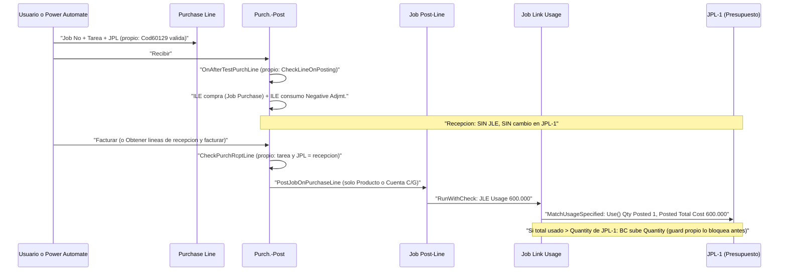
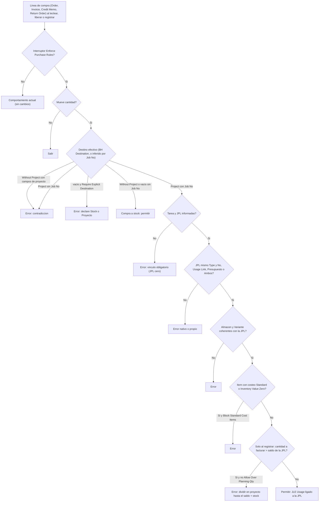
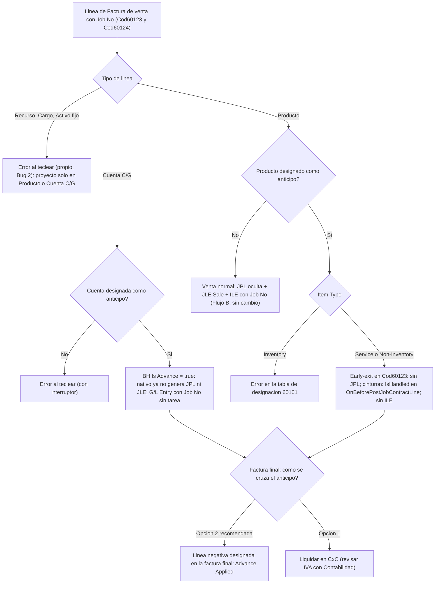
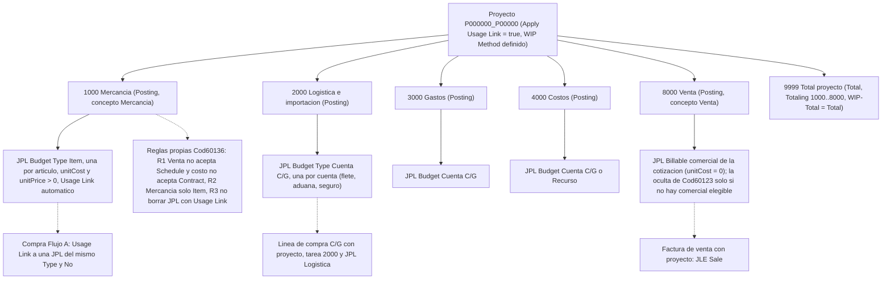
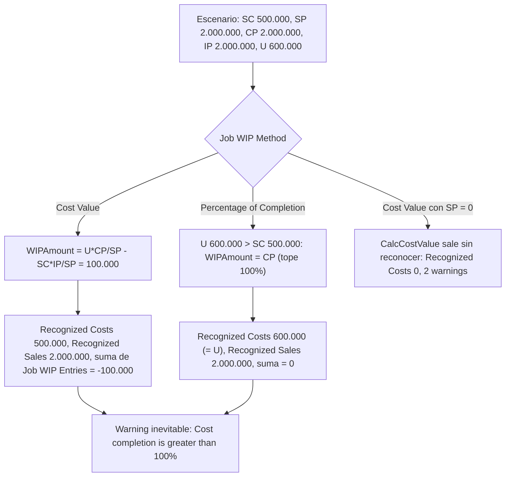
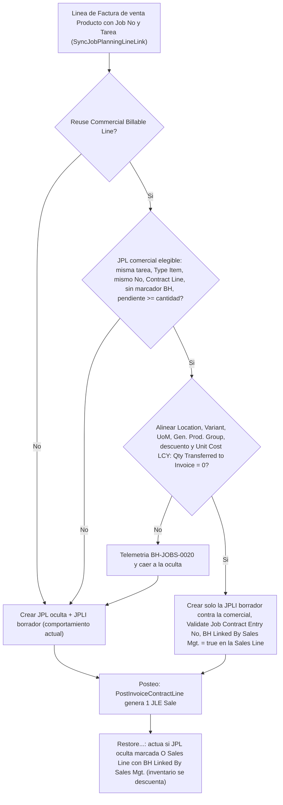

# DIS-2026-10-06 — Proyectos: costo real por compras, estructura por concepto, anticipos de venta y pendientes

| Campo | Valor |
|---|---|
| Fecha de la reunión (contabilidad/negocio) | 2026-10-06 |
| Elaborado | 2026-10-07 (bc-solution-architect) |
| Estado | **BORRADOR PARA REVISIÓN — no implementar** hasta que Cristhian conteste las preguntas bloqueantes (sección 13). Revisado de forma adversarial el 2026-10-07 contra BaseApp 28.4 y 27.5: ver sección 15 (registro de verificación) |
| Entorno de diseño y pruebas | Business Central **28.4** (`SandboxBHv2`). `app.json`: `application 28.0.0.0`, `runtime 16.0`, rango de IDs 60100-60149 |
| Audiencia | 1) Cristhian (decisiones), 2) `bc-implementer` (sección 11), 3) `al-code-reviewer` (secciones 6, 7 y 14) |
| Continúa a | `DIS-2026-08-31-jobs-sales-integration.md` (patrón JPL oculta, Factura de venta) y `DIS-2026-09-14-jobs-invoice-posting-fixes.md` (correcciones de posteo, Bug 2 original, Bug 1 original) |
| Insumos | Fact sheets F1-F7 (repo, Codeunit 50100, bugs, trazas de compras/posteo, cargos de producto, WIP, anticipos) y tres borradores de diseñadores (compras, estructura/costos, anticipos/bugs), todos reconciliados aquí |

**Etiquetas:** `[NATIVO BC]` comportamiento estándar leído en el código; `[NUESTRA EXTENSIÓN]` código de este repo; `[TERCEROS]` D365LATAM / LyLVariantsExt; `[NO VERIFICADO]` hay que probarlo en sandbox (sección 10); `[INFERIDO]` deducción sin prueba directa.
**Citas:** `Archivo : procedimiento (L<n> en 28.4)`. Las marcadas `(V)` en el apéndice (sección 14) las re-verificó el arquitecto leyendo el código extraído de BaseApp 27.5 y 28.4 el 2026-10-07.

## Índice y correspondencia con la estructura estándar de 8 secciones

| Sección estándar | Dónde está en este documento |
|---|---|
| 1. Requerimiento | 1 (Requerimiento y resumen ejecutivo) |
| 2. Supuestos y preguntas abiertas | 2 (hallazgos que cambian supuestos), 13 (preguntas abiertas) |
| 3. Análisis de lo existente | 3 |
| 4. Solución propuesta | 4 (por mejora), 5 (pendientes), 8 (diagramas), 9 (escenario numérico) |
| 5. Especificación técnica | 4 (c por mejora), 6 (registro de objetos e IDs), 7 (mapa de eventos) |
| 6. Plan de implementación | 11 (y 10 para las pruebas nativas previas) |
| 7. Criterios de aceptación | 4 (e por mejora), 9, 10 |
| 8. Riesgos | 4 (d por mejora), 12 |

Secciones: 1 Requerimiento y resumen · 2 Hallazgos que cambian supuestos · 3 Análisis de lo existente · 4 Mejoras 1 a 7 (+ 4.8 JPL ocultas) · 5 Pendientes (Bug 1, Bug 2, Codeunit 50100, huecos de Cod60123) · 6 Registro de objetos e IDs · 7 Mapa de eventos · 8 Diagramas · 9 Escenario numérico 500.000 / 2.000.000 / 600.000 · 10 Plan de pruebas "nativo primero" · 11 Plan de implementación · 12 Matriz de riesgos · 13 Preguntas abiertas · 14 Apéndice (afirmaciones críticas y verificación) · 15 Registro de verificación (revisión adversarial 2026-10-07).

---

## 1. Requerimiento y resumen ejecutivo

### 1.1 Requerimiento (reformulado)

Contabilidad y negocio necesitan que, en un proyecto (Job), **el presupuesto salga solo de la cotización comercial** (líneas de planificación, JPL, tipo Presupuesto) y **el costo real salga solo de las compras** (Job Ledger Entry, JLE, tipo Consumo/Usage, ligado a esa JPL), con importación y transporte incluidos en el costo real, comparables **por concepto** (mercancía, logística, gastos, costos) y con un WIP "balanceado" en el escenario de aceptación (presupuesto 500.000, venta 2.000.000, factura de proveedor 600.000). Además: (a) las facturas de **anticipo** de venta con proyecto no deben generar JLE ni movimiento de inventario y deben verse por tarea; (b) la compra a **stock** no lleva campos de proyecto y la misma variante repartida entre stock y proyecto se captura en dos líneas; (c) la factura de compra creada con "Obtener líneas de recepción" debe conservar proyecto/tarea; (d) hay que diagnosticar dos errores abiertos (Bug 1: borrado de líneas Facturable; Bug 2: "Project No. must be equal to ''") y localizar el Codeunit 50100 "Proyecto Obligatorio en Compras".

### 1.2 Decisiones recomendadas por mejora

| # | Mejora | Decisión recomendada (resumen) | Detalle |
|---|---|---|---|
| 1 | Compras solo afecta costo real | El vínculo a una JPL Presupuesto es **obligatorio** en toda línea de compra con proyecto; `Job Line Type` no lo elige el usuario/API (lo dicta la JPL) y se bloquea al teclear, al liberar y al registrar. Interruptor por empresa, apagado por defecto | 4.1 |
| 2 | Vínculo proyecto + tarea + JPL | "Concepto" = **tarea** (Job Task). El vínculo es a una JPL del mismo `Type` y mismo `No.` (una JPL por artículo o por cuenta). Guard de cantidad: el exceso sobre la JPL se bloquea (BC subiría el presupuesto) | 4.2 |
| 3 | Estructura por concepto | Modelo híbrido: **una tarea por concepto** (1000 Mercancía, 2000 Logística/Importación, 3000 Gastos, 4000 Costos, 8000 Venta, 9999 Total) y **una JPL por artículo/rubro**. JPL de costo = `Budget` con precio > 0 (nunca `Both`). Reglas a nivel tabla, campos de solo lectura aditivos en la BH-API y 2 páginas de rentabilidad | 4.3 |
| 4 | Costo real = mercancía + importación/transporte | En Flujo A (compra con proyecto) importación/transporte = **línea de compra Cuenta C/G (o Producto de servicio) con proyecto, tarea 2000 y JPL "Logística"**. El Cargo de producto **no admite proyecto y no genera JLE**: solo red de seguridad para stock. Activar costeo diferido en las 4 empresas. Flujo B: aceptar snapshot + reporte de conciliación | 4.4 |
| 5 | Stock vs proyecto | Campo propio `BH Destination` (Proyecto / Sin proyecto) por línea con validaciones y tabla de combinaciones; "misma variante repartida" = dos líneas; bloqueo de costeo Standard y de exceso | 4.5 |
| 6 | Anticipos de venta | Tabla de **designación** (Producto no inventariable y/o Cuenta C/G) + marcador `BH Is Advance` en la línea; corte **en origen** (no se crea JPL/JLE/ILE) con cinturón de seguridad en el posteo. Preferir **Cuenta C/G** (ya es nativo sin JLE). Cruce recomendado: línea negativa en la factura final. Visualización con FlowFields por tarea | 4.6 |
| 7 | Obtener líneas de recepción | Aceptar lo nativo (conserva proyecto pero **copiado de la orden**) y cerrar sus huecos: tomar Tarea/JPL/Tipo de la **línea de recepción** y validar Tarea+JPL (no solo Proyecto) al registrar | 4.7 |
| 3b | JPL ocultas de Cod60123 duplican "facturable" | **Reutilizar** la JPL Billable comercial cuando exista una elegible; si no, crear la oculta (comportamiento actual). Detrás de un interruptor, última fase, requiere aprobación (Q10) | 4.8 |
| — | WIP | Recomendar método **Percentage of Completion (POC)**; "WIP balanceado" definido operativamente (D1-D5, sección 9.4). Decisión final de contabilidad | 9 |

### 1.3 Las 10 decisiones funcionales que el usuario debe tomar (detalle y opciones en sección 13)

1. **Método WIP** por proyecto/empresa y la definición de "WIP balanceado" (recomendado: POC y definición D1-D5). Con Cost Value quedan 100.000 capitalizados en WIP por diseño del método. (Q1)
2. **Convención de tareas** por concepto (1000/2000/3000/4000/8000/9999) y tarea de Venta propia, solo para proyectos nuevos. (Q2)
3. **Importación y transporte**: gasto del proyecto vía línea C/G (recomendado en Flujo A) o capitalizar en el costo del artículo vía Cargo de producto (solo stock). Nunca ambos por el mismo importe. (Q3)
4. **Compras no presupuestadas y exceso de cantidad** sobre la JPL: bloquear (recomendado) o permitir que BC suba el presupuesto. (Q4, Q5)
5. **Cómo se emite hoy el anticipo** (Cuenta C/G, Producto "Anticipo", prepago sobre Pedido) y cómo se cruza al facturar el saldo (línea negativa o liquidación en CxC). (Q6, Q7)
6. **Reutilizar la JPL comercial** en lugar de crear la oculta (Opción A de 4.8). (Q10)
7. **Codeunit 50100**: ¿existe, dónde, qué suscribe? Mientras tanto la regla de "proyecto obligatorio" se diseña dentro de BH-API con el interruptor apagado. (Q8)
8. **Costeo**: prohibir costeo Standard / Inventory Value Zero en artículos comprados con proyecto, y activar `Automatic Update Job Item Cost` + Job Queue nocturna en las 4 empresas. (Q9, Q11)
9. **Flujo B** (compra a inventario y venta con proyecto): aceptar el snapshot de costo del JLE Venta + reporte de conciliación (necesita 1 ID extra), y regla "misma unidad no va por A y B". (Q12, Q13)
10. **Quién crea las JPL de presupuesto** (flujo de Power Automate, no está en este repo): confirmar que envía `Usage Link = true` (hoy la API no lo expone), precio > 0 en Presupuesto y la tarea correcta; y orden de activación por empresa. (Q14, Q15)

---

## 2. Hallazgos que cambian supuestos previos

| # | Supuesto previo (reunión, memoria, CLAUDE.md o diseños previos) | Hallazgo (hecho en BC 28.4) | Evidencia | Consecuencia en el diseño |
|---|---|---|---|---|
| H1 | "El JLE nace al recibir la mercancía" | En la **recepción** solo se generan ILE de compra (con `Job Purchase`) e ILE de consumo `Negative Adjmt.`; **no hay JLE ni cambio en la JPL**. El JLE Consumo nace al **facturar** (solo si la cantidad a facturar es distinta de 0). "Recibido no facturado" por proyecto solo se ve en `Amt. Rcd. Not Invoiced` (solo Órdenes) | `PurchPost.Codeunit.al : PostItemJnlLineJobConsumption (L5889-5951, L5946-5949)`; `PostGLAccICLine (L1244-1250)` para C/G | El proyecto no ve costo (ni WIP) hasta facturar (4.5, 4.7, 9) |
| H2 | "Obtener líneas de recepción hereda proyecto/tarea de la recepción" | Copia los campos de proyecto de la línea de la **ORDEN** (`PurchLine := PurchOrderLine`); la línea de recepción guarda los campos pero no se usan. El registro solo compara `Job No.` (no Tarea ni JPL) | `PurchRcptLine.Table.al : CopyFromPurchRcptLine (L1033)` (V); `PurchPost.Codeunit.al : CheckPurchRcptLine (L7741-7760)` | Mejora 7: dos subscribers |
| H3 | "El cargo de producto (importación/transporte) llega al proyecto" | **Charge (Item), Recurso y Activo fijo no admiten `Job No.`**; `PostJobOnPurchaseLine` descarta todo lo que no sea Producto o Cuenta C/G, así que un cargo **nunca** crea JLE. Solo llega de forma indirecta, tardía y en la JPL de mercancía si se asigna a una recepción de producto inventariable consumida al proyecto y corre el costeo diferido | `PurchaseLine.Table.al : VerifyLineTypeForJob (L7765-7776)`; `PurchPost.Codeunit.al : TestPurchLineItemCharge (L2649-2661)`; `JobPostLine.Codeunit.al : PostJobOnPurchaseLine (L365-390)` | Mejora 4: importación/transporte como línea C/G con proyecto |
| H4 | "Con el método Cost Value el WIP queda balanceado" | Con SP=2M, CP=2M, U=600k, SC=500k, IP=2M: `WIPAmount=100.000`, `Recognized Costs=500.000`, **suma de Job WIP Entries = -100.000** (100.000 de sobrecosto capitalizados). Con POC el tope es 100% (WIPAmount=CP), Recognized Costs=U y la suma da **0** | `JobCalculateWIP.Codeunit.al : CalcCostValue (L404-431)`, `CalcPercentageofCompletion (L459-485)` | Sección 9: recomendar POC; definir "balanceado" |
| H5 | "WIP balanceado = cero warnings" | **Imposible** en el escenario: `Job WIP Warning` emite "Cost completion is greater than 100%" siempre que U > SC | `JobWIPWarning.Table.al : CreateEntries (L79-106)` | Definición D4: warning admisible |
| H6 | "Una JPL Presupuesto sin precio es válida" | Con Cost Value y SP=0, `CalcCostValue` sale sin reconocer nada (Recognized Costs=0, 2 warnings). Además `Pag60114` solo fuerza `Unit Cost`/`Unit Price` si el valor del buffer es distinto de 0 y termina con `Rec.Modify()` sin triggers: **no se puede enviar precio 0 explícito** y el precio por defecto de una JPL Item viene de BC `[NO VERIFICADO]` | `JobCalculateWIP.Codeunit.al L404-431`; `src/Pages/Pag60114.projectLines.al : ApplyCostAndPrice (L147-179)` | Contrato del flujo: `unitPrice > 0` en Presupuesto (4.3) |
| H7 | "Las JPL ocultas de Cod60123 son inocuas" | Entran en `Contract (Total Price)` y, si ya existe la JPL Billable comercial, **duplican el facturable**: con la oculta CP=4.000.000; Cost Value da `Recognized Costs=-100.000` (negativo) + warning; POC reconoce ingreso doble | F6 §2.5 (cálculo con fórmulas citadas); `JobTask.Table.al : Contract (Total Price) (L236-249)` (V) | Mejora 3b (reutilizar JPL comercial) |
| H8 | "El bypass `OnBeforeTestJobPlanningLine` (Ruta A') está implementado" (DIS-2026-08-31 4.4/5.2 y memoria del arquitecto) | **Nunca existió** en `src/` ni en ningún commit. Y aunque existiera, la sincronización hacia la JPL oculta fallaría: `Unit Price`, `Location`, `Variant`, `Unit Cost` y `UoM` pasan por `ValidateModification`, que exige `Qty. Transferred to Invoice = 0`, y ese FlowField **cuenta borradores** de factura | `SalesLine.Table.al : TestJobPlanningLine (L8534-8551)` (V); `JobPlanningLine.Table.al : ValidateModification (L2600-2612)` (V), `Qty. Transferred to Invoice (L1053-1064)` | Decisión: documentar la limitación ("borrar y recrear la línea"), no implementar el bypass (5.4). **Corrección de la revisión adversarial (2026-10-07):** `TestJobPlanningLine` NO se invoca desde `Unit Price` (campo 22) ni desde `Unit Cost` (campo 100) de `Sales Line`; solo desde Type, No., Location Code, Quantity, Unit Cost (LCY) [L978, condicional], Line Discount Amount, Gen. Prod. Posting Group, Variant Code, Unit of Measure Code, Quantity (Base) y Line Discount % (`SalesLine.Table.al L133, 243, 408, 703, 978, 1053, 1647, 2837, 3022, 3114, 9558`). De los 6 suscriptores de sincronización de Cod60123 solo 4 (Cantidad, Almacén, Variante, UM) quedan precedidos por el guard nativo en edición de usuario. `SyncUnitPriceOnAfterValidate` y `SyncUnitCostOnAfterValidate` sí corren con `CurrFieldNo <> 0` y llaman `JobPlanningLine.Validate("Unit Price"/"Unit Cost")`, cuyo `OnValidate` ejecuta `ValidateModification` (`JobPlanningLine.Table.al L629, L652`) y falla con `TestField("Qty. Transferred to Invoice", 0)` mientras exista el borrador de `Job Planning Line Invoice` `[NO VERIFICADO en ejecución: prueba N-22b, pregunta Q31]` |
| H9 | "`SuspendDeletionCheck` suspende la protección nativa al borrar la tarea con JPL facturadas" (CLAUDE.md, causa raíz de Bug 1) | `SuspendDeletionCheck` solo omite `ConfirmDeletion()`. `CheckRelatedJobPlanningLineInvoice` es **incondicional** (Error si existe cualquier `Job Planning Line Invoice`) y `ValidateModification` sigue activo. `Job Task.OnDelete` hace `JobPlanningLine.DeleteAll(true)` y da Error si hay JLE | `JobPlanningLine.Table.al : OnDelete (L1499-1536), CheckRelatedJobPlanningLineInvoice (L2884-2899) (V), SuspendDeletionCheck (L3458-3461) (V)`; `JobTask.Table.al : OnDelete (L1022-1046) (V)` | La causa raíz de Bug 1 queda **no confirmada**; corregir CLAUDE.md (5.1, 5.4) |
| H10 | "BC v27" (CLAUDE.md, memorias, diseños previos) | `app.json` declara `application 28.0.0.0` y dependencias 28.4.x. El sandbox de trabajo es `SandboxBHv2` (BC 28.4). `SandboxBH` quedó en 28.5 sin D365LATAM. Los hallazgos previos se verificaron contra **27.5**. La versión exacta de Producción es `[NO VERIFICADO]` (el proyecto de depuración `GeneratedProject1` apunta a 28.4.53241) | F1 §1; F2 §2 | Todos los eventos usados se re-verificaron en 27.5 y 28.4 (sección 7). Actualizar CLAUDE.md |
| H11 | "El JLE de compra refleja el precio de la factura" | Para Productos con `Costing Method = Standard` el JLE toma `Standard Cost`; con `Inventory Value Zero` toma costo 0. El real del proyecto **no coincide** con la factura | `JobTransferLine.Codeunit.al : FromPurchaseLineToJnlLine (L667-679)` | Bloqueo `Block Standard Cost Items` (4.5) |
| H12 | "Update Job Item Cost genera asientos y ajusta todo" | El report 1095 **no genera asientos**: solo hace `Modify` de JLE/JPL/Value Entry; solo toca JLE `Type = Item` y `Entry Type = Usage` de proyectos Planning/Quote/Open. `Automatic Update Job Item Cost` (Jobs Setup, campo 1001) **no tiene InitValue** (default false) y `RunUpdateJobItemCost` solo corre si está activo | `UpdateJobItemCost.Report.al (L18-31), PostTotalCostAdjustment (L224-269)`; `JobsSetup.Table.al (L101-105)`; `InventoryAdjustment.Codeunit.al : RunUpdateJobItemCost (L2578-2596)` | Configuración por empresa (4.4); no completar proyectos antes del último Adjust Cost |
| H13 | "Job Line Type siempre en blanco" (decisión semilla S1) | **Imposible con vínculo**: `Validate("Job Planning Line No.")` asigna `"Job Line Type" := JobPlanningLine.ConvertToJobLineType()` sin pasar por el `OnValidate` del campo. La regla correcta: el tipo lo dicta la JPL y sin JPL el registro se bloquea | `PurchaseLine.Table.al : "Job Planning Line No." OnValidate (L2511-2545; la asignación está en L2539)` (V) | Mejora 1 |
| H14 | "Comprar de más no afecta el presupuesto" | `Job Remaining Qty.` se recorta a 0 y **no bloquea** el exceso; si el uso total supera `Quantity` de la JPL, BC hace `Validate(Quantity)` y **sube el presupuesto**. Con la misma cantidad solo sube `Posted Total Cost` | `PurchaseLine.Table.al : "Job Remaining Qty." OnValidate (L2565-2570)` (V); `JobLinkUsage.Codeunit.al : HandleMatchUsageSpecifiedJobPlanningLine (L149-155)` | Guard de cantidad (4.2) |
| H15 | "Cambiar la tarea de una línea de compra no deja rastro" | Cambiar `Job Task No.` ejecuta `Validate("Job Planning Line No.", 0)` (JPL a 0) pero **no limpia `Job Line Type`** (solo se limpia si la tarea queda en blanco). Línea con tipo Presupuesto y sin JPL: al registrar, con `Apply Usage Link`, BC crea una JPL nueva (sin `Confirm()`: los diálogos solo se alcanzan con `Job Line Type = " "`, `PurchPost.Codeunit.al L5943-5944, L8582-8635`). (Presente en 27.5 y 28.4.) | `PurchaseLine.Table.al : "Job Task No." OnValidate (L2103-2104 en 27.5; L2173-2174 en 28.4)` (V) | Validación "JPL <> 0" al registrar; orden de campos en la API (4.2, 4.5) |
| H16 | "Las JPL ocultas pueden recibir compras" | Una JPL Billable pura **no puede tener Usage Link**; el lookup y el `Validate` de compras exigen `Usage Link = true`. Las ocultas nunca son candidatas de compras: **no hay colisión Compras ↔ Cod60123** | `JobPlanningLine.Table.al : "Usage Link" OnValidate (L931-946)`; `PurchaseLine.Table.al L2504, L2536` | Se simplifica la coexistencia de mejoras 1-2 con ventas |
| H17 | "Un anticipo con proyecto necesita código para no generar JLE" | Con **Cuenta C/G** ya es nativo: sin `Job Contract Entry No.` no se llama `PostJobContractLine`, y `PostGenJnlLine` sale si `System-Created Entry`. El `G/L Entry` queda con `Job No.` pero **sin tarea**. El problema es solo el **Producto** (cualquier tipo): Cod60123 crea JPL oculta y el posteo genera JLE Venta | `SalesPost.Codeunit.al : UpdateSalesLineBeforePost (L3050-3053)`; `JobPostLine.Codeunit.al : PostGenJnlLine (L341-342)` | Mejora 6 |
| H18 | "Cambiar el Tipo de una línea de venta vinculada no deja huérfanos" | En 28.4 (hunk nuevo, no existe en 27.5) `Type OnValidate` llama `JobCreateInvoice.DeleteSalesLine` (borra el borrador `Job Planning Line Invoice`) y luego `Init()` limpia el vínculo: la JPL oculta queda **huérfana** (por UI lo frena `TestJobPlanningLine`; por API/código `CurrFieldNo = 0` pasa) | `SalesLine.Table.al : Type OnValidate (L181-190)` (V; en 27.5 solo existe la llamada de `OnDelete`) | Subscriber de limpieza (5.4) |
| H19 | "Bug 2 = dato residual de un Pedido" | Con `Document Type = Invoice` hay más causas, ninguna es cambio de 28.x: línea Cargo/Activo fijo con proyecto (Pag60125 habilita Job No./Tarea en **todos** los Tipo), y cambio de Precios IVA incluido/cliente/moneda con líneas vinculadas | `SalesPost.Codeunit.al : TestSalesLineItemCharge (L2569-2582), TestSalesLineFixedAsset (L2584-2595)`; `SalesHeader.Table.al : Prices Including VAT OnValidate (L1015-1021), TestSalesLineFieldsBeforeRecreate (L7249-7261)` | Validaciones propias + restricción de Pag60125 (5.2) |
| H20 | "ValidateRelationship no compara costo" (lista del borrador de anticipos) | **Sí compara `Unit Cost (LCY)`** (y `VAT %` si `Prices Including VAT`), además de Tipo, N.º, Almacén, Work Type, UM, Variante, Grupo contable producto y % descuento. No compara `Unit Price` | `JobPostLine.Codeunit.al : ValidateRelationship (L234-290; costo en L282-285)` (V) | Al reutilizar la JPL comercial hay que alinear costo (4.8) |
| H21 | "`Qty. Transferred to Invoice` = facturado" | Suma `Job Planning Line Invoice` **sin filtro de tipo de documento** (incluye borradores). El facturado real es `Qty. Invoiced` (solo Posted Invoice/Credit Memo) y `Contract (Invoiced Price)` (solo JLE Venta) | `JobPlanningLine.Table.al : Qty. Transferred to Invoice (L1053-1064), Qty. Invoiced (L1105-1117)`; `JobTask.Table.al : Contract (Invoiced Price) (L250-263)` | Visualización de "facturable / borrador / facturado" (4.6) |
| H22 | "`RestoreItemPostingForJobContractLine` basta con el marcador de la JPL" | Correcto **hoy** (JPL oculta siempre marcada). Si se reutiliza una JPL comercial (sin marcador) la supresión nativa de `Item Ledger Entry` volvería a ocurrir y **no se descontaría inventario**. Hace falta un segundo marcador en la **línea de venta** | Cod60123 L559-580; `SalesPost.Codeunit.al : PostItemJnlLine (L1532-1535)` (V) | Campo `BH Linked By Sales Mgt.` (4.8) |

---

## 3. Análisis de lo existente

### 3.1 Objetos propios (rango 60100-60149) y IDs

[NUESTRA EXTENSIÓN] Fuente: F1 y lectura directa de `src/` (2026-10-07).

| Tipo | ID | Nombre | Archivo |
|---|---|---|---|
| permissionset | 60100 | BH API - Objects | `src/PermissionSets/Per60100.bhApiObjects.al` |
| page API | 60103-60122 (salvo 60121) | vendors, salesInvoiceLines (60104), salesInvoices, productos, bomComponents, opportunities, salesQuotes, salesOrders, customers, salespersonPurchasers, paymentJournalLines, **projectLines (60114)**, purchaseInvoices (60115), noSeriesLines, **purchaseInvoiceLines (60117)**, budgetAmounts, multiplicadoresLP, origenesLP, **projects (60122)** | `src/Pages/Pag601xx.*.al` |
| page cliente BC | 60121 | BH Budget GL Accounts | `Pag60121.budgetGLAccounts.al` |
| table | 60118, 60121 | BH Budget Amount Buffer, BH Budget GL Account | `src/Tables/` |
| tableextension | 60123 | BH Job Planning Line Ext (campo 60100 `BH Auto-Created From Sales`) | `src/TableExtensions/Tab60123.jobPlanningLineExt.al` |
| codeunit | 60123 | BH Sales Job Planning Mgt. (**SingleInstance**) | `src/Codeunits/Cod60123.salesJobPlanningMgt.al` |
| pageextension | 60125 | BH Sales Invoice Subform Ext (Job No./Job Task No. editables en **todos** los Tipo) | `src/PageExtensions/Pag60125.salesInvoiceSubformExt.al` |
| codeunit | 60126 | BH LyL Origenes Convert Sync | `src/Codeunits/Cod60126.lylOrigenesConvertSync.al` |

- **IDs usados:** 60100, 60103 a 60123, 60125, 60126 (el repo ya repite número entre tipos distintos, p. ej. table 60118 y page 60118; AL lo permite por tipo). Este diseño es más estricto: **ningún ID nuevo se repite en ningún tipo**.
- **IDs libres (26):** 60101, 60102, 60124, 60127 a 60149. El hueco 60124 es el de la `Pag60124` eliminada el 2026-09-14. Ver el reparto en la sección 6.
- Campo `60100` de la tableextension 60123 ocupado (tabla `Job Planning Line`). Rangos vecinos: 60150-60199 `InformeInventarioBH` (otro repo), 50100-50149 "Proyecto Obligatorio en Compras" según el usuario `[NO VERIFICADO]`, 50800-50849 "Tabla Produccion SP BH".

### 3.2 Cod60123 hoy (lo que cambia este diseño)

[NUESTRA EXTENSIÓN] Solo Factura de venta (`Document Type = Invoice`), solo líneas `Type = Item`. Subscribers: `OnBeforePostSalesDoc` (marca documento en posteo), `Sales Line.OnAfterValidateEvent` de `Job Task No.`/`Job No.` (crea/retira/rehace la JPL oculta, `SyncJobPlanningLineLink` L77-125), 6 de sincronización (Cantidad, Precio, Costo, Almacén, Variante, UM; **solo Cantidad, Almacén, Variante y UM quedan precedidos por el guard nativo `TestJobPlanningLine`; Precio y Costo sí se ejecutan por UI y chocarían con `ValidateModification`**, ver H8 corregido y prueba N-22b), `OnAfterDeleteEvent` de Sales Line (`CleanupOnAfterDeleteSalesLine` L408), `OnPostItemJnlLineOnBeforeIsJobContactLineCheck` (`RestoreItemPostingForJobContractLine` L559: restaura el movimiento de inventario y estampa `Job No.`/`Job Task No.` en el ILE) y `Job Planning Line.OnBeforeDeleteEvent` (guard con relectura fresca). `SingleInstance = true` por una lección ya pagada (subscribers de codeunits no SingleInstance pueden correr en instancias distintas).

Qué toca este diseño de Cod60123 (lista única, sin ID nuevo): early-exit para anticipos (4.6), filtro `Document Type = Invoice` en `CleanupOnAfterDeleteSalesLine`, subscriber de cambio de Tipo (5.4), rama de reutilización de JPL comercial (4.8) y ajuste de `RestoreItemPostingForJobContractLine` (4.8).

### 3.3 BH-API relacionada

| Endpoint | Hoy | Cambio propuesto (aditivo, `beta`) |
|---|---|---|
| `projectLines` (Pag60114) | `lineType`, `type`, `no`, `quantity`, `unitCost`, `unitPrice`, etc. **No** expone Usage Link, Billable/Schedule, ni el marcador BH. Numeración `FindLast + 10000`. `DELETE` sin restricción | Campos de solo lectura (4.3). `DELETE`: sin cambio hasta tener telemetría (5.1) |
| `projects` (Pag60122) | Datos básicos + acción `copyProjectTasks` | Solo lectura: `applyUsageLink`, `wipMethodCode`, `jobPostingGroup`, `wipPostingMethod` (4.3) |
| `purchaseInvoiceLines` (Pag60117) | Crea `Purchase Line` borrador; **no expone ningún campo de proyecto**; `OnInsertRecord` solo calcula `Line No.` y `Validate('Direct Unit Cost')` (L187-216) | Agregar `destination`, `jobNo`, `jobTaskNo`, `jobPlanningLineNo` (R/W) y `jobLineType` (solo lectura) (4.2, 4.5) |
| `salesInvoiceLines`/`salesInvoices` (60104/60105) | 0 referencias a proyecto | Sin cambio en v1 (opcional fase 2: `isAdvance` de solo lectura) |
| Nueva | — | `projectTaskCosts` (60137, lectura) y, fase 2, `jobBillings` (60147, lectura) |

### 3.4 Flujos externos (Power Automate) y servidores

Los flujos "oportunidad → proyecto" y "cotización/pedido → líneas de planificación" **no están en AL de este repo**: se hacen desde Power Automate llamando `/projects`, `/projectLines` y `copyProjectTasks` (README y `pruebas/sandboxbhv2.http`) `[INFERIDO: no hay export de los flujos]`. N.º de proyecto observado: `P<nnnnnn>_P<nnnnn>` (p. ej. `P005174_P01414`). Consecuencia: el contrato del flujo (4.3) es un entregable de este diseño, y su cumplimiento (Usage Link, precio > 0, tarea correcta) **no se puede verificar desde el repo**.

### 3.5 Decisiones previas que este diseño respeta (no se contradicen)

1. Patrón "JPL Billable oculta" en Factura de venta (DIS-2026-08-31). El posteo de una Factura genera **solo** JLE Venta (`PostInvoiceContractLine` usa `Sale` incondicional) — re-verificado en 28.4.
2. Alcance de ventas = **solo Factura de venta** creada directamente (Pedido excluido el 2026-09-14). Ningún subscriber nuevo actúa sobre Pedido.
3. `RestoreItemPostingForJobContractLine` restaura el inventario y estampa proyecto/tarea en el ILE (2026-09-16, 2026-09-21).
4. Guard de borrado de la JPL oculta con relectura fresca + marcador persistido + `SingleInstance` (2026-09-14/15).
5. Cada codeunit/tabla propia necesita entrada en el permission set (`PTE0004`; codeunit = `X`).
6. Lecciones: un `Error()` dentro de un subscriber de posteo **aborta** la transacción (no confirma el resultado persistido); un codeunit sin `SingleInstance` no comparte variables entre subscribers. Aquí: los codeunits nuevos (60124, 60129, 60136, 60148) **no guardan estado entre eventos**; si algún cambio futuro lo necesita, deberá ser `SingleInstance`.
7. Todo cambio a la BH-API es aditivo (no se renombra/elimina/reordena nada en `beta`).

---

## 4. Solución propuesta y especificación por mejora

Formato por mejora: **(a)** requerimiento y decisión, **(b)** comportamiento nativo relevante, **(c)** especificación técnica (objetos con ID, eventos con firma exacta), **(d)** impacto y riesgos para JLE / WIP / inventario, **(e)** criterios de aceptación, **(f)** preguntas abiertas (el texto completo está en la sección 13). Siglas: JPL = línea de planificación de proyecto (Job Planning Line), JLE = Job Ledger Entry, ILE = Item Ledger Entry, ILE-C = ILE de compra, ILE-J = ILE de consumo a proyecto (`Negative Adjmt.`), CP/SP/SC/U/IP = Contract (Total Price) / Schedule (Total Price) / Schedule (Total Cost) / Usage (Total Cost) / Contract (Invoiced Price).

### 4.0 Elemento común: tabla de interruptores por empresa (table 60127, page 60128)

Todas las reglas nuevas que cambian el comportamiento de captura o posteo están detrás de un interruptor **por empresa** (EZGO, Laboratorio WR, Nueva Vansolix y Casa La Mantilla tienen datos y configuración independientes), **apagado por defecto**: desplegar la extensión no cambia nada hasta encender el interruptor empresa por empresa. (Los borradores de compras y de anticipos proponían tablas separadas; se unifican en una sola para no duplicar página, permisos ni lecturas.)

`table 60127 "BH Job Rules Setup"` (singleton: `"Primary Key"` Code[10]; `procedure GetSetup()` = `if not Get() then Init()`; **nunca** `Insert` dentro de un posteo):

| Campo | Tipo | Default | Gobierna |
|---|---|---|---|
| `Enforce Purchase Rules` | Boolean | false | Maestro de las mejoras 1, 2, 5 y 7 (Cod60129) |
| `Require Explicit Destination` | Boolean | false | Mejora 5: `" "` deja de ser válido al registrar/liberar |
| `Block Standard Cost Items` | Boolean | true | Mejora 5: bloquea Productos Standard/Inventory Value Zero con proyecto (solo si el maestro está encendido) |
| `Allow Over Planning Qty.` | Boolean | false | Mejora 2: permitir que el exceso suba el presupuesto (como hace BC) |
| `Enforce Sales Project Rules` | Boolean | false | Mejora 6 y Bug 2: validaciones de Tipo de línea/designación/pre-posteo (Cod60124) |
| `Reuse Commercial Billable Line` | Boolean | false | Mejora 3b (4.8) |

`page 60128 "BH Job Rules Setup"` (Card, `UsageCategory = Administration`, ToolTips en español). Lectura típica por llamada (1 fila): costo despreciable.

---

### 4.1 Mejora 1 — Compras solo afecta el costo real (Job Line Type automático/bloqueado)

**(a) Requerimiento y decisión.** El presupuesto sale solo de la cotización comercial. Una línea de compra con proyecto debe generar únicamente un JLE Consumo ligado a una JPL Presupuesto existente (Usage Link), nunca crear ni inflar presupuesto. **Recomendada (Opción 1):** forzar en tabla/evento (no solo en la UI) que (i) `Job Line Type` no sea editable por usuario/API, (ii) toda línea con `Job No.` lleve `Job Planning Line No.` (vínculo específico) y (iii) el tipo coincida con el de la JPL (Presupuesto o Ambos). Bloqueo en tres momentos: al teclear, al liberar la orden y al registrar.

Descartadas: *Opción 2* solo ocultar el campo en las subforms (no cubre API, Power Automate, Excel, `TransferSavedJobFields` del cambio de proveedor ni Copiar documento); *Opción 3* poner el tipo en blanco en el JLE y dejar el auto-match (sin JPL candidata + `Apply Usage Link` = `Confirm()` que aborta la API; con candidata ambigua se engancha la primera por fecha; sin ninguna el uso queda huérfano); *suprimir `InsertPlLineFromLedgEntry` globalmente* (cambia el Diario de Proyecto y otros orígenes; innecesario si la JPL es obligatoria). Se refuta además la parte de la semilla S1 que pedía suscribir los `Confirm()`: con la JPL obligatoria el tipo nunca queda en blanco, así que esos diálogos no se alcanzan.

**(b) Nativo.**
- `Job Line Type` no tiene default: se llena por digitación, por `Validate("Job Planning Line No.")` (asignación interna), por `TransferSavedJobFields` o por Obtener líneas de recepción (copia de la orden). Su `OnValidate` hace `TestStatusOpen`, `TestField("Receipt No.", '')` y `Error` si ya hay JPL: con JPL vinculada es de solo lectura por regla nativa; **sin** JPL es editable y es lo que dispara la creación de JPL nuevas. (`PurchaseLine.Table.al : "Job Line Type" OnValidate`, `L2211-2229` en el borrador; V.)
- Con `Job Planning Line No. <> 0` el JLE nunca crea JPL nueva: se aplica el uso con `MatchUsageSpecified` (`JobJnlPostLine.Codeunit.al : CreateJobLedgEntry (L346-372)`). Sin vínculo y con tipo Presupuesto/Facturable/Ambos, `InsertPlLineFromLedgEntry` crea una JPL con el costo real (presupuesto = real, duplicación).
- Los `Confirm()` solo se alcanzan si `Job Line Type = " "` en líneas Producto: `PostItemJnlLineJobConsumption` llama `ValidateMatchingJobPlanningLine` únicamente en ese caso (`PurchPost.Codeunit.al L5943-5944`); el diálogo de JPL en blanco está en `ValidateMatchingJobPlanningLine` (L8600-8635, `Confirm` en L8628) y el de tipo en blanco en `ValidateJobLineType` (L8582-8598, `Confirm` en L8594); eventos `OnBeforeConfirmJobLineType L11092` y `OnBeforeConfirmJobPlanningLineNo L11097` (V). Las líneas Cuenta C/G (`PostGLAccICLine` L1244-1252) no pasan por esos diálogos. *(Corregido en la revisión adversarial: la cita original L5949 era el cierre del bloque, no el `Confirm`.)*
- Una JPL Billable pura no puede tener Usage Link: las JPL ocultas de Cod60123 nunca compiten con compras (H16).

**(c) Especificación.** Objetos: `table 60127`, `page 60128` (4.0), `codeunit 60129 "BH Purchase Job Mgt."` (sin `SingleInstance`: no guarda estado), `pageextension 60132/60133` (solo UI). Eventos:

| Momento | Publisher y firma exacta (28.4) | Acción |
|---|---|---|
| Teclear / API / Excel | `Table "Purchase Line"`, `OnBeforeValidateEvent` campo `'Job Line Type'`: `(var Rec: Record "Purchase Line"; var xRec: Record "Purchase Line"; CurrFieldNo: Integer)` | Si `CurrFieldNo = Rec.FieldNo("Job Line Type")` y el maestro está encendido: `Error` "El tipo de línea de proyecto lo define la línea de planificación vinculada". No se bloquea la asignación interna (no pasa por `Validate`) |
| Dato legado/copiado/registro | `Codeunit "Purch.-Post"`, `OnAfterTestPurchLine(PurchHeader: Record "Purchase Header"; PurchLine: Record "Purchase Line"; WhseReceive: Boolean; WhseShip: Boolean)` (`PurchPost L9258`; se invoca al final de `TestPurchLine` L2607, dentro de `CheckPurchLines` L874-887: fase de **validación, antes de cualquier asiento**) (V) | `CheckPurchaseLineJob(..., Phase = Posting)`: JPL <> 0; `Job Line Type = JPL.ConvertToJobLineType()`; JPL Presupuesto/Ambos. Cubre recepción, factura, nota de crédito y devolución |
| Liberar orden | `Codeunit "Release Purchase Document"`, `OnBeforeReleasePurchaseDoc(var PurchaseHeader: Record "Purchase Header"; PreviewMode: Boolean; var SkipCheckReleaseRestrictions: Boolean; var IsHandled: Boolean; SkipWhseRequestOperations: Boolean)` (`ReleasePurchaseDocument L349`) (V) | `CheckDocumentOnRelease`: aviso temprano con la misma validación. `Release Purchase Document` **no filtra por tipo de documento** (`Code()` L50-75 solo sale si ya está `Released`, L59-60): el evento también dispara al liberar Factura, Nota de crédito y Cotización; el suscriptor debe filtrar por `PurchaseHeader."Document Type"` (Order, Invoice, Credit Memo, Return Order, igual que el resto de reglas) y se recomienda salir si `PreviewMode`. *(Corregido en la revisión adversarial: el texto original decía que solo Order/Return Order se liberan.)* La validación nativa de proyecto al liberar es solo `TestPurchaseJobFields` para Order con Producto inventariable (L173-182) |

Los guards de campo filtran por `CurrFieldNo` porque el propio posteo llama `PurchLine.Validate("Job Planning Line No.")` sin valor nuevo (`JobTransferLine.Codeunit.al L619`) y no debe fallar.

**(d) Impacto.** JLE: sin cambio de forma; el JLE Consumo hereda `Line Type` de la JPL. Inventario: igual (ILE-C + ILE-J). WIP: se calcula desde JLE, el real aparece completo. **Riesgo de datos:** órdenes abiertas con `Job Line Type = Presupuesto/Facturable` y sin JPL se bloquearán al liberar/registrar tras activar el interruptor (saneamiento en 11.5). Con una JPL "Ambos" recibiendo usos de compra: `Contract Line = true` y `Usage Link` coexisten; cómo lo trata el informe de facturable `[NO VERIFICADO]` (por eso el contrato exige JPL `Budget`, 4.3).

**(e) Aceptación.** CA-1.1 teclear/PATCH `Job Line Type` con el interruptor encendido → Error. CA-1.2 línea con proyecto+tarea sin JPL: liberar la orden → Error; recibir/facturar → Error **antes** de cualquier asiento (verificar que no hay ILE ni G/L nuevos). CA-1.3 JPL vinculada de tipo Presupuesto: registra y no se crea ninguna JPL nueva (contar JPL de la tarea antes y después). CA-1.4 con el interruptor apagado el comportamiento es idéntico al actual (regresión).

**(f) Preguntas.** Q4 (compras no presupuestadas), Q8 (50100), Q16 (órdenes abiertas actuales).

---

### 4.2 Mejora 2 — Asociar la línea de compra a proyecto + tarea + línea de planificación (concepto)

**(a) Requerimiento y decisión.** Comparar presupuesto vs real por concepto. **Recomendada (Opción A): concepto = tarea (Job Task); vínculo = JPL específica del mismo `Type` y mismo `No.`.** El presupuesto de mercancía se parte en una JPL por artículo (Type Item) y los de logística/gastos en JPL Type Cuenta C/G por cuenta, cada grupo bajo la tarea de su concepto. La compra elige tarea + JPL. El real por concepto se lee por tarea (Job Task Statistics / WIP / `Pag60137`) y por línea en las líneas de planificación (`Qty. Posted`, `Posted Total Cost`).

Descartada (Opción B): JPL genérica "Mercancía" con el match relajado. Habría que suscribir `OnValidateJobPlanningLineNoOnBeforeTestFields(var PurchaseLine; var JobPlanningLine; var IsHandled)` (`PurchaseLine L12028`) y reimplementar los `TestField`; el reporte Actual To Budget agrupa por `Tarea + Type + No. + Almacén + Variante + UM + Work Type` (`JobDifferenceBuffer.Table.al L84`) y mostraría dos renglones (presupuesto en un `No.`, real en otro).

**(b) Nativo.**
- `"Job Planning Line No." OnValidate` (L2511-2545): `Get(Job, Task, No)`, mismo `Type` (Producto o Cuenta C/G), `TestField("No.")`, `Usage Link = true`, `System-Created Entry = false`. No exige Almacén/Variante. Sin `TestStatusOpen` y **sin guarda de `Quantity Received`/`Receipt No.`** (a diferencia de Job No./Tarea/Line Type): en una orden ya recibida el vínculo puede cambiar y divergir de la recepción (V).
- **El uso excedente sube el presupuesto:** `Job Remaining Qty.` se recorta a 0 (no bloquea) y, si el uso total supera `Quantity` de la JPL, `HandleMatchUsageSpecifiedJobPlanningLine` hace `Validate(Quantity)` (L149-155). Con la misma cantidad solo sube `Posted Total Cost`; `Remaining Total Cost = Unit Cost × Remaining Qty` (no queda negativo) (V). **El sobrecosto no aparece como `Remaining` negativo**: hay que mostrarlo como `Posted Total Cost − Total Cost`.
- Cambiar `Job Task No.` pone la JPL en 0 pero no limpia `Job Line Type` (H15). Cambiar `Job No.` limpia Tarea y JPL (`InitJobFields L4474-4477`).
- `Job Task No.` no valida `Job Task Type = Posting` (la TableRelation filtra solo por proyecto) `[NO VERIFICADO]`.

**(c) Especificación.**
- Regla "vínculo obligatorio" (dentro de `CheckPurchaseLineJob`, 4.5): si `Job No. <> ''`: `Job Task No. <> ''`; `Job Planning Line No. <> 0`; la JPL existe con `Usage Link`, `Schedule Line`, no `System-Created Entry`, mismo Type/No., tipo Presupuesto/Ambos.
- Coherencia de dimensiones del comparativo: si la JPL y la línea tienen ambas `Location Code` y difieren → Error; si la JPL tiene `Variant Code` y difiere → Error; si la JPL no los tiene, se permite (el vínculo específico no los compara).
- **Guard de cantidad (evita inflar el presupuesto):** solo en registro, con `Qty. to Invoice (Base) > 0` y `Allow Over Planning Qty. = false`: Error si `Qty. to Invoice (Base) > JPL."Remaining Qty. (Base)"` con el texto "La cantidad supera el saldo de la línea de planificación; divida en dos líneas: una con proyecto hasta el saldo y otra sin proyecto (stock)". No aplica a cantidades negativas (notas de crédito/devoluciones: rige `CheckItemQuantityPurchCredit`, `JobPostLine L472-494`).
- Bloqueo tras recepción: `Table "Purchase Line"`, `OnBeforeValidateEvent` campo `'Job Planning Line No.'` `(var Rec: Record "Purchase Line"; var xRec: Record "Purchase Line"; CurrFieldNo: Integer)`: si `CurrFieldNo = Rec.FieldNo("Job Planning Line No.")` y (`Quantity Received <> 0` o `Receipt No. <> ''`) → Error.
- Fase 2 opcional, auto-asignación unívoca: `Table "Purchase Line"`, `OnAfterValidateEvent` `'Job Task No.'` → `TryAutoAssignPlanningLine`: si hay exactamente 1 JPL candidata, `Validate("Job Planning Line No.")`; con 0 o >1 no asigna y el registro exige elegirla. Evita que Power Automate tenga que conocer el `lineNo`.
- **BH-API `purchaseInvoiceLines` (Pag60117), cambio aditivo en `beta`:** `destination` (R/W, enum), `jobNo`, `jobTaskNo`, `jobPlanningLineNo` (R/W), `jobLineType` (solo lectura). El orden de aplicación **no** se asume del JSON `[NO VERIFICADO]`: se enlazan a variables globales de página (patrón de `documentId`) y `OnInsertRecord`/`OnModifyRecord` los aplican con `Validate` en el orden **Job No. → Tarea → JPL → Destino**, antes de `Validate("Direct Unit Cost")` (la tarea después de la JPL la pondría en 0, H15). Cada `OnValidate` marca una bandera para distinguir "no enviado" de "vacío" en PATCH.
- Objetos: `codeunit 60129` (suscriptores 1-9, sección 7), `tableextension 60131`, `table 60127`, modificación de `Pag60117`.

**(d) Impacto.** JLE: el real por línea queda en la JPL vía `Use()` (`Qty. Posted`, `Posted Total Cost`, `Posted Total Cost (LCY)`; `JobPlanningLine.Table.al L2465-2550`) (V). No existe reporte nativo por JPL: lo más fino nativo es la tarea (F6 §4.2) y por eso concepto = tarea. **Riesgos:** (1) compras no presupuestadas (ítem sustituto, gasto imprevisto) quedan bloqueadas hasta que Costos cree la JPL (Q4); (2) la BH-API `projectLines` **no expone `Usage Link`/`Schedule Line`**: si el flujo crea JPL Presupuesto por API en un proyecto con `Apply Usage Link = false` por defecto, nacen con `Usage Link = false` y el vínculo falla (contrato 4.3, Q14).

**(e) Aceptación.** CA-2.1 compra con JPL de otro Producto → Error nativo. CA-2.2 JPL con `Usage Link = false` (incluida una oculta de Cod60123) → Error nativo. CA-2.3 `Quantity` 11 contra JPL de 10 → Error; dividida en 10 con proyecto + 1 sin proyecto → OK y la JPL conserva `Quantity` 10. CA-2.4 cambiar la JPL de una línea ya recibida → Error. CA-2.5 `Pag60117`: POST con `jobNo`+`jobTaskNo`+`jobPlanningLineNo` válidos → 201 y línea vinculada; PATCH `jobLineType` → 400.

**(f) Preguntas.** Q2 (tareas por concepto), Q4, Q5 (exceso), Q14 (flujo crea JPL con Usage Link), Q17 (notas de crédito).

---

### 4.3 Mejora 3 — Estructura de líneas de planificación por concepto

**(a) Requerimiento y decisión.** Comparar presupuesto vs real por concepto con una línea "Mercancía" independiente. **Modelo híbrido: una tarea Posting por concepto + una JPL por artículo/rubro.** Justificación con hechos: (1) el real por JPL existe solo como campos de la propia JPL alimentados por Usage Link (F6 §4.2); (2) lo más fino agregado y nativo es la tarea (FlowFields 10-17 y 64 de `Job Task`, `Job Task Lines`, WIP por rango); (3) el vínculo exige mismo Type y mismo No., así que una JPL "Mercancía" genérica no puede recibir varios artículos sin parchear el chequeo nativo; la cotización ya viene por artículo, que casa sin código; (4) el WIP se calcula por rango de tareas: partir en tareas por concepto no lo rompe si todas cuelgan de una tarea Total (`JobCalculateWIP.Codeunit.al : CreateJobWIPTotal L272-321`) `[NO VERIFICADO en sandbox: probar con tareas por concepto + Total]`.

| Tarea | Tipo | Concepto BH | JPL que contiene |
|---|---|---|---|
| 1000 Mercancía | Posting | Mercancía | `Budget`, Type Producto, una por artículo cotizado |
| 2000 Logística e importación | Posting | Logística | `Budget`, Type Cuenta C/G (flete, aduana, seguro, transporte) o Producto de servicio |
| 3000 Gastos | Posting | Gastos | `Budget`, Cuenta C/G |
| 4000 Costos | Posting | Costos | `Budget`, Cuenta C/G / Recurso |
| 8000 Venta | Posting | Venta | `Billable` comercial de la cotización (+ reutilizada/oculta de Cod60123) |
| 9999 Total proyecto | Total (Totaling 1000..8000) | — | ninguna; `WIP-Total = Total`, recibe el método WIP |

Descartadas: (i) un concepto por JPL en una sola tarea (el agregado "concepto" no existe en ningún objeto nativo; Actual To Budget agrupa por `No.`); (ii) tarea por concepto con JPL genérica (obliga a parchear `OnValidateJobPlanningLineNoOnBeforeTestFields` y pierde trazabilidad por artículo).

**(b) Nativo.** `Line Type` Presupuesto: `Schedule Line = true, Contract Line = false`; Facturable: al revés; Ambos: las dos (`JobPlanningLine.Table.al : "Line Type" OnValidate L756-775`). `ControlUsageLink` pone `Usage Link := Schedule Line` si `Job."Apply Usage Link"` (L2628-2666; llamada L773) (V). Un proyecto nuevo toma `Apply Usage Link` de `Jobs Setup."Apply Usage Link by Default"` (`InitValue true`) y `WIP Method` de `Default WIP Method` (**sin InitValue**: valor real en las 4 empresas `[NO VERIFICADO]`) (`Job.Table.al : OnInsert L1403-1417`; `JobsSetup.Table.al L37-48`). Con vínculo específico el real no modifica `Quantity`/`Total Cost` de la JPL mientras no supere la cantidad (H14). `Pag60114`: `Insert(true)` y fuerza `Unit Cost`/`Unit Price` **solo si ≠ 0** con `Modify()` sin triggers (H6).

**(c) Especificación.**

*Objetos nuevos:* `enum 60139 "BH Job Concept"` (`" "`, Mercancia, Logistica, Gastos, Costos, Venta; `Extensible = true`; `" "` = sin reglas); `tableextension 60140 "BH Job Task Ext"` sobre `Job Task` (campo `60110 "BH Concept"`; `OnValidate`: si ya existen JPL o JLE en la tarea y el valor cambia → Error); `pageextension 60141 "BH Job Task Lines Subform Ext"` sobre `Job Task Lines Subform` (nombre exacto `[verificar en símbolos]`; muestra el concepto y una acción que abre `Pag60138` filtrada por proyecto); `codeunit 60136 "BH Job Concept Mgt."` (reglas); `page 60137 "BH Project Task Costs API"`; `page 60138 "BH Budget vs Actual by Concept"`.

*Reglas a nivel tabla (Cod60136, solo si `JobTask."BH Concept" <> " "`):*
- `[EventSubscriber(ObjectType::Table, Database::"Job Planning Line", OnBeforeInsertEvent, '', false, false)] local procedure CheckConceptRulesOnInsert(var Rec: Record "Job Planning Line"; RunTrigger: Boolean)` — **R1:** concepto `Venta` no acepta `Schedule Line = true`; conceptos de costo no aceptan `Contract Line = true` (incluye la JPL oculta de Cod60123: si el usuario teclea en la factura una tarea de costo, falla temprano con mensaje claro). **R2:** concepto `Mercancia` solo `Type = Item`.
- `[EventSubscriber(ObjectType::Table, Database::"Job Planning Line", OnBeforeDeleteEvent, '', false, false)] local procedure BlockDeleteOfLinkedBudgetLine(var Rec: Record "Job Planning Line"; RunTrigger: Boolean)` — **R3:** Error si existen filas de `Job Usage Link` para la JPL (protege el real posteado). Coordinar con el guard existente de Cod60123 sobre el mismo evento (orden de ejecución no garantizado; ambos solo bloquean, no hay conflicto).
- Con concepto `" "` (proyectos existentes) nada cambia.

*API aditiva (`beta`, solo lectura, no se renombra ni elimina nada):* `Pag60114 projectLines`: `scheduleLine`, `contractLine`, `usageLink`, `qtyPosted`, `postedTotalCost` (`Posted Total Cost (LCY)`), `remainingQty`, `remainingTotalCost`, `qtyTransferredToInvoice` (FlowField, `CalcFields` en `OnAfterGetRecord`), `systemCreatedEntry`, `autoCreatedFromSales`; opcionales `locationCode`/`variantCode` (R/W, `Validate` tras `no`). `Pag60122 projects`: `applyUsageLink`, `wipMethodCode`, `jobPostingGroup`, `wipPostingMethod` (solo lectura; no editable porque su `OnValidate` puede pedir `Confirm` si ya hay líneas, `Job.Table.al L808-850`).

*`page 60137` (API, lectura):* `EntityName 'projectTaskCost'`, `EntitySetName 'projectTaskCosts'`, `SourceTable "Job Task"` con `SourceTableView = where("Job Task Type" = const(Posting))`, `ODataKeyFields = SystemId`, Insert/Modify/Delete = false, `DelayedInsert = true`. Campos: `id`, `jobNo`, `jobTaskNo`, `description`, `concept`, `budgetCost` (SC), `budgetPrice` (SP), `actualCost` (U), `billablePrice` (CP), `invoicedPrice` (IP), `invoicedCost`, `remainingCost`; calculados `variance = actualCost − budgetCost`, `executionPct`, `linkedActualCost` (suma de `Posted Total Cost (LCY)` de JPL Presupuesto de la tarea) y **`actualWithoutPlanningLine = actualCost − linkedActualCost`** (control: JLE Consumo sin JPL; debe ser 0 en Flujo A bien operado). Rendimiento: ~7 FlowFields por tarea; los consumidores deben usar `$filter=jobNo eq '...'`; los FlowFields no actualizan `SystemModifiedAt`, así que no sirve para sincronización incremental.
*`page 60138` (lista cliente BC):* `SourceTable "Job Planning Line"`, vista `Schedule Line = true`, no editable; columnas: Proyecto, Tarea, Concepto (variable cargada en `OnAfterGetRecord`), Type, No., Descripción, Cantidad, Presupuesto (`Total Cost (LCY)`), `Qty. Posted`, Real (`Posted Total Cost (LCY)`), **Desviación** (Real − Presupuesto), % ejecución, `Remaining Total Cost (LCY)`, `Usage Link`; pie con `CalcSums` del filtro activo.

*CONTRATO del flujo externo (Power Automate) al crear proyecto, tareas y JPL:*
1. `POST /projects`: toma defaults de `Jobs Setup` (de la empresa). 2. `GET /projects(id)`: el flujo **aborta** si `applyUsageLink = false` o `wipMethodCode` está vacío. 3. `POST /projects(id)/NAV.copyProjectTasks` desde el proyecto plantilla con `copyPlanningLines = false` y `copyDimensions = true` (crea 1000-9999 con su concepto `[NO VERIFICADO: que Copy Job copie el campo de tableextension y WIP-Total; Plan B: PATCH posterior]`). 4. `POST /projectLines` por cada línea de la cotización:

| Caso | `jobTaskNo` | `lineType` | `type` / `no` | Campos obligatorios |
|---|---|---|---|---|
| Costo de mercancía (por artículo) | 1000 | `Budget` | `Item` / artículo | `quantity`, `unitCost`, **`unitPrice` > 0** (precio imputado igual al comercial; requisito de Cost Value), `unitOfMeasureCode`; **no** se envía Usage Link (automático) |
| Importación/transporte/gastos/costos | 2000/3000/4000 | `Budget` | `G/L Account` (una JPL por cuenta) o `Item` de servicio | `quantity` 1, `unitCost`, `unitPrice` > 0 |
| Venta comercial | 8000 | `Billable` | `Item` | `quantity`, `unitPrice`, `unitCost` = 0 (el costo vive en las Presupuesto) |

   No usar `lineType = Both` (duplica el monto en SP y CP y heredaría costo en `Contract (Total Cost)`) ni `Billable` en tareas de costo (R1 lo rechaza). Enviar `jobNo`, `jobTaskNo`, `type`, `no` antes de `lineType`/`quantity`/`unitCost`/`unitPrice` `[NO VERIFICADO el orden real de validación OData: probar que una Presupuesto de Producto creada por API queda con Usage Link = true]`. 5. El flujo guarda el `lineNo` de cada JPL Presupuesto para que Compras/Power Apps ofrezcan la JPL a vincular. 6. Idempotencia: `GET` por `jobNo`+`jobTaskNo`+`type`+`no` antes del `POST` (la numeración `FindLast + 10000` de `Pag60114` no es idempotente).

*Permisos y archivos:* sección 6.

**(d) Impacto.** JLE: ningún cambio de lógica; la estructura solo ordena en qué JPL cae el Usage Link. WIP: depende de que `9999` agrupe todas las tareas y de que SP > 0 en las Presupuesto (con precio 0 y venta aparte, Cost Value **sale sin reconocer nada**, `CalcCostValue L404-431`). Inventario: ninguno. Compatibilidad 27.5 → 28.4: JPL/Job Task/Usage Link sin cambios en lo usado (F6 §6). Multiempresa: reglas inactivas con concepto `" "`.

**(e) Aceptación.** CA-3.1 (nativo) proyecto con tareas 1000/8000/9999: JPL Presupuesto Producto en 1000 queda con `Usage Link = true` y la Billable con `false`. CA-3.2 `POST /projectLines` Presupuesto en 1000 → `GET` devuelve `usageLink = true`, `scheduleLine = true`, `contractLine = false`. CA-3.3 `POST` Billable en tarea 1000 (concepto Mercancía) → Error R1. CA-3.4 `POST` Presupuesto Type Cuenta C/G en tarea Mercancía → Error R2. CA-3.5 `DELETE` de una Presupuesto con real posteado → Error R3; con real 0 → permitido. CA-3.6 `copyProjectTasks` deja la tarea 1000 con `BH Concept = Mercancia` `[NO VERIFICADO]`.

**(f) Preguntas.** Q1 (WIP), Q2 (convención), Q14 (contrato del flujo), Q15 (orden de activación).

---

### 4.4 Mejora 4 — Costo real = mercancía + importación y transporte (cargos de producto)

**(a) Requerimiento y decisión.** Contabilidad asigna importación/transporte con cargos de producto en la factura de compra. **Conclusión por flujo:**
- **Flujo A (compra con proyecto):** el cargo **no puede llevar proyecto ni genera JLE** (H3). Llega al JLE solo de forma **indirecta, tardía y en la JPL equivocada**: si se asigna a la recepción de un Producto inventariable consumido al proyecto, corre "Adjust Cost - Item Entries" y corre "Update Job Item Cost" (`InventoryAdjustment.Codeunit.al : RunUpdateJobItemCost L2578-2596`), se reescribe el `Total Cost` del JLE Consumo de la **mercancía** y su `Posted Total Cost`. El WIP lo ve recién entonces.
- **Flujo B (compra a inventario sin proyecto + venta con proyecto vía Cod60123):** el cargo **nunca** llega al JLE ni al WIP: el JLE Venta congela el costo de la línea de venta (`JobTransferLine.Codeunit.al : FromPlanningSalesLineToJnlLine L236-244`) y el report 1095 filtra `Entry Type = Usage` (`UpdateJobItemCost.Report.al L23-25`) (V). El cargo solo mueve inventario/COGS: **brecha permanente** entre costo del proyecto y COGS contable.
- **Rentabilidad:** `Job Statistics`, `Job Task Lines`, `Job Analysis` y WIP leen solo JLE y JPL, nunca Value Entries ni G/L (`JobCalculateStatistics.Codeunit.al : CalcJobLedgAmounts L218-227`, `CalcJobPlanAmounts L230-246`) (V).

**Recomendación para Flujo A:** importación/transporte como **línea de compra Cuenta C/G (o Producto de servicio) con proyecto + tarea 2000 + JPL Presupuesto "Logística"** (una JPL por cuenta, así se separa importación de transporte). Nace en el JLE al registrar la factura (`PostGLAccICLine L1244 → PrepareJobLine → PostJobPurchaseLines`, `PurchPostInvoice.Codeunit.al : PostLines L553-557`), por concepto, sin batch, sin doble conteo con inventario, y la rentabilidad lo refleja de inmediato como Consumo tipo Cuenta C/G. **Descartado** el cargo de producto como canal principal en Flujo A: (1) retraso hasta Adjust Cost + Update Job Item Cost; (2) cae en la JPL de mercancía (el real de Mercancía dejaría de ser 600.000 y se rompe la separación por concepto de la mejora 3); (3) no cubre Cuenta C/G ni proyectos Completed; (4) con costeo Standard el JLE usa `Standard Cost` y el cargo queda como varianza que nunca llega. Si Contabilidad exige **capitalizar** importación al costo del artículo, el cargo sigue siendo necesario en **stock/Flujo B**, y entonces **nunca** se duplica con una línea C/G al proyecto por el mismo valor.

**(b) Matriz resumida** (F5 §3):

| Esc. | Descripción | JLE Consumo | ¿Refleja el cargo? | Cuándo | Veredicto |
|---|---|---|---|---|---|
| E1 | Flujo A, Producto inventariable con proyecto + Charge asignado a su recepción | Sí (mercancía) | Sí, indirecto | Tras Adjust Cost + Update Job Item Cost | Red de seguridad |
| E2 | Charge con Job No. | n/a | Imposible (`FieldError`/`TestField`) | — | Descartado |
| E3 | Flujo A, Producto no inventariable/servicio + cargo | Sí | `[NO VERIFICADO]` | — | Probar N-10 |
| E4 | Flujo A, importación/transporte como línea C/G con proyecto/tarea/JPL | Sí (Type C/G) | Sí, directo | Al registrar | **Recomendado** |
| E5 | Flujo B, compra a stock + Charge; venta posterior con Cod60123 | No (solo JLE Venta) | No | Nunca | Brecha permanente |
| E6a/b | Flujo B, cargo antes/después de la venta | No | Antes: parcial vía `Item."Unit Cost"` (costeo Average) `[NO VERIFICADO]`; después: no | — | Mitigable por proceso / brecha |

**(c) Especificación.** *Configuración, sin código, en cada una de las 4 empresas* (Jobs Setup, Inventory Setup y Job Queue son por empresa): (1) `Jobs Setup."Automatic Update Job Item Cost" = true` (campo 1001; default asumido false `[NO VERIFICADO]`); (2) Job Queue Entry recurrente nocturna: report 795 "Adjust Cost - Item Entries" (al terminar dispara `RunUpdateJobItemCost`, `InventoryAdjustment L176`) y luego "Post Inventory Cost to G/L" (1002); (3) calendario WIP: "Job Calculate WIP" y "Job Post WIP to G/L" **después** del cierre de costos, nunca antes (el WIP se reversa y recalcula completo en cada corrida); (4) no pasar un proyecto a `Completed` antes del último Adjust Cost (el report 1095 filtra `Status = Planning|Quote|Open`, L26); (5) evitar costeo Standard en artículos de proyecto.

*Opciones para la brecha del Flujo B:*

| Opción | Descripción | Veredicto |
|---|---|---|
| B-1 Aceptar | Costo del proyecto = snapshot del JLE Venta (`Invoiced (Total Cost)`) | Base |
| B-2 Reporte de conciliación | Por proyecto: Σ `Contract (Invoiced Cost)` (JLE Venta) vs Σ `Cost Amount (Actual)` de Value Entries con `Job No.` (el ILE Venta lo estampa `RestoreItemPostingForJobContractLine`) | **Sí, junto con B-1** (fase 2; `page 60134`) |
| B-3 Puente propio (diario de proyecto Consumo por el cargo) | Cierra la brecha en JLE | **No**: doble conteo seguro, mezcla Consumo + Venta, reversos complejos |
| B-4 Costear antes de vender | Correr Adjust Cost antes de crear la factura de venta | Complemento de proceso |

Objetos AL para el canal recomendado (E4): **ninguno** (proceso + reglas de 4.1/4.2). Fase 2: `page 60134 "BH Job Cost Reconciliation"` (lista sobre `Job` con columnas calculadas: Σ `Contract (Invoiced Cost)` de tareas Posting vs `CalcSums("Cost Amount (Actual)")` sobre `Value Entry` con `Job No.` e `Item Ledger Entry Type = Sale`).

**(d) Impacto.** G/L: el cargo se contabiliza a inventario/COGS en ambos flujos; la línea C/G de E4 va a la cuenta de costo del proyecto; no capitaliza al inventario (aceptable: la mercancía de Flujo A se consume al proyecto en el acto). Riesgo de doble conteo si Contabilidad registra el mismo importe como cargo y como línea C/G. WIP: E1 puede mover costos retroactivamente tras un WIP posteado (conviene congelar la fecha del WIP). Inventario: `CheckValuationDateAllowed` (28.4, `ItemJnlPostLine L4353+`) puede bloquear cargos con fecha en período de inventario cerrado `[NO VERIFICADO]`. Rendimiento: Adjust Cost nocturno por empresa.

**(e) Aceptación.** CA-4.1 (nativo, N-09) Producto inventariable (cant. 10, 1.000) con proyecto/tarea/JPL + factura con Charge 100 asignada a su recepción: sin el flag el JLE no cambia; con flag y Adjust Cost, el JLE = 1.100. CA-4.2 teclear `Job No.` en una línea Charge → `FieldError`. CA-4.3 línea C/G con proyecto + tarea 2000 + JPL Logística → JLE `Type = G/L Account`, `Entry Type = Usage`, `Posted Total Cost` de la JPL Logística = importe y el real de la JPL de Mercancía no cambia. CA-4.4 Flujo B: `JLE Venta.Total Cost` no cambia tras un cargo posterior (snapshot).

**(f) Preguntas.** Q3 (gasto vs capitalizar), Q9 (costeo), Q11 (activar costeo diferido), Q12-Q13 (Flujo B).

---

### 4.5 Mejora 5 — Stock vs proyecto: validaciones y "misma variante repartida = dos líneas"

**(a) Requerimiento y decisión.** La compra a stock no lleva campos de proyecto; si una misma variante se reparte entre stock y proyecto se capturan dos líneas. **Recomendada: declarar el destino en la línea** con un campo propio `"BH Destination"` (`enum 60130 "BH Purchase Destination"`: `" "`, `Project`, `Without Project`) sobre `Purchase Line` (`tableextension 60131`, campo `60100`), con dos modos: **inferido** (default: `Job No. <> ''` ⇒ `Project`; vacío ⇒ `Without Project`; no rompe nada) y **explícito** (`Require Explicit Destination`: `" "` no se permite al registrar/liberar; se activa cuando los flujos envíen `destination`). Sin el campo, olvidar el proyecto en una línea de proyecto se confunde con una compra a stock (el error que Contabilidad quiere evitar) y un integrador no puede declarar su intención.
Descartadas: bandera en cabecera (no soporta documento mixto: mismo proveedor, stock + proyecto); deducir por `Location Code` (no hay evidencia de una ubicación exclusiva de proyecto, Q18); partir automáticamente una línea al exceder la JPL (reescribe cantidades y complica la trazabilidad con recepciones parciales; se prefiere bloquear con mensaje claro).

**(b) Nativo.** Una línea es de un solo proyecto: la "repartición" ya es naturalmente dos líneas; lo que falta es impedir que una línea con proyecto absorba cantidad que era de stock (guard de cantidad, 4.2). Línea con proyecto e Producto inventariable: la recepción genera ILE-C (con `Job No./Task/Job Purchase = true`, `ItemJournalLine.Table.al : CopyFromPurchLine L2798-2801`) + ILE-J, sin JLE; el JLE nace en la factura (H1). La línea sin proyecto de la misma variante entra a stock normal; la aplicación de costo del ILE con `Job Purchase` queda acotada a mismo Job/Tarea/Documento (`ItemJnlPostLine L1727-1731`) `[INFERIDO]`. No se puede asignar proyecto a Drop Shipment/Special Order (`PurchaseLine L1135-1136`) ni a Charge/Recurso/Activo fijo (H3); `Job No.` queda bloqueado tras recibir (L1141) y con `Receipt No.` (L1137). Costeo: H11.

**(c) Especificación.**
- *Objetos:* `enum 60130`, `tableextension 60131 "BH Purchase Line Ext"` (campo `60100 "BH Destination"`, `DataClassification = SystemMetadata`), `pageextension 60132 "BH Purch Inv Subform Ext"` sobre `Purch. Invoice Subform` (55) y `60133 "BH Purch Order Subform Ext"` sobre `Purchase Order Subform` (54) (`modify("Job No.")`, `("Job Task No.")`, `("Job Planning Line No.")` visibles; `modify("Job Line Type") { Editable = false; Visible = false; }`; `addafter` el destino; la `Visible = false` nativa los oculta por defecto, F4b §2.1). `[verificar nombres exactos de las subforms en símbolos]`. Opcional (reservado 60135): subform de nota de crédito (98).
- *Eventos (`codeunit 60129`):* `Table "Purchase Line"` `OnAfterValidateEvent` `'Job No.'` (`var Rec; var xRec; CurrFieldNo`): `Job No. <> ''` ⇒ destino `Project` (asignación directa); en blanco y destino `Project` ⇒ `" "`. `OnAfterValidateEvent` `'BH Destination'`: `Without Project` con `Job No.` ⇒ Error; `Project` ya recibida y sin proyecto ⇒ Error. Se evita `OnBeforeInsertEvent/OnBeforeModifyEvent` de Purchase Line (D365LATAM CO ya los suscribe sin filtro; F4b §6).
- *Núcleo `procedure CheckPurchaseLineJob(PurchHeader: Record "Purchase Header"; PurchLine: Record "Purchase Line"; Phase: Option Release,Posting)`:* sale de inmediato si el maestro está apagado, si el tipo de documento no es Order/Invoice/Credit Memo/Return Order, o si la línea no mueve cantidad (en registro: `Qty. to Receive`/`Return Qty. to Ship`/`Qty. to Invoice` todas 0). Pasos: (1) destino efectivo y contradicciones; (2) si `Job No. <> ''`: Tarea, JPL y tipo (4.2); (3) Location/Variant contra la JPL; (4) si `Type = Item`: costeo Standard/`Inventory Value Zero` ⇒ Error si `Block Standard Cost Items`; (5) solo registro: guard de cantidad; (6) mensajes en español con `Error(ErrorInfo)` y telemetría `Session.LogMessage('BH-COMPRAS-000x', ...)` para advertencias. Rendimiento: 1-3 `Get` por línea con proyecto con `SetLoadFields`; documentos < 100 líneas: despreciable.

*Tabla de combinaciones (condensada; origen [N] nativo / [BH] regla nueva; momento T = teclear, L = liberar, R = registrar):*

| # | Situación | Acción | Origen |
|---|---|---|---|
| 1 | Producto inventariable, sin proyecto, destino vacío/`Without Project` | Permitir (stock) | — |
| 2 | Con proyecto pero sin Tarea | Bloquear | [N] R (`TestPurchLineJob`); [BH] L |
| 3 | Con proyecto y tarea pero JPL = 0 | Bloquear (el nativo pediría `Confirm()` o crearía JPL) | [BH] L,R |
| 4 | JPL válida (mismo No., Usage Link, Presupuesto/Ambos) | Permitir | — |
| 5 | JPL con Almacén o Variante distintos a la línea | Bloquear (parte el comparativo). Si la JPL no tiene Variante y la línea sí: advertir con telemetría `BH-COMPRAS-0003` | [BH] L,R |
| 6 | Cantidad a facturar > saldo de la JPL | Bloquear (dividir: proyecto hasta el saldo + stock) | [BH] R |
| 7 | Costeo Standard o `Inventory Value Zero` con proyecto | Bloquear (el JLE tomaría Standard Cost/0) | [BH] L,R |
| 8 | JPL de otro `No.` o con `Usage Link = false` | Bloquear | [N] T |
| 9 | Cuenta C/G con JPL C/G misma cuenta | Permitir (JLE `Ledger Entry Type = G/L Account`; costo fijo, no se reajusta) | [N] |
| 10 | Charge / Recurso / Activo fijo con proyecto | Bloquear | [N] T |
| 11 | `Without Project` pero con campos de proyecto, o `Project` sin `Job No.` | Bloquear (contradicción) | [BH] T,L,R |
| 12 | Modo explícito y destino `" "` | Bloquear (declarar Stock o Proyecto) | [BH] L,R |
| 13 | Orden recibida: cambiar Job/Tarea/Line Type | Bloquear | [N] (L1141, L2176, L2225) |
| 14 | Orden recibida o con `Receipt No.`: cambiar JPL | Bloquear | [BH] |
| 15 | Nota de crédito/devolución (cantidad negativa) con proyecto | Permitir; no aplica el guard de cantidad (`CheckItemQuantityPurchCredit` nativo) | [N] |
| 16 | Drop Shipment / Special Order con proyecto | Bloquear | [N] T |
| 17 | Proyecto bloqueado o con moneda distinta a la de la línea | Bloquear | [N] T,R |
| 18 | Misma variante: línea A sin proyecto + línea B con proyecto | Permitir (patrón correcto de reparto) | — |
| 19 | Una línea con proyecto cuya cantidad incluye "una parte para stock" | No representable (bloqueado por #6) | [BH] R |

**(d) Impacto.** JLE solo nace en factura; los productos recibidos y no facturados tienen ILE-J pero no JLE ni WIP (WIP se calcula desde JLE). El campo nuevo en `Purchase Line` (tabla caliente) no tiene impacto de rendimiento material. Con costeo Standard sin el bloqueo el JLE no coincide con la factura y `Update Job Item Cost` solo reajusta Productos.

**(e) Aceptación.** CA-5.1 línea de stock de la misma variante en el mismo documento: se registra; ILE-C normal sin `Job Purchase`. CA-5.2 destino `Without Project` con `Job No.`: Error. CA-5.3 modo explícito con destino vacío: Error. CA-5.4 Producto Standard con proyecto: Error; con `Block Standard Cost Items` apagado: JLE con `Standard Cost`. CA-5.5 Cuenta C/G con JPL C/G misma cuenta: JLE con `Ledger Entry Type = G/L Account` y costo = importe de la factura. CA-5.6 Charge con proyecto: Error nativo. CA-5.7 nota de crédito negativa vinculada: permitida, JLE negativo, `Posted Total Cost` baja. CA-5.8 maestro apagado: regresión idéntica (facturas por `purchaseInvoiceLines` sin campos de proyecto se registran como antes).

**(f) Preguntas.** Q4, Q9, Q16, Q17, Q18, Q19.

---

### 4.6 Mejora 6 — Anticipos de venta con proyecto

**(a) Requerimiento y decisión.** Una factura de venta de anticipo con N.º de proyecto (y tarea) no debe generar JLE ni ILE; debe poder distinguirse de una venta normal y verse por tarea: facturable / en borrador / facturado / anticipo recibido / anticipo aplicado. **Recomendada: tabla de designación BH (Producto no inventariable y/o Cuenta C/G) + marcador `"BH Is Advance"` en la línea.** Un solo lugar de mantenimiento, O(1) por línea, admite mezcla anticipo + venta en una factura y el marcador viaja a la línea posteada por `TransferFields` (`SalesInvoiceLine.Table.al : InitFromSalesLine L1324-1327`; `SalesCrMemoLine.Table.al L1277-1280`) (V).

| Opción | Veredicto |
|---|---|
| **B** tabla de designación + marcador por línea | **Recomendada** |
| A solo Type = Cuenta C/G (sin código) | Ya funciona hoy (H17), pero sin marcador no se puede mostrar "anticipo recibido" sin adivinar por número de cuenta. B la incluye |
| C bandera en cabecera | Ambigua en facturas mixtas; reservado ID 60149 si Contabilidad la exige (Q23) |
| E prepago nativo (codeunit 442) | Descartado: opera sobre Pedido y el Pedido no admite `Job No.` al postear; decisión 2026-09-14 (solo Factura). No toca Job; D365LATAM solo adapta IVA/numeración DIAN del prepago |
| F dimensión "Tipo de ingreso" | No evita JPL/JLE; complemento contable posible, no solución |

**(b) Nativo.**
- Línea de Factura con `Job No.` y Tarea pero `Job Contract Entry No. = 0`: **no** invoca el posteo de Job (`SalesPost.Codeunit.al : UpdateSalesLineBeforePost L3050-3053`) (V). Cuenta C/G con `Job No.`: el buffer de posteo copia `Job No.` y marca `System-Created Entry`; `JobPostLine.PostGenJnlLine` sale de inmediato (`L341-342`) (V); el `G/L Entry` queda con `Job No.` pero **sin `Job Task No.`**.
- `PostSalesLine` y `TestSalesLineJob` exigen `Job No. = ''` **solo** si el documento no es Invoice/Credit Memo (`SalesPost L1084-1088, L2603-2614`) (V).
- Con `JobContractLine = false` (línea no vinculada) un Producto **inventariable SÍ postea ILE** como venta normal (`ShouldPostItemJnlLine := not JobContractLine`, L1532-1533): cortar el vínculo no basta, el corte de ILE debe ser explícito (V).
- Cod60123 **no consulta `Item.Type`**: un Producto de servicio "Anticipo" recibe JPL oculta y JLE Venta.
- "Facturado" nativo no incluye un anticipo sin JLE (no hay confusión, pero tampoco visibilidad): H21.

| Type | Item Type | Hoy (Cod60123) | Con el diseño (línea marcada `BH Is Advance`) |
|---|---|---|---|
| Producto | Inventory | JPL sí / JLE Venta sí / ILE sí | La designación **no lo admite** (Error en la tabla). Si llegara marcado por datos legados: JPL no (early-exit) / JLE no (cinturón) / ILE no (supresión explícita) |
| Producto | Service / Non-Inventory | JPL sí / JLE sí / ILE: movimiento de valor, fila exacta `[NO VERIFICADO]` | JPL no / JLE no / sin movimiento de producto |
| Cuenta C/G | n/a | JPL no / JLE no / ILE no; G/L Entry con Job No. | Igual, **pero** con el interruptor encendido exige cuenta designada para admitir Job No. |
| Producto no designado | cualquiera | Igual que hoy | Igual que hoy |

**(c) Especificación.**

*Objetos nuevos:* `table 60101 "BH Advance Designation"`, `page 60102 "BH Advance Designations"`, `codeunit 60124 "BH Advance Mgt."`, `tableextension 60142 "BH Sales Line Ext"`, `60143 "BH Sales Inv. Line Advance Ext"`, `60144 "BH Sales Cr.Memo Line Adv. Ext"`, `60145 "BH Job Task Billing Ext"`, `pageextension 60146 "BH Job Task Lines Sub. Ext"`, `page 60147 "BH Job Billing Summary"` (API, fase 2), `codeunit 60148 "BH Job Delete Telemetry"` (Bug 1, sección 5.1). Reservado: 60149 (bandera de cabecera).

*`table 60101`:* `Type` (Enum `"Sales Line Type"`, PK1; solo `Item` y `"G/L Account"`), `"No."` (Code[20], PK2; TableRelation por tipo), `Description` Text[100]. `OnValidate("No.")`: Producto con `Item.Type = Inventory` ⇒ Error "Un anticipo no puede ser un Producto inventariable"; Cuenta C/G exige `Account Type = Posting` y `Direct Posting = true`. Por empresa: sin filas, no hay anticipos designados y el comportamiento es el actual. `page 60102`: lista (patrón de `Pag60121`).

*`tableextension 60142` (Sales Line):* campo `60101 "BH Is Advance"` (Boolean, `Editable = false`, `SystemMetadata`), campo **`60102 "BH Linked By Sales Mgt."`** (Boolean, `Editable = false`; lo pone Cod60123 al vincular la línea, ver 4.8) y `key(BHJobAdvance; "Job No.", "Job Task No.", "BH Is Advance")` (necesario para los FlowFields; clave nueva en tabla caliente: ver riesgos). `60143` (Sales Invoice Line) y `60144` (Sales Cr.Memo Line): mismo campo `60101` Boolean (mismo número y tipo para que `TransferFields` lo copie); `60144` con clave equivalente `[verificar si ya existe una clave de Job]`.

*`codeunit 60124` — procedimientos:* `IsAdvance(SalesLine): Boolean`; `IsDesignated(LineType, No): Boolean`; `CheckProjectLinesBeforePost(SalesHeader)` (un solo Error listando los N.º de línea); `GetAdvanceOpenBalance(JobNo, JobTaskNo): Decimal` (solo si Contabilidad liquida en CxC). *Suscriptores (firmas completas en la sección 7):*

1. `Sales Line` `OnAfterValidateEvent` `'No.'`: si el documento es Invoice/Credit Memo: `BH Is Advance := IsDesignated(Type, No.)`. Si el marcador pasa a true y la línea ya está vinculada, pide a Cod60123 deshacer el vínculo (procedimiento público nuevo de Cod60123, ver más abajo).
2. `Sales-Post` `OnBeforePostJobContractLine`: `if SalesLine."BH Is Advance" then IsHandled := true` (cinturón de seguridad; con el early-exit de origen no debería activarse).
3. `Sales-Post` `OnPostItemJnlLineOnBeforeIsJobContactLineCheck`: `if SalesLine."BH Is Advance" then ShouldPostItemJnlLine := false`. Dos suscriptores sobre el mismo evento (este y `RestoreItemPostingForJobContractLine`) tienen orden **no definido**: se elimina la ambigüedad con un `if SalesLine."BH Is Advance" then exit;` al inicio de `RestoreItemPostingForJobContractLine`.
4. `Sales Line` `OnAfterValidateEvent` `'Job No.'` y `'Job Task No.'` → `ValidateProjectAllowedForLineType`: solo si `Enforce Sales Project Rules`, **`CurrFieldNo <> 0`** (edición de usuario/API; nunca llamadas internas del asistente nativo) y `"Job Contract Entry No." = 0`: (i) Tipo fuera de {Producto, Cuenta C/G} ⇒ Error "El proyecto solo puede asignarse a líneas de tipo Producto o Cuenta C/G (anticipo)"; (ii) Cuenta C/G no designada ⇒ Error "Las líneas de Cuenta C/G con proyecto solo se admiten para cuentas designadas como anticipo". Se usa `OnAfterValidateEvent` (no `OnBefore`) para no depender del estado de `Rec` previo `[NO VERIFICADO el valor de Rec en OnBefore]`; el Error revierte la asignación. Su orden relativo a los suscriptores de Cod60123 sobre el mismo evento no está garantizado: es correcto en ambos órdenes porque el Error revierte lo ya escrito en la misma operación.
5. `Sales-Post` `OnBeforePostSalesDoc` → `CheckProjectLinesBeforePost`: solo con el interruptor encendido; revisa las líneas con `Job No. <> ''` y `"Job Contract Entry No." = 0` (las del asistente nativo de Proyectos —Recurso/Cuenta C/G con contrato— quedan **exentas**, tienen Contract Entry > 0). Es validación previa a toda escritura (no un diagnóstico).

*Restricción de diseño (no romper el asistente nativo "Crear factura de venta" de Proyectos):* las dos validaciones (4 y 5) están acotadas como arriba; **CA-6.9 lo verifica**. Los borradores originales las aplicaban sin ese acotamiento.

*Cambios a Cod60123 (existente, sin romper):*
- `SyncJobPlanningLineLink` (L77): tras el chequeo de `Document Type` insertar `if Codeunit "BH Advance Mgt.".IsAdvance(SalesLine) then begin RemoveAutoCreatedJobPlanningLine(SalesLine); exit; end;` (no crea JPL/JPLI/Contract Entry; si el marcador se activó después de crear el vínculo, lo deshace por la ruta autorizada que respeta el marcador en BD y el guard). Se expone `procedure ReevaluateJobLink(var SalesLine: Record "Sales Line")` público que envuelve `SyncJobPlanningLineLink` para el suscriptor 1.
- `RestoreItemPostingForJobContractLine` (L560): early-exit para líneas marcadas (arriba).
- `CleanupOnAfterDeleteSalesLine` (L408): `if Rec."Document Type" <> Rec."Document Type"::Invoice then exit;` (endurecimiento: hoy corre para cualquier Sales Line con Contract Entry).

*Cruce al facturar el saldo (decisión de Contabilidad, Q7):*

| Opción | Mecánica | Efecto | Fiscal (DIAN/D365LATAM) |
|---|---|---|---|
| 1 Liquidar en CxC | Aplicar el anticipo contra la factura final | JLE Venta = precio completo; sin línea visible | El IVA de la factura final se cobra completo: puede duplicar IVA `[NO VERIFICADO con Contabilidad]` |
| **2 Línea negativa en la factura final (recomendada)** | Línea Cuenta C/G (misma cuenta/IVA) con importe negativo, proyecto/tarea, designada (= `BH Is Advance`) | JLE Venta = precio completo; la línea negativa no genera JLE; "aplicado" = suma de líneas marcadas con importe < 0 | Reversa explícita de IVA del anticipo |
| 3 Prepago nativo | Descuento automático | Solo Pedido; contradice "Pedido sin proyecto" | Descartada |
| 4 Campo "Anticipo aplicado" en cabecera | Código + ledger | Trazabilidad por proyecto | Solo si Contabilidad la exige |

Una nota de crédito de un anticipo no toca JLE (no tiene); las líneas heredan `BH Is Advance` por `TransferFields`; un Producto designado en nota de crédito tampoco postea ILE (el suscriptor 3 no filtra tipo de documento). Una nota de crédito de una factura **normal** (con JLE) queda fuera de esta sección.

*Visualización:* `tableextension 60145 "BH Job Task Billing Ext"` (`Job Task`; FlowFields `Editable = false`, filtro `Job No. = field("Job No.")`, `Job Task No. = field("Job Task No.")`):

| Campo | Fórmula | Significado |
|---|---|---|
| 60101 `BH Billable Commercial` | `sum("Job Planning Line"."Line Amount (LCY)" where("Contract Line" = const(true), "BH Auto-Created From Sales" = const(false)))` | Facturable del presupuesto comercial (cotización), sin las ocultas |
| 60102 `BH Billable From Sales` | igual con marcador `= true` | Lo que sumaron las ocultas de Cod60123 (hace visible la duplicación, 4.8) |
| 60103 `BH Invoice Draft` | `sum("Sales Line"."Line Amount" where("Document Type" = const(Invoice), "BH Is Advance" = const(false)))` | Facturado en borrador (sin anticipos) |
| 60104 `BH Advance Draft` | idem con `BH Is Advance = true` | Anticipos en borrador |
| 60105 `BH Advance Received` | `sum("Sales Invoice Line".Amount where("BH Is Advance" = const(true), Amount = filter(>0)))` | Anticipo recibido (posteado) |
| 60106 `BH Advance Applied` | `-sum("Sales Invoice Line".Amount where("BH Is Advance" = const(true), Amount = filter(<0)))` | Anticipo aplicado (opción de cruce 2) |
| 60107 `BH Advance Credited` | `sum("Sales Cr.Memo Line".Amount where("BH Is Advance" = const(true)))` | Anticipo devuelto por nota de crédito |

Más las nativas: **facturado por avance** = `Contract (Invoiced Price)`. "Anticipo pendiente de aplicar" = 60105 − 60106 − 60107 (calculado en la página). Limitación: `Amount` está en moneda del documento (no LCY): válido si los anticipos son en moneda local (Q20). `pageextension 60146` sobre `Job Task Lines Subform` (1001): columnas Facturable (comercial), 60102, 60103, 60105, 60106 y "Anticipo pendiente". `page 60147` (fase 2, solo si Power Automate/MCP lo consume): `EntityName 'jobBilling'`, `EntitySetName 'jobBillings'`, `SourceTable "Job Task"`, solo lectura. `Pag60104`/`Pag60105`: sin cambio en v1 (los anticipos con proyecto se capturan en el cliente BC; si Power Automate debe crearlos, primero hay que exponer `jobNo`/`jobTaskNo` en `Pag60104`: nuevo requerimiento, y la validación de tabla ya cubre ese camino).

*Permisos:* sección 6.

**(d) Impacto.** JLE: anticipo = 0 JLE por diseño (corte en origen + cinturón). WIP: se calcula desde JLE y JPL; como el anticipo no crea JLE no entra en `Contract (Invoiced Price)` ni en el reconocimiento de ingreso: correcto (es pasivo, no avance). Si se emitiera como Producto con proyecto (JLE Venta), el WIP lo contaría como facturación y se desbalancearía al facturar el saldo. Inventario: sin ILE para líneas marcadas; al excluir Productos inventariables de la designación no hay costo/COGS que dejar de registrar. Contable: el asiento de un Producto de servicio designado va a la cuenta de ventas de su Gen. Prod. Posting Group: para que el anticipo sea pasivo debe apuntar a la cuenta de anticipos de clientes (decisión de Contabilidad; se prefiere C/G). Riesgos: designación incompleta o distinta por empresa; cambios posteriores en la tabla no actualizan líneas ya creadas (el marcador se evalúa al validar `No.`); `Amount` en moneda de documento; un Producto de servicio designado no puede venderse además como venta normal con proyecto.

**(e) Aceptación.** CA-6.0 (nativo, N-19) factura con una línea Cuenta C/G + `Job No./Task` (habilitada por pageextension de prueba): 0 JLE; `G/L Entry` con `Job No.` sin tarea; la línea posteada conserva `Job No./Task` `[NO VERIFICADO]`. CA-6.1 cuenta designada + proyecto → se acepta; `Sales Invoice Line."BH Is Advance" = true`; 0 JLE; `BH Advance Received` = importe sin IVA. CA-6.2 Producto de servicio "ANTICIPO" designado + proyecto/tarea: no se crea JPL, 0 JLE, ningún ILE nuevo, ingreso a la cuenta esperada. CA-6.3 designar un Producto inventariable → Error. CA-6.4 (regresión Flujo B) Producto inventariable no designado + proyecto → JPL oculta, 1 JLE Venta, ILE con `Job No./Job Task No.`. CA-6.5 factura mixta (anticipo C/G + Producto normal con proyecto en la misma tarea): 1 JLE Venta (solo el Producto), `BH Invoice Draft` excluye el anticipo. CA-6.6 C/G no designada + proyecto → Error al teclear; Cargo/Activo fijo + proyecto → Error claro al teclear (no el "Project No. must be equal to ''" al postear). CA-6.7 nota de crédito (Corregir factura) de un anticipo: `Advance Credited` sube, 0 JLE; ¿conserva `Job No.` y el marcador? `[NO VERIFICADO]`. CA-6.8 cruce opción 2: `Advance Applied` = anticipo, JLE Venta = solo las líneas Producto, pendiente = 0. CA-6.9 asistente nativo "Crear factura de venta" de Proyectos con líneas Recurso/Cuenta C/G sigue funcionando con el interruptor encendido. CA-6.10 usuario no-SUPER postea una factura con anticipo (permisos de Cod60124).

**(f) Preguntas.** Q6 (cómo se emite hoy), Q7 (cruce), Q23 (bandera de cabecera), Q20 (moneda), Q21 (campos de anticipo en D365LATAM 28.0.0.10), Q15 (empresas), Q27 (flujos que ponen proyecto en líneas no Producto).

---

### 4.7 Mejora 7 — Factura de compra con "Obtener líneas de recepción" conserva proyecto/tarea

**(a) Requerimiento y decisión.** La factura creada con Obtener líneas de recepción debe conservar proyecto/tarea (y JPL), y debe quedar documentado cuándo se alimenta el proyecto. **Recomendada:** aceptar lo nativo (conserva, pero desde la **orden**) y cerrar dos huecos: (1) al copiar, tomar Tarea/JPL/Tipo de la **línea de recepción** (el snapshot de lo que realmente consumió inventario hacia el proyecto); (2) al registrar, ampliar la verificación nativa (solo compara `Job No.`) a Tarea y JPL. **Descartada:** bloquear Obtener líneas de recepción para líneas con proyecto (rompe el flujo de contabilidad "recibir y facturar después con la factura del proveedor").

**(b) Nativo** (H1, H2). `PurchRcptLine.Table.al : InsertInvLineFromRcptLine (L842-1029) → CopyFromPurchRcptLine (L1031-1060)`: `PurchLine := PurchOrderLine` (L1033) copia Job No./Tarea/JPL/Job Line Type de la **línea de la orden**; solo se toman de la recepción Variante, Almacén y dimensiones (L1006-1008) (V). Si la orden origen no existe: `Error(Text001)` (L939); no hay pérdida silenciosa. `CheckPurchRcptLine (L7741-7760)` solo hace `TestField("Job No.", PurchLine."Job No.")`: puede divergir únicamente la JPL (único campo sin guarda tras recibir): el JLE iría a la JPL/tarea de la factura mientras el ILE-J ya quedó con el Job/Tarea de la recepción. **Momento exacto de alimentación del proyecto:** *recepción* ⇒ ILE-C + ILE-J (`Source Type = Customer`, `Source No. = Job."Bill-to Customer No."`), sin JLE ni cambio en la JPL (C/G no tiene recepción); *factura registrada* ⇒ nace el JLE Consumo con el **costo de la factura** (`Unit Cost (LCY)` de la línea) y se aplica el Usage Link (`Use()`). Los ajustes de costo posteriores (cargos, variaciones) solo llegan por Update Job Item Cost y solo a Productos. Diagrama (ii) en la sección 8.

**(c) Especificación (`codeunit 60129`).**

| Evento (firma exacta 28.4) | Uso |
|---|---|
| `Table "Purch. Rcpt. Line"`, `OnAfterCopyFromPurchRcptLine(var PurchaseLine: Record "Purchase Line"; PurchRcptLine: Record "Purch. Rcpt. Line"; var TempPurchLine: Record "Purchase Line")` (`PurchRcptLine L1352`) (V) | Si `PurchRcptLine."Job No." <> ''` (y maestro encendido): asignación directa (no `Validate`) de `"Job Task No."`, `"Job Planning Line No."`, `"Job Line Type"` y `"BH Destination" := Project` desde la línea de recepción. Corre antes de `Validate(Quantity)` (L951) y del `Insert` (L1018). `Job Remaining Qty.` queda como la de la orden (informativo; el posteo la recalcula, `JobTransferLine L619`) |
| `Codeunit "Purch.-Post"`, `OnBeforeCheckPurchRcptLine(var PurchRcptLine: Record "Purch. Rcpt. Line"; PurchaseLine: Record "Purchase Line"; var IsHandled: Boolean)` (`PurchPost L9418`) (V) | Además del `TestField("Job No.")` nativo: Error si la Tarea o la JPL difieren. No pone `IsHandled`. **Ojo:** `UndoPurchaseReceiptLine` publica otro evento con el mismo nombre y firma distinta: el suscriptor debe declarar `Codeunit::"Purch.-Post"` |
| `Table "Purchase Line"`, `OnBeforeValidateEvent` `'Job Planning Line No.'` | Bloqueo de cambio tras recibir (4.2) |

**(d) Impacto.** Sin (1) y (2), costo real a una tarea y consumo de inventario en otra. Moneda o proveedor distintos en Obtener líneas: la línea se salta con `Message` (`PurchGetReceipt L81-98`); la BH-API no usa Obtener líneas de recepción. Las dimensiones de la recepción pisan las de la orden (L1006-1008): fuera de alcance. Deshacer recepción revierte el consumo a proyecto.

**(e) Aceptación.** CA-7.1 OC con proyecto recibida; cambiar la JPL en la OC → Error. CA-7.2 Obtener líneas de recepción de una línea sin cambios: la línea de factura trae Job/Tarea/JPL/Line Type de la recepción. CA-7.3 divergencia forzada (maestro apagado, cambiar la JPL en la OC, encender, Obtener líneas): se toma el valor de la recepción. CA-7.4 registrar una factura con Tarea distinta a la de la recepción: Error en `CheckPurchRcptLine` (antes de asientos). CA-7.5 (nativo, N-07) borrar la OC tras recibir/facturar parcial y repetir Obtener líneas.

**(f) Preguntas.** Q8 (50100: usa `OnInsertInvLineFromRcptLineOnAfterCalcShouldProcessAsRegularLine`, cuya firma cambió en 28.4), Q16.

---

### 4.8 Hallazgo transversal 3b — JPL ocultas de Cod60123 frente al facturable comercial (decisión semilla S4)

**(a) Problema y decisión.** Cod60123 crea siempre una JPL Billable oculta + su `Job Planning Line Invoice` al diligenciar proyecto/tarea en una línea Producto de Factura. Si ya existe la JPL Billable comercial de la cotización (misma tarea/artículo), `Contract (Total Price)` se duplica (CP = 4.000.000 en el escenario), la comercial queda "facturable no facturada" y la oculta queda facturada. Efecto (H7): Cost Value ⇒ `WIPAmount = 700.000`, `Recognized Costs = -100.000` + warning; POC ⇒ ingreso doble (Accrued Sales -2.000.000).

| Opción | Descripción | Pros / contras |
|---|---|---|
| **A (recomendada, detrás de interruptor)** Reutilizar | Antes de crear la oculta, buscar una JPL comercial elegible (mismo Job/Tarea, `Type = Item`, mismo `No.`, `Contract Line = true`, `BH Auto-Created From Sales = false`, cantidad pendiente (`Quantity − Qty. Transferred to Invoice`) ≥ cantidad de la línea). Si existe: crear solo el `Job Planning Line Invoice` borrador contra ella y `Validate("Job Contract Entry No.")` | CP no se duplica, la comercial pasa a "facturada", semántica nativa. Modifica la JPL comercial; más lógica; pruebas de borrado |
| B Marcar y excluir en vistas | Mantener la oculta y excluirla solo en las vistas BH | Sin riesgo de posteo, pero el WIP nativo sigue distorsionado |
| C No crear la Billable comercial | Solo Presupuesto con precio; la venta nace con la factura | Sin duplicado, pero POC pierde el contrato antes de facturar (CP = 0) y cambia flujos ya implementados |
| D No hacer nada | Documentar | Mientras no se apruebe A, es el estado real |

**(b) Hechos que acotan la solución A (verificados el 2026-10-07, 28.4):**
1. `ValidateRelationship` exige igualdad de Tipo, N.º, Almacén, Work Type, UM, Variante, Gen. Prod. Posting Group, % descuento y **`Unit Cost (LCY)`** (y `VAT %` si Precios IVA incluido); **no** compara `Unit Price` (`JobPostLine L234-290`) (V; corrige la lista del borrador de anticipos, H20).
2. Alinear esos campos en la JPL comercial por `Validate` exige `Qty. Transferred to Invoice = 0` (`ValidateModification L2600-2612`): si la comercial ya tiene un borrador/factura previa y algún campo difiere ⇒ **no reutilizar** (caer a la oculta) y registrar telemetría `BH-JOBS-0020`.
3. Alinear `Unit Cost (LCY)` en la comercial deja costo en `Contract (Total Cost)` (el contrato de 4.3 pide `unitCost = 0` en Billable): es el mismo sentido en que hoy se sincroniza la oculta (JPL ← línea de venta); el JLE Venta toma el costo de la línea de venta de todos modos. Se acepta y se documenta; alternativa descartada: relajar solo ese chequeo con `OnValidateRelationshipOnUnitCostLCYDifferenceError (JobPostLine L749)` (no hay forma de distinguir una reutilizada de una genuina del asistente nativo sin otro marcador).
4. `SalesLine.OnDelete` ya llama `JobCreateInvoice.DeleteSalesLine(Rec)` (`SalesLine L4244-4245`, también en 27.5): al borrar la línea de venta, el borrador `Job Planning Line Invoice` se elimina de forma nativa y la JPL comercial no se toca (no está marcada, así que `CleanupOnAfterDeleteSalesLine` no la borra). Para **re-vincular** (cambio de proyecto/tarea sobre una línea ya vinculada) hay que llamar `JobCreateInvoice.DeleteSalesLine(SalesLine)` explícitamente y poner `SalesLine."Job Contract Entry No." := 0` (asignación directa, patrón vigente).
5. **Marcador en la línea de venta (nuevo, hallazgo H22).** `RestoreItemPostingForJobContractLine` se acota hoy por el marcador de la **JPL**. Una JPL comercial reutilizada **no** lleva marcador (así los guards de borrado no la tocan), de modo que la supresión nativa de `Item Ledger Entry` actuaría y no se descontaría inventario. Se agrega `"BH Linked By Sales Mgt."` (campo 60102 de la `tableextension 60142`) a la **línea de venta**, que Cod60123 pone en true al vincular (oculta o reutilizada) y limpia al desvincular. `RestoreItemPostingForJobContractLine` actúa si `"Job Contract Entry No." > 0` y (marcador de JPL **o** marcador de línea). Sin tocar la lógica existente para líneas ocultas ya creadas (siguen por el marcador de JPL).
6. La JPL comercial ya tiene su propio `Job Contract Entry No.` (se asigna en `InitJobPlanningLine`, L2002) `[NO VERIFICADO que una JPL creada por Pag60114 lo conserve]`.

**(c) Especificación.** Sin objetos nuevos (campo 60102 en `tableextension 60142`; interruptor `Reuse Commercial Billable Line`). Cod60123: `local procedure FindEligibleCommercialBillableLine(SalesLine: Record "Sales Line"; var JobPlanningLine: Record "Job Planning Line"): Boolean` y rama en `CreateJobPlanningLineFromSalesLine`/`SyncJobPlanningLineLink`; ajuste de `RemoveAutoCreatedJobPlanningLine` (si la JPL hallada no está marcada **y** la Sales Line tiene `"BH Linked By Sales Mgt." = true` ⇒ camino de reutilización: `JobCreateInvoice.DeleteSalesLine` + `Job Contract Entry No. := 0`; si no tiene el marcador ⇒ línea genuina del asistente, no tocar). Diagrama (vii) en la sección 8.

**(d) Impacto.** JLE: el JLE Venta se genera por el mismo `PostInvoiceContractLine`, pero contra la JPL comercial (que pasa a `Qty. Invoiced`). WIP: CP no se duplica (condición C4 del escenario). Inventario: riesgo H22 mitigado con el marcador de línea. Es el cambio de mayor riesgo del diseño: **última fase**, interruptor apagado, regresión obligatoria con FEN002037, FEN002043 y FEN002045 (casos reales).

**(e) Aceptación.** CA-8.1 tarea con 1 JPL Billable de 2.000.000 + factura con Producto/proyecto: con el interruptor apagado CP = 4.000.000 (reproduce); encendido CP = 2.000.000 y la JPL comercial con `Qty. Transferred to Invoice` = 1. CA-8.2 posteo: 1 JLE Venta, ILE con `Job No./Job Task No.` (inventario descontado). CA-8.3 borrar la línea de venta: la JPL comercial intacta y sin borrador. CA-8.4 comercial con almacén distinto y `Qty. Transferred > 0` ⇒ cae a la oculta con telemetría. CA-8.5 regresión de las tres facturas reales.

**(f) Preguntas.** Q10.

---

## 5. Pendientes: Bug 1, Bug 2, Codeunit 50100 y huecos de Cod60123

### 5.1 Bug 1 — "Un clic en N.º mov. contrato proyecto borra en cascada las líneas Facturable de la tarea"

**Veredicto: NO REPRODUCIBLE ESTÁTICAMENTE. Decisión: instrumentar de forma pasiva antes de cambiar comportamiento.**

*Hechos (28.4, sin diferencias relevantes frente a 27.5):*
- El campo `Job Contract Entry No.` (1030 en JPL) es `Editable = false` y sin `OnValidate`/`OnLookup`/`OnDrillDown`; su control en `JobPlanningLines.Page.al L450` es `Visible = false` y sin triggers; tampoco el de `SalesInvoiceSubform L476`. El repo tiene 0 `OnDrillDown/OnLookup/OnAssistEdit` (grep en `src/`). **Un clic no ejecuta código de borrado.**
- Las únicas rutas que borran JPL en cascada: (1) `Job Task.OnDelete` (`JobPlanningLine.DeleteAll(true)` sobre todas las JPL de la tarea; Error si hay JLE) (V); (2) Suprimir con varias filas seleccionadas; (3) `DeleteAttachedJobPlanningLines` (solo líneas con `Attached to Line No.`, `Pag60114` no lo expone); (4) restaurar un archivo de proyecto (`DeleteAll()` sin trigger); (5) nuestro `Cod60123` (1 JPL marcada por Sales Line, acotado); (6) un flujo externo con `DELETE /projectLines(id)` (`Pag60114` no declara `DeleteAllowed = false`).
- **Corrección a CLAUDE.md (H9):** `SuspendDeletionCheck` solo omite `ConfirmDeletion()`; `CheckRelatedJobPlanningLineInvoice` y `TestField("Qty. Transferred to Invoice", 0)` siguen activos. Una JPL con **cualquier** `Job Planning Line Invoice` (borrador o posteado) **no** se puede borrar en cascada. Por tanto la causa raíz documentada en CLAUDE.md ("borrar la Tarea suspende la protección") **no es sostenible tal cual**: las JPL borradas el 2026-09-14 no tenían JPLI en ese instante, o la causa fue otra `[NO VERIFICADO]`.
- Nuestro guard `BlockManualDeleteOfAutoCreatedJobPlanningLine` solo **bloquea** (un `Error` dentro de un `DeleteAll(true)` en cascada revierte todo lo borrado antes en la misma operación): no puede causar "borrar de más". Los demás terceros (D365LATAM, DocSoporte, Retenciones, LyLVariantsExt) no extienden `Job`, `Job Task` ni `Job Planning Line` en los símbolos; sus cuerpos no se pueden leer `[NO VERIFICADO]`.

*Hipótesis (por probar):* Hip-1 seleccionar varias filas/Ctrl+A + Suprimir, o borrar la **tarea** desde la ficha; Hip-2 un flujo de Power Automate que borra y recrea líneas; Hip-3 `CleanupOnAfterDeleteSalesLine` (sin filtro de tipo de documento); Hip-4 el Codeunit 50100 `[DESCONOCIDO]`.

*Mitigaciones (en orden; ninguna cambia comportamiento):*
- **M1 telemetría pasiva permanente:** `codeunit 60148 "BH Job Delete Telemetry"` (sin `Error`, sin `Message`, sin escritura a BD). Suscriptores en la sección 7 (E10-E12): `LogJobPlanningLineDelete` (evento `BH-JOBS-0010`: proyecto/tarea/línea, `Line Type`, `Type`, `No.`, `RunTrigger`, `CurrentClientType()` —Web vs ODataV4 distingue UI de Power Automate—, usuario), `LogJobTaskDelete` (`BH-JOBS-0011`), `LogJobDelete` (`BH-JOBS-0012`), todos con `Session.LogMessage(..., Verbosity::Warning, DataClassification::SystemMetadata, TelemetryScope::ExtensionPublisher, ...)`. No leer el marcador BH desde `Rec` en `OnBeforeDeleteEvent` (se observó en 27.5 que en cascada llega en false aunque en BD sea true): usar `FreshRead.Get(...)` si se quiere registrar (no re-verificado en 28.4).
- **M2 Change Log (sin código):** activar el registro de cambios para las tablas 1003 `Job Planning Line` y 1001 `Job Task`, solo **eliminación** (todos los campos): da usuario, fecha/hora y valores mientras dure la investigación (Q26).
- **M3 guard en la API (fase 2, condicionado a que M1 muestre un DELETE OData sobre líneas facturables):** `Pag60114` `trigger OnDeleteRecord(): Boolean` con `if Rec."Contract Line" then Error('Las líneas facturables solo se borran desde la ficha de Proyecto')`. Cambio de contrato en `beta`: avisar al dueño de los flujos. Descartado `DeleteAllowed = false` ya (rompería reemplazos legítimos).
- **M4 Snapshot Debugger** (`launch.json`, "AL: Generated Snapshot request") con punto de interrupción en `LogJobPlanningLineDelete`: la pila muestra al invocador.

*Protocolo de reproducción 100% nativo (SandboxBHv2, sin BH-API; datos: proyecto P-TEST, tarea T1 Posting, 3 JPL creadas a mano: L1 Producto/Facturable, L2 Producto/Presupuesto, L3 Producto/Ambos, sin JPLI ni JLE):* N-27 clic y doble clic en la celda `N.º mov. contrato proyecto` (esperado: nada); aislar (extensiones BH y "Proyecto Obligatorio en Compras" desinstaladas, flujos apagados); N-28 seleccionar L1+L2+L3 y Suprimir (esperado nativo: borra las 3); N-29 borrar T1 (esperado: borra T1 y las 3 JPL en cascada; con una JPL con JPLI borrador → Error `NotPossibleJobPlanningLineErr`; con JLE → `CannotDeleteAssociatedEntriesErr`); N-30 con nuestra extensión: línea de factura con proyecto/T1 (JPL oculta) y borrar T1 → Error `CannotDeleteFromJobErr` y todo revertido (si se pierden las otras JPL es bug nuestro); borrar la línea de factura → solo se borra la JPL oculta.

**Aceptación Bug 1:** tras M1, un borrado de JPL/Tarea/Proyecto genera la traza `BH-JOBS-0010/11/12` con `ClientType` y usuario; el protocolo nativo reproduce o descarta el síntoma con captura; si se reproduce solo con una extensión/flujo activo, se aísla el culpable. Preguntas: Q24, Q26.

### 5.2 Bug 2 — "Project No. must be equal to ''" al contabilizar una factura con líneas Producto vinculadas

**Veredicto: CAUSA PROBABLE MÚLTIPLE; ninguna es un cambio de 28.x.** El conjunto de `TestField`/`FieldError` de Job en ventas es idéntico a 27.5 (mismos sitios; los `.diff` de `SalesPost`, `SalesHeader`, `CopyDocumentMgt` y `JobPostLine` no traen chequeos nuevos). El caption del campo 45 es "Project No." (`SalesLine.Table.al L1328`): "Job No." es solo el nombre AL.

| # | Candidato | Prob. | Qué lo distingue |
|---|---|---|---|
| 1 | **Pag60125 habilita Job No./Tarea en TODOS los Tipo** y alguien (o un flujo) puso proyecto en una línea Cargo (producto) o Activo fijo (Cod60123 las ignora por `Type <> Item`); al contabilizar disparan `TestSalesLineItemCharge (L2569-2582)`, `TestSalesLineFixedAsset (L2584-2595)` y `CopyAndCheckItemCharge (L4383-4384)`, incondicionales por tipo de documento (V) | Alta si "líneas Producto" incluye cargos de transporte/importación | Error al **contabilizar**; cola "in Sales Line: Document Type=Invoice, ..., Line No.=x"; pila `TestSalesLineItemCharge`/`TestSalesLineFixedAsset` |
| 2 | Cambiar **Precios IVA incluido / cliente / moneda** en una factura con líneas ya vinculadas: `SalesHeader."Prices Including VAT" OnValidate (L1015-1021)` y `TestSalesLineFieldsBeforeRecreate (L7249-7261)` hacen `TestField("Job No.", '')` y `("Job Contract Entry No.", 0)` para cualquier tipo de documento (V). Nuestras líneas **siempre** tienen Contract Entry ≠ 0 | Alta si el error aparece al **editar la cabecera** | Pila `SalesHeader.Validate("Prices Including VAT")` |
| 3 | `Job No.` residual en líneas de **Pedido/Cotización** (`SalesQuotetoOrder L340` copia la línea entera; `InsertInvLineFromShptLine L1129` no limpia campos Job); `PostSalesLine L1086-1088` da el mismo mensaje con `Document Type=Order` (V). Es la explicación de DIS-2026-09-14 para P01414 | Media | La cola dice `Document Type=Order` |
| 4 | Explotar BOM (`SalesExplodeBOM L261-262`) o Reservar (`SalesLineReserve L1104, L944`) sobre una línea vinculada | Baja | Acción previa del usuario |
| 5 | Cambio de 28.x | Descartado por diff | — |

*Verificación de solo lectura (usuario, sin cambiar datos):* **V1** "Líneas de venta" con filtro `Tipo de documento = Pedido` y `N.º proyecto <> ''` (repetir con Cotización y Factura): filas en Pedido/Cotización ⇒ candidato 3. **V2** en la factura con error, filtrar sus líneas por `Tipo <> Producto` y `N.º proyecto <> ''` ⇒ candidato 1. **V3** capturar el texto completo con "Copiar detalles" (cola y pila AL). *Protocolo nativo:* N-B2-1 control sin proyecto; N-B2-2 nativo puro (proyecto + JPL Facturable + asistente "Crear factura de venta" + contabilizar: si falla aquí no es nuestro); N-B2-3 flujo propio (Producto + proyecto/tarea, contabilizar: reconfirmar FEN002037 en 28.4); N-B2-4a añadir línea Cargo/Activo fijo con proyecto y contabilizar (esperado nativo: el error); N-B2-4b cambiar Precios IVA incluido con línea vinculada (mismo error); N-B2-6 Pedido con `Job No.` → Enviar y facturar.

*Corrección de diseño (candidato 1, el único que es "nuestro"):* (1) `Pag60125`: reemplazar `Editable = true` incondicional por una variable `JobFieldsEditable` calculada en `OnAfterGetCurrRecord` (`Rec.Type in [Item, "G/L Account"]`) y `Editable = JobFieldsEditable` en ambos `modify` (UX; `Visible = true` se mantiene); (2) validación a nivel de tabla/evento que cubre UI, API y Power Automate: `ValidateProjectAllowedForLineType` y `CheckProjectLinesBeforePost` de Cod60124 (4.6), con el acotamiento que protege el asistente nativo (`CurrFieldNo <> 0`, `Job Contract Entry No. = 0`); (3) **no se toca ningún `TestField` nativo** (son guardas intencionales de Microsoft); (4) datos existentes: limpiar a mano las líneas Cargo/Activo fijo con proyecto que detecte V2.

**Aceptación Bug 2:** línea Cargo con proyecto → Error claro al teclear (no llega a postear); `Pag60125` no editable en líneas Recurso/Cargo/Activo fijo; líneas Producto o Cuenta C/G designada con proyecto sin regresión (CA-6.1, CA-6.4); las guardas nativas de Precios IVA incluido siguen intactas y se documentan como comportamiento esperado. Preguntas: Q25, Q27.

### 5.3 Codeunit 50100 "Proyecto Obligatorio en Compras"

**Veredicto (F2): NO ENCONTRADO en ningún repositorio ni disco local; NO verificable que esté en Producción.**

| Lugar | Resultado |
|---|---|
| Este repo (`src/`, `docs/`, `.claude/`, `git log --all -S50100`) | Cero objetos 50100; los únicos commits con "50100" son docs/memoria que lo mencionan |
| Disco local (todos los `app.json`/`.al`) | 0 objetos con id 50100-50149 en archivos `.al` |
| `Documents\AL\ALProject1`, `ALTablaProduccionBH` | Copias antiguas de BH-API v1.2.0.8 (60100-60149) |
| `Documents\AL\GeneratedProject1` (creado 2026-10-01) | **Único rastro**: `app.json` "GeneratedProject1", publisher "Default Publisher", `idRanges 50100-50149`, `application 28.4.53241.54676`, `runtime 17.0`, dependencia "D365LATAM Recepción Documentos" 1.0.0.64; `launch.json` con **un solo** "Generated Snapshot request" a `environmentType Production`, mismo tenant que BH-API, sesión de snapshot creada 2026-10-02. **Sin ningún `.al`**: es un andamio para depurar en Producción con Snapshot Debugger. Es consistente con una extensión 50100-50149 instalada en Producción y desarrollada fuera de estos repos, pero **no prueba** que contenga un Codeunit 50100 ni que se llame así |
| DIS-2026-08-31 "Pregunta 1 — CERRADA (2026-09-01)" | Ese día no existía ninguna extensión con ese nombre en SandboxBH ni en Producción; era un diseño conversado en Claude.ai que nunca se implementó (memoria `feedback_verify_narrated_precedents`) |
| GitHub público `cristhianlopez14` (19 repos) | Ninguno relacionado; los privados no son visibles |

**Acciones concretas para el usuario (en este orden):**
1. En BC **Producción** y **SandboxBHv2** → "Gestión de extensiones / Extensiones instaladas": buscar "Proyecto Obligatorio", "Compras", publisher "Default Publisher" y anotar nombre, publisher, versión, App ID y estado; revisar si hay una app "GeneratedProject1".
2. Si existe: "Descargar código fuente" (solo si `allowDownloadingSource`) o pedir el repositorio/`.app` a quien la publicó (la sesión de snapshot del 2026-10-01 indica que alguien con acceso a Producción la depuró) y listar sus `EventSubscriber`.
3. Si **no** existe en Producción: cerrar formalmente la Pregunta 1 (como el 2026-09-01) y asumir que la regla aún no está implementada: se diseña desde cero dentro de BH-API (mejoras 1, 2 y 5).

**Contrato que BH-API necesita de esa extensión si existe:** (1) no exigir `Job No.` en líneas de stock (choca con la mejora 5; debe eximir `"BH Destination" = Without Project` o una señal neutral acordada); (2) no tocar `Job Line Type`/`Job Planning Line No.` (los gobierna Cod60129); (3) documentar sus subscribers; si usa `OnInsertInvLineFromRcptLineOnAfterCalcShouldProcessAsRegularLine` hay que recompilar contra 28.4 (la firma cambió); (4) un solo dueño de la regla "proyecto obligatorio". **Opciones:** **X (recomendada)** BH-API absorbe la regla condicional y el 50100 se retira o queda inerte (un solo dueño, versionado en este repo, cubre API); **Y** el 50100 se mantiene y se modifica para eximir stock (dos apps validan el mismo tema, dependencia no verificable); **fallback** mientras no se confirme: la regla vive en BH-API con el interruptor **apagado** en Producción hasta confirmar el estado real. Orden de ejecución entre subscribers de apps distintas: no garantizado.

### 5.4 Huecos vigentes de Cod60123 y Pag60125

| # | Hueco | Evidencia | Decisión |
|---|---|---|---|
| G1 | Bypass `OnBeforeTestJobPlanningLine` (Ruta A') **nunca implementado** y, aunque se implementara, la sincronización fallaría con el borrador de JPLI (H8). El guard nativo se dispara desde `Validate` de Type, No., Location Code, Quantity, Unit Cost (LCY) (solo Standard), Line Discount Amount, Gen. Prod. Posting Group, Variant Code, UoM, Quantity (Base) y Line Discount % (`SalesLine L133, 243, 408, 703, 978, 1053, 1647, 2837, 3022, 3114, 9558`) | `SalesLine L8534-8551`; firma `OnBeforeTestJobPlanningLine(var SalesLine: Record "Sales Line"; var IsHandled: Boolean; CallingFieldNo: Integer)` (L12294) (V) | **Recomendada:** documentar la limitación ("para cambiar Cantidad/Precio/Almacén/Variante/UM: borrar la línea y recrearla"; el borrado ya limpia JPL oculta + JPLI). Marcar los suscriptores de Cantidad, Almacén, Variante y UM como "solo operativos por vías con `CurrFieldNo = 0`"; para **Precio y Costo** (no cubiertos por `TestJobPlanningLine`, ver H8 corregido) ejecutar N-22b y, si falla, o bien documentar "borrar y recrear" o añadir un suscriptor `OnBeforeValidateEvent` de `'Unit Price'`/`'Unit Cost'` que, con la línea vinculada y `CurrFieldNo <> 0`, emita un `Error` claro en español (sin tocar la lógica nativa; Q31). **Fase 2 opcional** (Q28): un bypass acotado + re-vínculo (`RemoveAutoCreatedJobPlanningLine` + `CreateJobPlanningLineFromSalesLine`) en vez de sincronizar campo a campo |
| G2 | `Pag60125` hace Job No./Tarea editables en todos los Tipo | F1 §3 | Restringir por Tipo (5.2) |
| G3 | Cambiar el **Tipo** de una línea vinculada deja la JPL oculta huérfana (H18) | `SalesLine L181-190` | Nuevo suscriptor `Sales Line OnAfterValidateEvent 'Type'` (sección 7, E4): si `Document Type = Invoice`, `xRec."Job Contract Entry No." <> 0`, `Rec."Job Contract Entry No." = 0` y el Tipo cambió: copiar `xRec` a una variable y llamar `RemoveAutoCreatedJobPlanningLine` (no modifica la línea real). Se usa `After` + `xRec` porque `Init()` ya limpió `Rec` pero `xRec` conserva el vínculo `[NO VERIFICADO el estado exacto de xRec en este evento: prueba N-22]` |
| G4 | `CleanupOnAfterDeleteSalesLine` no filtra `Document Type` | F3 §1.4 | Endurecer con `Document Type = Invoice` (4.6) |
| G5 | `DELETE` sin restricción en `/projectLines` | `Pag60114` | Telemetría M1; guard solo con evidencia (5.1) |
| G6 | JPL oculta infla "Billable (Total Price)" | H7 | Opción A de 4.8 (gated) y columnas separadas 60101/60102 (4.6) |
| G7 | Orden entre dos suscriptores del mismo evento de posteo (Cod60123 y Cod60124) | — | Early-exit explícito en `RestoreItemPostingForJobContractLine` (4.6) |

**Correcciones documentales a hacer (cuando se implemente; no antes):** (1) CLAUDE.md encabezado "BC v27" → `application 28.0.0.0`/sandbox 28.4, y marcar cada hallazgo con la versión verificada; (2) CLAUDE.md párrafo de `Job Task.OnDelete`/`SuspendDeletionCheck` (H9) y marcar la causa raíz de Bug 1 como no confirmada; (3) DIS-2026-08-31 4.4/5.2 y memoria `finding_sales_line_edit_guard_on_job_contract_entry`: Ruta A' **no implementada y no viable sin rediseño**; (4) CLAUDE.md: los suscriptores de Cantidad/Almacén/Variante/UM no son operativos por UI (Precio/Costo sí corren y chocan con `ValidateModification`, N-22b); (5) añadir "re-verificado en 28.4" a la limitación "solo JLE Venta" y a `RestoreItemPostingForJobContractLine`; (6) nota de anticipos C/G (H17); (7) tabla de entornos (`SandboxBH` 28.5 sin D365LATAM, `SandboxBHv2` 28.4).

---

## 6. Registro de objetos e IDs

Reglas verificadas: todos los IDs dentro de **60100-60149**; ninguno choca con los usados (**60100, 60103-60123, 60125, 60126**); **ningún ID nuevo se repite** entre objetos nuevos (ni siquiera entre tipos distintos). Convención de archivo: `<Prefijo><Id>.<nombre>.al` con prefijo `Tab` (tabla y tableextension), `Pag` (página y pageextension), `Cod`, `Enum`, `Per`; el Id del archivo coincide con el Id declarado. Los borradores originales nombraban algunos archivos `TabExt…`/`PagExt…`: se unifican a la convención del repo.

### 6.1 Objetos nuevos

| Tipo | ID | Nombre | Archivo propuesto | Propósito | Mejora |
|---|---|---|---|---|---|
| table | 60101 | BH Advance Designation | `src/Tables/Tab60101.advanceDesignation.al` | Designación de Producto/Cuenta C/G como anticipo | 6 |
| page | 60102 | BH Advance Designations | `src/Pages/Pag60102.advanceDesignations.al` | Mantenimiento de la tabla 60101 (cliente BC) | 6 |
| codeunit | 60124 | BH Advance Mgt. | `src/Codeunits/Cod60124.advanceMgt.al` | Anticipos, validaciones de proyecto en ventas (Bug 2) | 6, 5.2 |
| table | 60127 | BH Job Rules Setup | `src/Tables/Tab60127.jobRulesSetup.al` | Interruptores por empresa (4.0) | 1, 2, 3b, 5, 6 |
| page | 60128 | BH Job Rules Setup | `src/Pages/Pag60128.jobRulesSetup.al` | Ficha de los interruptores | idem |
| codeunit | 60129 | BH Purchase Job Mgt. | `src/Codeunits/Cod60129.purchaseJobMgt.al` | Reglas de compras (suscriptores E13-E19) | 1, 2, 5, 7 |
| enum | 60130 | BH Purchase Destination | `src/Enums/Enum60130.purchaseDestination.al` | `" "`, `Project`, `Without Project` (`Extensible = false`) | 5 |
| tableextension | 60131 | BH Purchase Line Ext | `src/TableExtensions/Tab60131.purchaseLineExt.al` | Campo 60100 `BH Destination` | 5 |
| pageextension | 60132 | BH Purch Inv Subform Ext | `src/PageExtensions/Pag60132.purchInvSubformExt.al` | Campos de proyecto/destino visibles; `Job Line Type` no editable | 1, 2, 5 |
| pageextension | 60133 | BH Purch Order Subform Ext | `src/PageExtensions/Pag60133.purchOrderSubformExt.al` | Idem en la orden | 1, 2, 5 |
| page (lista, fase 2) | 60134 | BH Job Cost Reconciliation | `src/Pages/Pag60134.jobCostReconciliation.al` | Conciliación Flujo B: JLE Venta vs Value Entries | 4 |
| *(reservado)* | 60135 | — | — | Subform de nota de crédito (98) o permission set de solo lectura | 5 |
| codeunit | 60136 | BH Job Concept Mgt. | `src/Codeunits/Cod60136.jobConceptMgt.al` | Reglas R1-R3 por concepto de tarea | 3 |
| page API | 60137 | BH Project Task Costs API | `src/Pages/Pag60137.projectTaskCosts.al` | `projectTaskCosts` (lectura) | 3 |
| page (lista) | 60138 | BH Budget vs Actual by Concept | `src/Pages/Pag60138.budgetVsActualByConcept.al` | Presupuesto vs real por JPL | 3 |
| enum | 60139 | BH Job Concept | `src/Enums/Enum60139.jobConcept.al` | Concepto de tarea (`Extensible = true`) | 3 |
| tableextension | 60140 | BH Job Task Ext | `src/TableExtensions/Tab60140.jobTaskExt.al` | Campo 60110 `BH Concept` | 3 |
| pageextension | 60141 | BH Job Task Lines Subform Ext | `src/PageExtensions/Pag60141.jobTaskLinesSubformExt.al` | Concepto + acción a Pag60138 | 3 |
| tableextension | 60142 | BH Sales Line Ext | `src/TableExtensions/Tab60142.salesLineExt.al` | Campos 60101 `BH Is Advance`, 60102 `BH Linked By Sales Mgt.`, clave `BHJobAdvance` | 6, 3b |
| tableextension | 60143 | BH Sales Inv. Line Advance Ext | `src/TableExtensions/Tab60143.salesInvLineAdvanceExt.al` | Campo 60101 `BH Is Advance` | 6 |
| tableextension | 60144 | BH Sales Cr.Memo Line Adv. Ext | `src/TableExtensions/Tab60144.salesCrMemoLineAdvExt.al` | Campo 60101 + clave | 6 |
| tableextension | 60145 | BH Job Task Billing Ext | `src/TableExtensions/Tab60145.jobTaskBillingExt.al` | FlowFields 60101-60107 | 6 |
| pageextension | 60146 | BH Job Task Lines Sub. Ext | `src/PageExtensions/Pag60146.jobTaskLinesSubExt.al` | Columnas de facturación/anticipos | 6 |
| page API (fase 2) | 60147 | BH Job Billing Summary | `src/Pages/Pag60147.jobBillingSummary.al` | `jobBillings` (lectura) | 6 |
| codeunit | 60148 | BH Job Delete Telemetry | `src/Codeunits/Cod60148.jobDeleteTelemetry.al` | Telemetría pasiva de borrados (Bug 1) | 5.1 |
| *(reservado)* | 60149 | — | — | Tableextension de Sales Header (bandera de anticipo) si Contabilidad la exige | 6 |

**Reparto:** 22 objetos de la entrega principal + 2 de fase 2 (60134, 60147) + 2 reservados (60135, 60149) = los **26 IDs libres** (60101, 60102, 60124, 60127-60149). **No queda ningún ID libre**; si no se construyen las fases 2 quedan 4 (60134, 60135, 60147, 60149). El rango vecino 60150-60199 pertenece a otra app (`InformeInventarioBH`): ampliar `idRanges` exigiría un rango distinto (Riesgo R-12). Alternativas para ahorrar IDs sin perder función: fusionar 60145 en 60140 y 60146 en 60141 (−2 objetos); no se hace aquí para mantener cada mejora entregable por separado.

### 6.2 Objetos existentes que se modifican (sin ID nuevo)

| Objeto | Cambio | Mejora |
|---|---|---|
| `Pag60114` projectLines | Campos aditivos de solo lectura (+ `locationCode`/`variantCode` opcionales); fase 2 `OnDeleteRecord` condicionado | 3, 5.1 |
| `Pag60117` purchaseInvoiceLines | `destination`, `jobNo`, `jobTaskNo`, `jobPlanningLineNo` (R/W), `jobLineType` (lectura); aplicación ordenada con `Validate` | 2, 5 |
| `Pag60122` projects | `applyUsageLink`, `wipMethodCode`, `jobPostingGroup`, `wipPostingMethod` (lectura) | 3 |
| `Cod60123` | Early-exit de anticipo, `ReevaluateJobLink` público, filtro de tipo de documento en `Cleanup…`, subscriber de cambio de Tipo, `BH Linked By Sales Mgt.`, rama de reutilización, ajuste de `Restore…` | 6, 5.4, 3b |
| `Pag60125` | `JobFieldsEditable` por Tipo | 5.2 |
| `Per60100` | Entradas de 6.3 | todas |

### 6.3 Ampliación del permission set `Per60100` (única; `tableextension`/`pageextension`/`enum` **no** admiten entrada: AL0104/AL0301, ya documentado en el archivo)

```al
tabledata "BH Advance Designation" = RIMD,   table "BH Advance Designation" = X,
page "BH Advance Designations" = X,          codeunit "BH Advance Mgt." = X,
tabledata "BH Job Rules Setup" = RIMD,       table "BH Job Rules Setup" = X,
page "BH Job Rules Setup" = X,               codeunit "BH Purchase Job Mgt." = X,
codeunit "BH Job Concept Mgt." = X,          page "BH Project Task Costs API" = X,
page "BH Budget vs Actual by Concept" = X,   codeunit "BH Job Delete Telemetry" = X,
page "BH Job Cost Reconciliation" = X,       page "BH Job Billing Summary" = X; // las dos últimas, solo si se construyen
```

Sin el `X` del codeunit los suscriptores fallan para usuarios no-SUPER ("Su licencia no le concede los siguientes permisos... Execute"; ya visto con 60123 y 60126). Los usuarios necesitan además lectura sobre `Sales Invoice Line`, `Sales Cr.Memo Line`, `Sales Line` y `Job Planning Line` para los FlowFields: cubierta por los permission sets base de Proyectos/Ventas `[NO VERIFICADO por rol]`. El `RIMD` sobre las tablas de setup/designación lo recibe todo el que tenga el set: si se quiere separar administración de uso, crear un permission set de solo lectura con el ID reservado 60135.

### 6.4 Registro de campos de tableextension (sin colisiones por tabla base)

| Tabla base | Campo | Extensión | Tipo |
|---|---|---|---|
| Job Planning Line | 60100 `BH Auto-Created From Sales` | 60123 (existente) | Boolean |
| Purchase Line | 60100 `BH Destination` | 60131 | Enum 60130 |
| Job Task | 60110 `BH Concept` | 60140 | Enum 60139 |
| Job Task | 60101-60107 (FlowFields de 4.6) | 60145 | Decimal |
| Sales Line | 60101 `BH Is Advance`, 60102 `BH Linked By Sales Mgt.` | 60142 | Boolean |
| Sales Invoice Line | 60101 `BH Is Advance` | 60143 | Boolean (mismo número y tipo que en Sales Line) |
| Sales Cr.Memo Line | 60101 `BH Is Advance` | 60144 | Boolean |

---

## 7. Mapa de eventos

Todas las firmas de la columna "Publisher" son las de BaseApp 28.4 y se **verificaron idénticas en 27.5** para los siete eventos de codeunit/tabla de la lista marcados (V) (2026-10-07). Los eventos de plataforma de campo/tabla (`OnBefore/OnAfterValidateEvent`, `OnBefore/OnAfterInsert/DeleteEvent`) no cambian entre versiones; su riesgo es el comportamiento del campo, no la firma. Un suscriptor puede declarar solo un prefijo de los parámetros (Cod60123 ya lo hace con `OnBeforePostSalesDoc`). Ningún evento nuevo de 28.4 (p. ej. `OnAfterPostJobOnPurchaseLine(PurchaseLine)`) se usa.

| # | Publisher / evento (firma exacta) | Suscriptor | Propósito | Riesgo 28.4 vs 27.5 |
|---|---|---|---|---|
| E1 | `Codeunit "Sales-Post"`: `OnBeforePostSalesDoc(var SalesHeader: Record "Sales Header"; CommitIsSuppressed: Boolean; PreviewMode: Boolean; var HideProgressWindow: Boolean; var IsHandled: Boolean; var CalledBy: Integer)` (L8981) | Cod60123 `MarkSalesDocPostingStarted` (existe); Cod60124 `CheckProjectLinesOnBeforePost` (nuevo) | Marcar documento en posteo; validación previa de proyecto en líneas | Idéntico (V; 27.5 L8846). Orden entre los dos no definido: independientes |
| E2 | `Table "Sales Line"`: `OnAfterValidateEvent` `'Job No.'` y `'Job Task No.'` `(var Rec; var xRec; CurrFieldNo: Integer)` | Cod60123 `SyncJobPlanningLineOn…` (existe); Cod60124 `ValidateProjectAllowedForLineType` (nuevo) | Crear/retirar JPL oculta; validar Tipo/designación | Plataforma. El Error revierte lo escrito en la operación: correcto en ambos órdenes |
| E3 | `Table "Sales Line"`: `OnAfterValidateEvent` `'No.'` | Cod60124 `SetAdvanceFlagOnNo` | Calcular `BH Is Advance` | Plataforma |
| E4 | `Table "Sales Line"`: `OnAfterValidateEvent` `'Type'` | Cod60123 `CleanOrphanJobPlanningLineOnTypeChange` (nuevo) | Retirar la oculta huérfana tras cambio de Tipo (H18) | El hunk nativo `L181-182` es **nuevo en 28.4** (no existe en 27.5): en 27.5 el suscriptor es inocuo |
| E5 | `Codeunit "Sales-Post"`: `OnBeforePostJobContractLine(SalesHeader: Record "Sales Header"; SalesLine: Record "Sales Line"; var IsHandled: Boolean; var JobContractLine: Boolean; var InvoicePostingInterface: Interface "Invoice Posting"; SalesLineACY: Record "Sales Line"; SalesInvHeader: Record "Sales Invoice Header"; SalesCrMemoHeader: Record "Sales Cr.Memo Header")` (L10329) | Cod60124 `SkipJobPostingForAdvanceLine` | Cinturón: `IsHandled := true` para líneas de anticipo | Idéntico (V; 27.5 L9385). Vigilar 28.5/29 |
| E6 | `Codeunit "Sales-Post"`: `OnPostItemJnlLineOnBeforeIsJobContactLineCheck(var ItemJnlLine: Record "Item Journal Line"; SalesHeader: Record "Sales Header"; SalesLine: Record "Sales Line"; var ShouldPostItemJnlLine: Boolean; var ItemJnlPostLine: Codeunit "Item Jnl.-Post Line"; QtyToBeShipped: Decimal)` (L12830) | Cod60123 `RestoreItemPostingForJobContractLine` (existe, modificado); Cod60124 `SuppressItemPostingForAdvanceLine` (nuevo) | Restaurar ILE/estampar proyecto; suprimir ILE de anticipos | Idéntico (V; 27.5 L10805). Dos suscriptores: early-exit explícito en el primero |
| E7 | `Table "Sales Line"`: `OnAfterDeleteEvent(var Rec; RunTrigger: Boolean)` | Cod60123 `CleanupOnAfterDeleteSalesLine` (existe, filtro de tipo de documento) | Borrar JPL oculta + JPLI borrador | Plataforma |
| E8 | `Table "Job Planning Line"`: `OnBeforeDeleteEvent(var Rec; RunTrigger: Boolean)` | Cod60123 `BlockManualDelete…` (existe); Cod60136 `BlockDeleteOfLinkedBudgetLine` (nuevo) | Guards de borrado | Plataforma; orden no definido, ambos solo bloquean |
| E9 | `Table "Job Planning Line"`: `OnBeforeInsertEvent(var Rec; RunTrigger: Boolean)` | Cod60136 `CheckConceptRulesOnInsert` | Reglas R1-R2 | Plataforma: `Rec` ya trae Line Type/Type validados por `Pag60114` (`DelayedInsert`) `[NO VERIFICADO con Insert(true) del propio Cod60123: prueba CA-3.3]` |
| E10 | `Table "Job Planning Line"`: `OnAfterDeleteEvent(var Rec; RunTrigger: Boolean)` | Cod60148 `LogJobPlanningLineDelete` | Telemetría (Bug 1) | Plataforma |
| E11 | `Table "Job Task"`: `OnBeforeDeleteEvent(var Rec; RunTrigger: Boolean)` | Cod60148 `LogJobTaskDelete` | Telemetría | Plataforma |
| E12 | `Table "Job"`: `OnBeforeDeleteEvent(var Rec; RunTrigger: Boolean)` | Cod60148 `LogJobDelete` | Telemetría | Plataforma |
| E13 | `Table "Purchase Line"`: `OnBeforeValidateEvent` `'Job Line Type'` `(var Rec; var xRec; CurrFieldNo: Integer)` | Cod60129 `BlockManualJobLineType` | Mejora 1 | Plataforma |
| E14 | `Table "Purchase Line"`: `OnBeforeValidateEvent` `'Job Planning Line No.'` | Cod60129 `BlockPlanningLineChangeAfterReceipt` | Mejora 2; filtrar por `CurrFieldNo` (el posteo llama `Validate` sin valor, `JobTransferLine L619`) | Plataforma |
| E15 | `Table "Purchase Line"`: `OnAfterValidateEvent` `'Job No.'`, `'BH Destination'`, `'Job Task No.'` (fase 2) | Cod60129 `SetDestinationFromJobNo`, `ValidateDestination`, `TryAutoAssignPlanningLine` | Mejora 5 / auto-asignación | Plataforma. `Job Task No.` ya hace `Validate("Job Planning Line No.", 0)` (H15) |
| E16 | `Codeunit "Purch.-Post"`: `OnAfterTestPurchLine(PurchHeader: Record "Purchase Header"; PurchLine: Record "Purchase Line"; WhseReceive: Boolean; WhseShip: Boolean)` (L9258) | Cod60129 `CheckLineOnPosting` | Validación de línea antes de cualquier asiento | Idéntico (V; 27.5 L9130) |
| E17 | `Codeunit "Release Purchase Document"`: `OnBeforeReleasePurchaseDoc(var PurchaseHeader: Record "Purchase Header"; PreviewMode: Boolean; var SkipCheckReleaseRestrictions: Boolean; var IsHandled: Boolean; SkipWhseRequestOperations: Boolean)` (L349) | Cod60129 `CheckDocumentOnRelease` | Aviso temprano | Idéntico (V; 27.5 L326) |
| E18 | `Codeunit "Purch.-Post"`: `OnBeforeCheckPurchRcptLine(var PurchRcptLine: Record "Purch. Rcpt. Line"; PurchaseLine: Record "Purchase Line"; var IsHandled: Boolean)` (L9418) | Cod60129 `CheckReceiptLineJobConsistency` | Tarea y JPL coherentes con la recepción | Idéntico (V; 27.5 L9282). **Homónimo** en `Codeunit "Undo Purchase Receipt Line"` con otra firma: declarar `Codeunit::"Purch.-Post"` |
| E19 | `Table "Purch. Rcpt. Line"`: `OnAfterCopyFromPurchRcptLine(var PurchaseLine: Record "Purchase Line"; PurchRcptLine: Record "Purch. Rcpt. Line"; var TempPurchLine: Record "Purchase Line")` (L1352) | Cod60129 `RestoreJobFieldsFromReceiptLine` | Tomar Tarea/JPL/Tipo de la recepción | Idéntico (V; 27.5 L1261). Cuidado con `OnInsertInvLineFromRcptLineOnAfterCalcShouldProcessAsRegularLine` (firma ampliada en 28.4; solo relevante si el 50100 lo usa) |
| — | **No se usan:** `Sales Line.OnBeforeTestJobPlanningLine` (L12294), `Purch.-Post.OnBeforeConfirmJobLineType` (L11092) / `OnBeforeConfirmJobPlanningLineNo` (L11097), `Purchase Line.OnValidateJobPlanningLineNoOnBeforeTestFields` (L12028), `Job Post-Line.OnValidateRelationshipOnUnitCostLCYDifferenceError` (L749), `OnAfterPostJobOnPurchaseLine` (nuevo en 28.4) | — | Descartados con motivo en 4.1, 4.2, 4.8 y 5.4 | — |

**Dependencias de terceros no inspeccionadas** (riesgo permanente): `D365LATAM_CO` suscribe `OnBeforeInsertEvent/OnBeforeModifyEvent` de `Purchase Line` sin filtro (no leen campos Job), `Codeunit 90` (`OnBeforePostPurchaseDoc/OnAfterPostPurchaseDoc`) y eventos de redondeo de compras (`D365LCOSalesTaxCalc L1839-1957`); `Sustainability` suscribe el consumo a proyecto (inerte sin el módulo `[NO VERIFICADO]`); LyLVariantsExt y D365LATAM 28.x solo en símbolos (sin cuerpos).

<!-- FIN-PARTE-3 -->

---

## 8. Diagramas consolidados (Mermaid)

Siete diagramas. La numeración (i)-(vii) es la que citan las secciones 4.7 (diagrama ii) y 4.8 (diagrama vii). Las etiquetas van entre comillas para que rendericen en GitHub/VS Code. Todos reflejan código leído en BaseApp 28.4 (citas en la sección 14); los pasos marcados "propio" son lo que agrega este diseño.

### 8.(i) Flujo de costos Flujo A vs Flujo B hasta JLE y WIP



### 8.(ii) Secuencia de posteo de compra: Usage Link en recepcion vs en factura



### 8.(iii) Validacion stock vs proyecto en la linea de compra



### 8.(iv) Decision de anticipo de venta con proyecto



### 8.(v) Estructura de conceptos (tareas y JPL)



### 8.(vi) Eleccion de metodo WIP y resultado en el escenario



### 8.(vii) Reutilizacion de la JPL comercial (mejora 3b, ultima fase, interruptor apagado)



---

## 9. Escenario de aceptación numérico: presupuesto 500.000 / venta 2.000.000 / factura de proveedor 600.000

Fuente: F6 §2 y borrador DB (B.6), re-expresados con la estructura recomendada (4.3) y con las fórmulas de `JobCalculateWIP.Codeunit.al : CalcCostValue (L404-431)` y `CalcPercentageofCompletion (L459-485)` **leídas de nuevo el 2026-10-07 en 28.4** (V). Todas las cifras son en COP, sin moneda de proyecto. Los valores son **derivados del código**; la confirmación numérica en sandbox es la prueba N-12/N-13 (sección 10), `[NO VERIFICADO]` hasta correrla.

### 9.1 Datos de entrada y supuestos

| Elemento | Valor |
|---|---|
| Proyecto | `Apply Usage Link = true`; `WIP Method` = el que se pruebe; `WIP Posting Method = Per Job`; Job Posting Group con cuentas WIP |
| Tareas | 1000 Mercancía (Posting), 8000 Venta (Posting), 9999 Total (`Totaling 1000..8000`, `WIP-Total = Total`) |
| JPL-1 (tarea 1000) | `Line Type = Budget`, Producto X, `Quantity` 1, `Unit Cost` 500.000, **`Unit Price` 2.000.000** (precio imputado igual al comercial, requisito de Cost Value, H6/4.3); `Usage Link = true` (automático) |
| JPL-2 (tarea 8000) | `Line Type = Billable`, Producto Y, `Quantity` 1, `Unit Price` 2.000.000, `Unit Cost` 0 |
| Paso A: factura de venta 2.000.000 | Con proyecto/tarea 8000, **vía reutilización (4.8 opción A)** o vía el asistente nativo "Crear factura de venta": el JLE Sale es contra JPL-2, no hay oculta. Se asume `Unit Cost` de la línea de venta = 0 (en un Producto inventariable real el costo de la línea se alinea a la JPL, 4.8 hecho 3) |
| Paso B: factura de compra 600.000 | Línea Producto X, `Quantity` 1, `Direct Unit Cost` 600.000, vinculada a JPL-1 (tarea 1000). Flujo A |
| Fecha de cálculo WIP | >= fechas de los JLE |

### 9.2 Valores esperados en JPL, Job Task y estadísticas (después de Paso A y Paso B)

**JPL-1 (Presupuesto, tarea 1000):** `Quantity` **1** (no cambia), `Total Cost` **500.000** (no cambia), `Line Amount` 2.000.000, `Qty. Posted` **1**, `Posted Total Cost` **600.000**, `Remaining Qty.` 0, `Remaining Total Cost` 0 (queda en 0, no negativo: el sobrecosto es `Posted Total Cost - Total Cost` = **100.000**, ver 4.2 (b)). No se crea ninguna JPL nueva en la tarea 1000 (contar antes y después).
**JPL-2 (Billable, tarea 8000):** `Qty. Transferred to Invoice` 1, `Qty. Invoiced` 1 tras postear; `Contract Line = true`, `Schedule Line = false`, `Usage Link = false`.

| Magnitud (FlowField de Job Task) | Tarea 1000 | Tarea 8000 | Total 9999 |
|---|---|---|---|
| Schedule (Total Cost) SC | 500.000 | 0 | **500.000** |
| Schedule (Total Price) SP | 2.000.000 | 0 | **2.000.000** |
| Usage (Total Cost) U | 600.000 | 0 | **600.000** |
| Contract (Total Price) CP | 0 | 2.000.000 | **2.000.000** (4.000.000 si coexiste la oculta con la comercial, H7) |
| Contract (Invoiced Price) IP | 0 | 2.000.000 | **2.000.000** |
| Remaining (Total Cost) | 0 | 0 | 0 |
| EAC (Total Cost) = U + Remaining | 600.000 | — | **600.000** |
| Real vs presupuesto (`Posted Total Cost - Total Cost`, Pag60138) | **+100.000** | — | +100.000 |
| Cost Completion % = 100·U/SC | — | — | **120%** |
| Invoiced % = 100·IP/CP | — | — | **100%** |

`actualWithoutPlanningLine` (Pag60137) = U - Σ `Posted Total Cost (LCY)` de JPL Presupuesto = 600.000 - 600.000 = **0** (control: el real está ligado).

### 9.3 Job WIP por método (Per Job)

**Precisión de la revisión adversarial:** `Recognized Costs` y `Recognized Sales` son campos independientes del registro `Job WIP Method` (`JobCalculateWIP.Codeunit.al L351-360` y `L372-383`). Las cifras de esta tabla asumen las combinaciones estándar (Cost Value: costos = Cost Value, ventas = Contract (Invoiced Price); POC: costos = Usage (Total Cost), ventas = Percentage of Completion). Si el método real de una empresa combina otras opciones, los importes cambian: N-01 debe registrar ambas columnas del método, no solo su código.

Fórmulas a nivel de proyecto (`JobWIPTotal`) y reparto a la tarea por `RecognizedAllocationPercentage` (L424-429 y L478-483, V): en Cost Value el reparto es proporcional a `Usage (Total Cost)` de la tarea (toda la diferencia cae en la tarea 1000, que es la única con U); en POC es proporcional a `Contract (Total Price)` (toda cae en la tarea 8000).

| | **Cost Value** | **Percentage of Completion (recomendado)** |
|---|---|---|
| Recognized Costs / Sales | Costs = Usage; Sales = Contract (Invoiced Price) | Costs = Usage (Total Cost); Sales = Percentage of Completion |
| `WIPAmount` | `U·CP/SP − SC·IP/SP` = 600.000 − 500.000 = **100.000** | U (600.000) > SC (500.000) ⇒ `WIPAmount = CP` = **2.000.000** (tope 100%) |
| Recognized Costs | U − WIPAmount = **500.000** | = U = **600.000** |
| Recognized Sales | = IP = **2.000.000** | = WIPAmount = **2.000.000** |
| Job WIP Entries (importe) | Recognized Costs +500.000; Applied Costs −600.000 (−MAX(500.000; 600.000)); Recognized Sales −2.000.000; Applied Sales +2.000.000 | Recognized Costs +600.000; Applied Costs −600.000; Recognized Sales −2.000.000; Applied Sales +2.000.000 |
| **Σ Job WIP Entries** | **−100.000** (sobrecosto capitalizado en WIP por diseño del método) | **0** |
| WIP de costo (Usage − Recognized Costs) | **100.000** queda en la cuenta WIP de costo | **0** |
| Accrued Costs / Accrued Sales | No (Recognized Costs 500.000 < U; Recognized Sales = IP) | No (Recognized Sales = IP) |
| Warnings (`JobWIPWarning.CreateEntries L79-106`) | **1**: "Cost completion is greater than 100%" | **1**: el mismo |

Por qué el warning es inevitable: se emite siempre que `U > SC` y en el escenario 600.000 > 500.000 es la condición de negocio que se quiere visibilizar, no un defecto. Con `SP = 0` (Budget sin precio) Cost Value sale sin reconocer nada (Recognized Costs 0, 2 warnings, Σ = −600.000): por eso el contrato exige `unitPrice > 0` (H6).

### 9.4 Definición operativa propuesta de "WIP balanceado" (para aprobación de Contabilidad, Q1)

BC no define "balanceado". Propuesta (cada punto es verificable en el sandbox sin criterio subjetivo):

| # | Condición | Cómo se verifica |
|---|---|---|
| **D1** | Cada `Job WIP G/L Entry` cuadra por par cuenta/contracuenta | Siempre cierto por construcción (`InsertWIPGL L967-1004`); confirmar que el diario "Job Post WIP to G/L" no deja saldo huérfano |
| **D2** | **Σ de `Job WIP Entry` del proyecto = 0** (WIP de costo = 0 y WIP de ventas = 0) con el método aprobado | Job WIP Entries del proyecto; POC da 0, Cost Value da −100.000 |
| **D3** | **Real = factura de proveedor, presupuesto intacto:** JLE Usage 600.000 ligado a JPL-1; `Quantity` y `Total Cost` de JPL-1 sin cambio; ninguna JPL nueva | 9.2; `actualWithoutPlanningLine = 0` |
| **D4** | **Warnings:** solo se admite "Cost completion is greater than 100%" cuando U > SC. Cualquier otro (`Schedule (Total Price) is 0`, `Schedule (Total Cost) is 0`, `Contract (Total Price) is 0`, `Calc. Recog. Costs/Sales Amount is negative`) es un defecto de configuración o de datos | Job WIP Warnings |
| **D5** | **Sin duplicación de contrato:** CP = IP = 2.000.000 (no 4.000.000) y Recognized Sales = IP | Job Task Lines; depende de 4.8 opción A o del asistente nativo |

**Cumplimiento:** POC cumple D1-D5. Cost Value cumple D1, D3, D4, D5 pero **no D2** (−100.000): el 100.000 de sobrecosto queda capitalizado en WIP hasta que se reconozca por facturación (decisión del método, no un error). Si Contabilidad exige D2 con Cost Value, no hay forma nativa: se necesita POC (o Sales Value) o reconocer el sobrecosto fuera del WIP.

### 9.5 Por qué el Flujo B no cumple la definición (F6 §3, DB B.7)

Mismo negocio con la compra de 600.000 **a inventario sin proyecto** y la venta con proyecto vía Cod60123:

| Condición | Flujo B | Motivo |
|---|---|---|
| D3 real = 600.000 | **No**: U = 0; `Posted Total Cost` de JPL-1 = 0 | No hay JLE Usage; el 600.000 vive en ILE/Value Entry. Lo único "real" es `Invoiced (Total Cost)` = costo unitario de la línea de venta (snapshot al vender, `JobTransferLine.Codeunit.al : FromPlanningSalesLineToJnlLine L236-244`), no la factura de compra |
| D2 Σ WIP = 0 | **No**: Cost Value: `WIPAmount = −500.000`, Recognized Costs +500.000, Applied Costs −500.000, Accrued Costs +500.000 ⇒ el WIP reconoce el costo del *presupuesto* como acumulado sin real (Σ de costo +500.000). POC: U = 0 ⇒ Recognized Sales 0 y Applied Sales +2.000.000 ⇒ Σ = +2.000.000 (ingreso facturado sin avance) | `JobCalculateWIP : CreateTempJobWIPBuffers L519-569`, `GetAccruedCostsAmount L1108` `[derivado de F6 §3; NO VERIFICADO: N-14]` |
| Cargos y costeo posteriores | **No llegan**: el JLE Sale congela el costo y `UpdateJobItemCost.Report.al` filtra `Entry Type = Usage` | Brecha permanente, mitigada con B-1 + reporte de conciliación (4.4) |
| Posible doble efecto G/L | Costo en COGS (Sales-Post) **y** costo acumulado por WIP | `[NO VERIFICADO]` signos de `PostWIPGL L953+` (N-14) |

Conclusión: el criterio "real 600.000 / presupuesto 500.000 / WIP balanceado" **solo se cumple en Flujo A** (compra con proyecto y JLE Usage ligado a la JPL). Por eso las mejoras 1, 2 y 5 fuerzan el vínculo y la regla "la misma unidad no va por A y por B" (Q13).

### 9.6 Sensibilidades que el equipo de pruebas debe reproducir (estado actual vs diseño)

| Variante | Resultado esperado | Prueba |
|---|---|---|
| Estado actual: oculta de Cod60123 coexiste con JPL-2 comercial (CP = 4.000.000) | Cost Value: `WIPAmount = 700.000`, Recognized Costs **−100.000** (negativo) + warning "Calc. Recog. Costs Amount is negative"; POC: Recognized Sales 4.000.000 vs IP 2.000.000 ⇒ Accrued Sales −2.000.000 (ingreso doble) | N-12b |
| JPL-1 con `Unit Price` 0 (Budget sin precio) y Cost Value | Recognized Costs 0; Σ = −600.000; 2 warnings | N-12c |
| JPL-1 y JPL-2 fusionadas en una `Both` (V2b) | Mismo `WIPAmount` 100.000 pero `Contract (Total Cost)` y `Invoiced Cost` = 500.000; **no recomendada** (duplica monto en SP y CP) | N-17 |
| Cantidad comprada 2 contra JPL-1 de cantidad 1 (guard apagado) | BC sube `Quantity` de JPL-1 a 2 y el presupuesto (SC) a 1.000.000: se pierde el 500.000 | N-03 |

---

## 10. Plan de pruebas "nativo primero"

**Principio:** antes de escribir una línea de AL se ejecutan estas pruebas en `SandboxBHv2` (BC 28.4) **sin BH-API** (extensión desinstalada o, si no se puede, usar una empresa de prueba y no tocar `Pag60114/60117/60125` ni documentos con `Job No.` en ventas), solo con la UI estándar y las dependencias ya instaladas (D365LATAM no se puede quitar: se anota si interfiere). Cada prueba confirma o refuta un `[NO VERIFICADO]` del documento; el resultado se anota en la columna "Resultado" y, si contradice el diseño, se corrige el diseño **antes** de implementar. Las pruebas que dependen de un campo u objeto propio (`BH ...`) no pertenecen a esta sección: son los criterios CA-x.y de la sección 4, que se ejecutan después de implementar. Excepciones deliberadas, marcadas en su fila: N-14 y N-30 (necesitan Cod60123) y N-32 (usa la BH-API actual).

**Datos base (T0):** empresa de prueba con Jobs Setup `Apply Usage Link by Default = true`; proyecto P-TEST con `Apply Usage Link = true`, `WIP Method` (se cambia por prueba), Job Posting Group con cuentas WIP; tareas 1000 Mercancía, 2000 Logística, 8000 Venta (Posting) y 9999 Total (`Totaling 1000..8000`, WIP-Total = Total); Producto inventariable X (costeo FIFO o Average), Producto de servicio ANTICIPO, cuenta C/G de anticipos, cuenta C/G de flete, Producto Standard Z; proveedor y cliente de prueba; Job Queue y Adjust Cost disponibles.

### 10.1 Compras, vínculo y costo real (mejoras 1, 2, 5, 7)

| Paso | Acción nativa en sandbox | Observación a registrar | Qué confirma |
|---|---|---|---|
| N-01 | Jobs Setup y Job Card de 3 proyectos existentes de **cada una de las 4 empresas**: leer `Default WIP Method`, `Apply Usage Link by Default`, `Automatic Update Job Item Cost`, `Default WIP Posting Method`; por proyecto `Apply Usage Link` y `WIP Method` | Tabla empresa x campo | Valores reales (H10, 4.3, 4.4): decide Q1 y la configuración de 11.4 |
| N-02 | Línea base: JPL-1 Budget Producto X (cant. 1, costo 500.000, precio 2.000.000) en tarea 1000; OC Producto X con Job/Tarea/JPL-1 y costo 600.000; recibir; mirar ILE y JLE; facturar | Tras recibir: ILE compra (con `Job Purchase`) + ILE consumo `Negative Adjmt.`, **0 JLE**. Tras facturar: 1 JLE Usage 600.000; JPL-1 `Qty. Posted` 1, `Posted Total Cost` 600.000, `Quantity` 1, `Total Cost` 500.000, `Remaining` 0 | H1, F4a: el JLE nace en la factura; comportamiento Usage Link específico (4.1, 4.2) |
| N-03 | Repetir N-02 con cantidad 2 contra JPL-1 de cantidad 1 | ¿Sube `Quantity` de JPL-1 a 2 y `Total Cost` a 1.000.000? | H14: exceso sube presupuesto: justifica el guard |
| N-04 | Línea de compra con `Job Line Type = Budget`, Job/Tarea y **sin** JPL; recibir y facturar | ¿Se crea una JPL nueva (cuántas, con qué `Line Type`, `Usage Link`)? Contar JPL de la tarea antes/después | Mejora 1: duplicación presupuesto = real |
| N-05 | Línea con proyecto, tarea y sin JPL y **`Job Line Type` en blanco**; facturar desde la UI y desde un Job Queue/API de prueba | ¿`Confirm()` y qué pasa en contexto sin UI? | `OnBeforeConfirmJobLineType`/`...JobPlanningLineNo` (descartar o no), 4.1 (descripción) |
| N-06 | Producto Z (costeo Standard) comprado con proyecto y JPL; luego costeo `Inventory Value Zero` | JLE `Total Cost` ¿Standard Cost / 0 o la factura? | H11: bloqueo `Block Standard Cost Items` |
| N-07 | OC con proyecto, recibida parcial y facturada parcial: "Obtener líneas de recepción"; luego borrar la OC y repetir | Campos Job/Tarea/JPL/Line Type de la línea de factura ¿vienen de la orden o de la recepción? ¿Error `Text001`? | H2, 4.7 CA-7.5 |
| N-08 | Cambiar `Job Task No.` de una línea ya vinculada; poner una tarea de tipo Heading/Total; cambiar `Job Planning Line No.` tras recibir | JPL queda en 0 y `Job Line Type` no se limpia (H15); ¿acepta tarea no Posting?; ¿deja cambiar JPL tras recibir? | H15, 4.2 (b), 4.1 |
| N-09 | Producto inventariable X (cant. 10, costo 1.000) con proyecto/tarea/JPL; factura con **Cargo (Item)** 100 asignado a su recepción; probar con `Automatic Update Job Item Cost` apagado y encendido; correr Adjust Cost - Item Entries | JLE Usage `Total Cost` y `Posted Total Cost` de la JPL: ¿1.000 o 1.100? ¿Cuándo? | H3, H12, E1, CA-4.1 |
| N-10 | Servicio / No inventariable con proyecto + Cargo asignado | ¿El cargo llega al JLE? | E3 (4.4) |
| N-11 | Crear JPL Budget Tipo Producto a mano **sin** teclear precio en un proyecto con lista de precios | `Unit Price` propuesto y `Line Amount` (SP) | H6, 4.3: ¿hace falta forzar `unitPrice`? |
| N-21 | Línea de compra C/G (flete) con proyecto/tarea 2000/JPL C/G; correr Adjust Cost y `Update Job Item Cost` | JLE `Ledger Entry Type = G/L Account`; `Posted Total Cost` de la JPL Logística; el JLE C/G no se reajusta | E4, F6 §7.6, CA-4.3 |
| N-26 | Cargo con fecha anterior a un período de inventario cerrado | ¿`CheckValuationDateAllowed` lo bloquea? | 4.4 (d) |
| N-32 | Con la **BH-API actual** (única prueba no 100% nativa): `POST /projectLines` Budget Producto en proyecto con `Apply Usage Link = true` y luego `GET`; probar el orden de campos en el JSON | ¿`Usage Link` queda en true? ¿Conserva `Job Contract Entry No.`? ¿Orden de validación OData? | 4.3 contrato del flujo; 4.8 hecho 6 |

### 10.2 WIP y rentabilidad (sección 9)

| Paso | Acción nativa | Observación | Qué confirma |
|---|---|---|---|
| N-12 | Escenario 9 con estructura 4.3, **Cost Value**: factura de venta desde el asistente "Crear factura de venta" de la JPL-2 (sin oculta); N-02 con costo 600.000; "Calcular WIP" + "Contabilizar WIP en G/L" | Tabla 9.3: `WIPAmount`, Recognized Costs/Sales, Σ Job WIP Entries (−100.000), warnings (1) | Valores de 9.3 columna Cost Value, D2/D4 |
| N-12b | Igual a N-12 pero con **dos** JPL Billable (la comercial y otra equivalente de 2.000.000 facturada) para simular la oculta | CP 4.000.000; Recognized Costs negativo + warning | H7, 9.6 |
| N-12c | Igual a N-12 con Budget sin precio (SP = 0) | Recognized Costs 0, 2 warnings, Σ = −600.000 | H6, 9.6 |
| N-13 | Mismo escenario con **POC** | Σ = 0; Recognized Costs 600.000; 1 warning | 9.3 columna POC, D2 |
| N-14 | Flujo B equivalente: compra X sin proyecto (600.000), venta con proyecto con la oculta de Cod60123 (única prueba que necesita la extensión) en Cost Value y POC; "Contabilizar WIP en G/L" y revisar G/L Entries | Σ WIP (+500.000 / +2.000.000), signos de `PostWIPGL`, ¿doble costo con COGS? | 9.5 |
| N-15 | Proyecto con tareas 1000/2000/8000 + Total 9999 vs una sola tarea: mismo escenario; Calc WIP; ¿se reparte por tarea? ¿`AssignWIPTotalAndMethodToJobTask` toma el método? | Job WIP Total y reparto por tarea (todo en 1000 con Cost Value; en 8000 con POC) | 4.3 (a) punto 4, 9.3 |
| N-16 | "Copiar tareas de proyecto" (`Copy Job`) desde una plantilla con tareas 1000-9999, `WIP-Total` y un campo de prueba en tableextension (o dimensión) | ¿Se copian `WIP-Total`, `Totaling`, dimensiones? (el campo propio solo tras implementar) | CA-3.6, 4.3 paso 3 (Plan B: PATCH posterior) |
| N-17 | JPL `Both` (costo 500.000, precio 2.000.000) en lugar de Budget + Billable | CP/SP/Contract Cost; informe de facturable | 4.1 (d), 9.6 |
| N-25 | Sales Value: `Usage (Total Price)` del JLE Usage de una compra | ¿Qué trae `Line Amount (LCY)`? | F6 §7.3 (solo si Contabilidad elige Sales Value) |

### 10.3 Ventas, anticipos y JPL ocultas (mejoras 6 y 3b)

| Paso | Acción nativa | Observación | Qué confirma |
|---|---|---|---|
| N-18 | Factura (con la pageextension de prueba o desde la ficha del Proyecto vía "Crear factura de venta") con Producto de servicio ANTICIPO y proyecto/tarea | Si el asistente nativo no lo permite, cargar a mano el vínculo de prueba; ILE/Value Entry generados (¿fila de valor sin cantidad?) | 4.6 (b) tabla "ILE: fila exacta" |
| N-19 | Factura con línea C/G (cuenta de anticipos) + `Job No./Tarea` (pageextension de prueba) y postear | 0 JLE; `G/L Entry` con `Job No.`, sin `Job Task No.`; ¿la `Sales Invoice Line` conserva Job No. y Tarea? | H17, CA-6.0 |
| N-20 | "Corregir" (nota de crédito) de la factura de N-19 | ¿La línea de la nota conserva Job No./Tarea? | CA-6.7 |
| N-22 | `xRec` en `OnAfterValidate` de `Type` tras cambiar el Tipo de una línea de venta con vínculo (depurar con un suscriptor de prueba que haga `Message`; en la UI el guard nativo lo frena, usar una página de prueba/API) | Valor de `xRec."Job Contract Entry No."` y `Rec` | G3/H18, evento E4 |
| N-22b | Con la extensión BH: en una línea de factura ya vinculada (JPL oculta + `Job Planning Line Invoice` borrador) editar `Unit Price` y `Unit Cost` desde la UI | ¿Error `Qty. Transferred to Invoice must be 0` (de `ValidateModification`)? ¿Mensaje comprensible? ¿Queda la línea de venta modificada? | Corrige H8/G1: Precio y Costo no pasan por `TestJobPlanningLine` |
| N-23 | Crear a mano una JPL Billable y revisar su `Job Contract Entry No.`; facturarla parcialmente y luego intentar alinear `Location Code` | ¿Conserva el N.º? ¿`ValidateModification` bloquea si hay borrador? | 4.8 hechos 2 y 6 |
| N-24 | Factura nativa de proyecto con Producto de servicio y costo distinto en línea vs JPL | Mensaje de `ValidateRelationship` por `Unit Cost (LCY)` | H20 |
| N-31 | Personalizar Sales Header/Line: buscar campos de anticipo de D365LATAM Colombia 28.x | Existen o no | Q21 |

### 10.4 Bug 1 (borrado en cascada de líneas Facturable)

Datos: proyecto P-TEST, tarea T1 Posting, 3 JPL creadas a mano: L1 Producto/Facturable, L2 Producto/Presupuesto, L3 Producto/Ambos, sin JPLI ni JLE. Aislar primero: extensiones BH y "Proyecto Obligatorio en Compras" desinstaladas y flujos de Power Automate apagados.

| Paso | Acción nativa | Esperado (código) | Qué confirma |
|---|---|---|---|
| N-27 | Clic y doble clic en la celda `N.º mov. contrato proyecto` de L1 (y en `SalesInvoiceSubform`) | Nada se borra (campo `Editable = false`, sin triggers) | Descarta "un clic borra" (5.1) |
| N-28 | Seleccionar L1+L2+L3 y Suprimir | Borra las 3 | Hip-1 (multiselección) |
| N-29 | Borrar la tarea T1 (a) sin JPLI; (b) con una JPL con JPLI borrador; (c) con JLE | (a) borra T1 y las 3 JPL; (b) Error `NotPossibleJobPlanningLineErr`; (c) `CannotDeleteAssociatedEntriesErr` | Corrige H9: `SuspendDeletionCheck` no suspende `CheckRelatedJobPlanningLineInvoice` |
| N-30 | Con la extensión BH instalada: línea de factura con proyecto/T1 (JPL oculta); borrar T1; borrar la línea de factura | T1: Error `CannotDeleteFromJobErr` y todo revertido; borrar línea: solo se borra la JPL oculta | Que Cod60123 no borra de más (si se pierden otras JPL es bug nuestro) |
| N-33 | **Protocolo de captura:** con M1 (telemetría) y M2 (Change Log de tablas 1003 y 1001, solo eliminación) activos, pedir al usuario reproducir "su" síntoma y exportar la traza `BH-JOBS-0010/11/12` y el Change Log | `ClientType` (Web vs ODataV4), usuario, hora | Origen real (UI, flujo, cascada) |

### 10.5 Bug 2 ("Project No. must be equal to ''" al contabilizar)

| Paso | Acción | Esperado | Qué confirma |
|---|---|---|---|
| V1-V3 (usuario, solo lectura) | V1: "Líneas de venta", filtro Tipo documento = Pedido (luego Cotización, Factura) y `N.º proyecto <> ''`. V2: líneas de la factura con error, `Tipo <> Producto` y proyecto. V3: "Copiar detalles" del error (cola y pila AL) | Identifica el candidato 1, 2 o 3 de 5.2 | Texto exacto (Q25) |
| N-B2-1 | Factura sin proyecto, contabilizar | Control OK | Línea base |
| N-B2-2 | Proyecto + JPL Facturable + asistente "Crear factura de venta" + contabilizar | OK; si falla aquí no es nuestro | Nativo puro |
| N-B2-3 | Flujo propio: Producto + proyecto/tarea (Cod60123), contabilizar (reconfirmar FEN002037 en 28.4) | JLE Sale; sin error | Regresión 28.4 |
| N-B2-4a | Añadir línea Cargo / Activo fijo con proyecto (pageextension 60125 lo permite hoy) y contabilizar | Error `TestSalesLineItemCharge` / `TestSalesLineFixedAsset` | Candidato 1 |
| N-B2-4b | Cambiar "Precios IVA incluido" con línea vinculada | Error `TestField("Job No.", '')` en la cabecera | Candidato 2 |
| N-B2-6 | Pedido con `Job No.` en una línea (vía datos de prueba) → "Enviar y facturar" | Error de `PostSalesLine L1086-1088` con `Document Type = Order` | Candidato 3 |

### 10.6 Cobertura de los `[NO VERIFICADO]`

| `[NO VERIFICADO]` del documento | Prueba |
|---|---|
| Valor de `Default WIP Method`, `Apply Usage Link`, `Automatic Update Job Item Cost` (H10, 4.3, 4.4) | N-01 |
| `Job Task No.` no valida `Job Task Type = Posting` (4.2) | N-08 |
| Precio por defecto de JPL Budget Item (H6) | N-11, N-32 |
| Tareas por concepto + Total en WIP; `Copy Job` copia campo y WIP-Total (4.3) | N-15, N-16 |
| `Usage Link` por API, orden de validación OData, `Job Contract Entry No.` en JPL creada por `Pag60114` (4.3, 4.8) | N-32, N-23 |
| Cargo + servicio / no inventariable (E3); cargos en Flujo A (E1); Update Job Item Cost con C/G (F6 §7.6) | N-10, N-09, N-21 |
| Cargo en período cerrado (4.4 d) | N-26 |
| Flujo B: signos de `PostWIPGL`, doble costo, `Unit Cost` de la Sales Line (F6 §3, §7.4-5) | N-14 |
| Movimientos de producto de un Producto de servicio en anticipo (4.6 b) | N-18 |
| `Sales Invoice Line` conserva Job No./Tarea; NC de anticipo (CA-6.0, CA-6.7) | N-19, N-20 |
| `xRec` en `OnAfterValidate` de `Type` (G3) | N-22 |
| JPL comercial: `Job Contract Entry No.`, alineación con `ValidateModification` (4.8) | N-23, N-24 |
| Campos de anticipo de D365LATAM 28.x (Q21) | N-31 |
| Causa raíz de Bug 1 (H9, 5.1) | N-27 a N-30, N-33 |
| Causa de Bug 2 (5.2) | V1-V3, N-B2-1 a N-B2-6 |
| Valor de `Rec` en `OnBeforeInsertEvent` de JPL con `Insert(true)` (E9, CA-3.3) y `OnBeforeValidateEvent` de `Sales Line` | Post-implementación: CA-3.3 y prueba de depuración del suscriptor |
| Existencia y contenido del Codeunit 50100 (5.3) | Acciones 1-3 de 5.3 (no es una prueba de sandbox) |
| Permisos por rol para los FlowFields (6.3) | CA-6.10 con un usuario de prueba por rol |
| Sustainability inerte (7); `Job Task Type = Posting` | N-08 y revisión de Extension Management |

**Regla de diagnóstico (lección 2026-09-16):** un `Error()` temporal dentro de un suscriptor de posteo sirve para leer valores en el momento exacto pero **aborta** la transacción; nunca confirma el resultado persistido. Toda prueba de posteo termina con una ronda sin `Error()` que verifique JLE/ILE/G-L grabados.

---

## 11. Plan de implementación para `bc-implementer`

**Reglas de ejecución:** (1) un paso = un commit pequeño que compila y se prueba en `SandboxBHv2`; (2) **ningún paso cambia el comportamiento por defecto**: todo lo que cambia captura o posteo queda detrás de un interruptor de la tabla 60127 apagado; (3) cada objeto nuevo lleva su entrada en `Per60100` **en el mismo commit** (si no, `PTE0004` al importar y "Execute" falla para no-SUPER); (4) nombre de archivo `<Prefijo><Id>.<nombre>.al` con Id igual al declarado; IDs solo los de la sección 6; (5) los codeunits nuevos **no guardan estado entre eventos** (si alguno lo necesitara: `SingleInstance = true`); (6) cambios de API solo aditivos en `beta`; (7) los eventos se suscriben con la firma exacta de la sección 7 y se compila contra 28.4; (8) al terminar cada fase, correr la regresión de Cod60123 (factura de venta con Producto/proyecto: 1 JLE Sale + ILE con `Job No./Job Task No.`) con el interruptor apagado; (9) actualizar `app.json` (versión) y `CLAUDE.md` solo en el paso 30.

### 11.1 Qué NO se hace sin respuesta del usuario

| No se implementa… | …hasta que responda | Por qué |
|---|---|---|
| Nada de las fases 2 a 8 | **Q8** (Codeunit 50100: acciones de 5.3) y **Q14** (el flujo crea JPL con `Usage Link = true`, precio > 0, tarea correcta) | Si el 50100 existe puede duplicar o contradecir las reglas; sin Q14 todo vínculo de compra falla |
| Fase 4 (estructura por concepto, `BH Concept`, R1-R3, Pag60137/60138) | **Q2** (convención de tareas) y **Q1** (método WIP / D1-D5) | El enum y las reglas R1-R3 codifican la convención |
| Fase 5 (anticipos) | **Q6** (cómo se emite hoy) y **Q27** (flujos que ponen proyecto en líneas no Producto) | Define qué se designa (Producto vs C/G) y a quién se restringe |
| Pag60125 `JobFieldsEditable` | **Q27** | Restringe una pantalla que hoy usan los flujos |
| Fase 7 (reutilizar JPL comercial) | **Q10** y **Q1** | Es el cambio de mayor riesgo; cambia el contrato y el WIP |
| `Require Explicit Destination` encendido | **Q19** (los flujos envían `destination`) | Si no, se bloquean las facturas por API |
| Reporte de conciliación 60134 | **Q12** | Solo si se acepta el snapshot del Flujo B |
| Guard `OnDeleteRecord` en `Pag60114` (M3) | Evidencia de M1 (**Q24**) | Cambio de contrato en `beta` |
| Bypass de `TestJobPlanningLine` (fase 2 opcional) | **Q28** | No viable sin rediseño (H8) |
| Activar cualquier interruptor en una empresa | **Q15** y el saneamiento 11.5 de esa empresa | Datos y configuración independientes por empresa |

### 11.2 Pasos

| # | Paso (pequeño y verificable) | Objetos / archivos | Depende de | Verificación |
|---|---|---|---|---|
| **Fase 0: sin código** | | | | |
| 1 | Ejecutar las acciones 1-3 de 5.3 (Codeunit 50100) y registrar el resultado en el documento | — | — | Q8 respondida |
| 2 | Ejecutar N-01 en las 4 empresas y las pruebas nativas N-02 a N-26 y N-32 de la sección 10 (las que no necesitan código) | — | — | Tabla de resultados; ajustar el diseño si algo contradice |
| 3 | Ejecutar V1-V3 y N-B2-x (Bug 2) y N-27 a N-30 (Bug 1); activar Change Log de tablas 1003/1001 (solo eliminación) en Producción | — | — | Capturas; M2 activo |
| 4 | Respuesta a las preguntas bloqueantes (sección 13) | — | 1-3 | Registro de decisiones en este documento |
| **Fase 1: fundación** | | | | |
| 5 | `table 60127 "BH Job Rules Setup"` (singleton, `GetSetup()` sin `Insert`) + `page 60128` + entradas en `Per60100` | `Tab60127.jobRulesSetup.al`, `Pag60128.jobRulesSetup.al`, `Per60100` | — | Abrir la página en cada empresa; todos los interruptores en su default; un no-SUPER la abre |
| 6 | Telemetría pasiva de borrados (M1): `codeunit 60148` con E10-E12, sin `Error`/`Message`/escritura a BD | `Cod60148.jobDeleteTelemetry.al`, `Per60100` | — | Borrar una JPL de prueba en la UI y por OData: aparece `BH-JOBS-0010` con `ClientType` distinto; usuario no-SUPER no recibe error de permisos |
| **Fase 2: compras (mejoras 1, 2, 5, 7)** | | | | |
| 7 | `enum 60130` + `tableextension 60131` (campo `60100 BH Destination`) | `Enum60130...`, `Tab60131...` | 5 | Compila; el campo aparece en Personalizar; sin lógica |
| 8 | `codeunit 60129` esqueleto: `GetSetup` cacheado en variable local por llamada y salida inmediata si el maestro está apagado; `Per60100` | `Cod60129.purchaseJobMgt.al` | 5, 7 | Con maestro apagado una factura de compra se registra igual (CA-1.4, CA-5.8) |
| 9 | E13 `BlockManualJobLineType` (solo `CurrFieldNo` = el campo) | Cod60129 | 8 | CA-1.1 |
| 10 | `CheckPurchaseLineJob` fases `Posting` pasos 1-4 (destino, tarea, JPL, Location/Variant, costeo) + E16 `CheckLineOnPosting` | Cod60129 | 9 | CA-1.2, CA-1.3, CA-2.1, CA-2.2, CA-5.4, CA-5.6 (verificar que no hay ILE ni G/L nuevos tras el Error) |
| 11 | Guard de cantidad (paso 5 de `CheckPurchaseLineJob`) + `Allow Over Planning Qty.` | Cod60129 | 10 | CA-2.3, CA-5.7 (negativos exentos) |
| 12 | E17 `CheckDocumentOnRelease` (aviso temprano, misma validación) | Cod60129 | 10 | CA-1.2 (liberar) |
| 13 | E14 `BlockPlanningLineChangeAfterReceipt` + E15 `SetDestinationFromJobNo`/`ValidateDestination` | Cod60129 | 10 | CA-2.4, CA-5.2, CA-5.3 |
| 14 | E19 `RestoreJobFieldsFromReceiptLine` y E18 `CheckReceiptLineJobConsistency` (declarar `Codeunit::"Purch.-Post"`); si Q8 reveló uso de `OnInsertInvLineFromRcptLineOnAfterCalcShouldProcessAsRegularLine`, recompilar contra 28.4 | Cod60129 | 10, 13 | CA-7.1 a CA-7.4 |
| 15 | `pageextension 60132` y `60133` (campos de proyecto visibles, `Job Line Type` no editable, destino) | `Pag60132...`, `Pag60133...` | 7 | Nombres exactos de las subforms verificados en símbolos; UI sin errores |
| 16 | `Pag60117`: `destination`, `jobNo`, `jobTaskNo`, `jobPlanningLineNo` (R/W) y `jobLineType` (lectura) con variables globales y aplicación ordenada en `OnInsert/OnModifyRecord` | `Pag60117` | 10, 13 | CA-2.5, CA-5.8; `pruebas/sandboxbhv2.http` actualizado |
| **Fase 3: Bug 2 y huecos de Cod60123 (parte sin interruptor de ventas)** | | | | |
| 17 | `Pag60125`: `JobFieldsEditable` por Tipo (Producto y Cuenta C/G) | `Pag60125` | Q27 | Línea Cargo/Activo fijo/Recurso no editable en proyecto; Producto sin regresión |
| 18 | `Cod60123`: filtro `Document Type = Invoice` en `CleanupOnAfterDeleteSalesLine`; suscriptor E4 `CleanOrphanJobPlanningLineOnTypeChange`; comentar los suscriptores de Cantidad/Almacén/Variante/UM como "solo `CurrFieldNo = 0`" y ejecutar N-22b para Precio/Costo | `Cod60123` | N-22 | Prueba N-22; regresión FEN002037 |
| **Fase 4: estructura por concepto (mejora 3)** | | | | |
| 19 | `enum 60139`, `tableextension 60140 (BH Concept)`, `codeunit 60136` (R1-R3, E8-E9), `pageextension 60141` | archivos de la sección 6 | Q1, Q2 | CA-3.3 a CA-3.5 con interruptor y con concepto `" "` (sin reglas) |
| 20 | `Pag60114`: campos de solo lectura aditivos; `Pag60122`: `applyUsageLink`, `wipMethodCode`, `jobPostingGroup`, `wipPostingMethod` | `Pag60114`, `Pag60122` | 19 | CA-3.2; `$select` sin los campos nuevos devuelve lo mismo que hoy |
| 21 | `page 60137` (API `projectTaskCosts`) y `page 60138` (lista cliente BC) | `Pag60137...`, `Pag60138...` | 19, 20 | Escenario 9: valores de 9.2 (`actualWithoutPlanningLine = 0`) |
| **Fase 5: anticipos (mejora 6) y reglas de ventas** | | | | |
| 22 | `table 60101` + `page 60102` | `Tab60101...`, `Pag60102...` | 5, Q6 | CA-6.3 (Producto inventariable → Error) |
| 23 | `tableextension 60142` (campos 60101/60102 y clave `BHJobAdvance`), `60143`, `60144` | archivos de la sección 6 | 22 | `TransferFields` copia `BH Is Advance` a la línea posteada |
| 24 | `codeunit 60124`: `IsAdvance`/`IsDesignated`, suscriptores 1 y 4 (marcador y validación de Tipo, acotados con `CurrFieldNo <> 0` y `Job Contract Entry No. = 0`) | `Cod60124.advanceMgt.al`, `Per60100` | 23, 18 | CA-6.1, CA-6.6, CA-6.9 (asistente nativo intacto) |
| 25 | `Cod60123`: early-exit de anticipo en `SyncJobPlanningLineLink`, `ReevaluateJobLink` público, early-exit en `RestoreItemPostingForJobContractLine`; `Cod60124` suscriptores 2, 3 y 5 (E5, E6, E1) | `Cod60123`, `Cod60124` | 24 | CA-6.2, CA-6.4 (regresión Flujo B), CA-6.5, CA-6.10 |
| 26 | `tableextension 60145` (FlowFields) + `pageextension 60146` | `Tab60145...`, `Pag60146...` | 23 | CA-6.1 (`Advance Received`), CA-6.8 |
| **Fase 6: configuración (sin código)** | | | | |
| 27 | Por empresa: `Automatic Update Job Item Cost`, Job Queue nocturna (Adjust Cost, Post Inventory Cost to G/L) y calendario WIP después del cierre de costos | — | Q9, Q11 | CA-4.1 |
| **Fase 7: reutilizar la JPL comercial (3b), última** | | | | |
| 28 | `FindEligibleCommercialBillableLine`, rama de reutilización, `RemoveAutoCreatedJobPlanningLine` con `BH Linked By Sales Mgt.`, ajuste de `Restore...` | `Cod60123` | Q10, Q1, 25 | CA-8.1 a CA-8.5; regresión FEN002037, FEN002043, FEN002045 (con y sin interruptor) |
| **Fase 8: cierre y fase 2 opcional** | | | | |
| 29 | Fase 2 opcional: `page 60134` (Q12), `page 60147` (si Power Automate/MCP lo consume), M3 en `Pag60114` (con evidencia) | según 6.1 | Q12, Q24 | CA correspondientes |
| 30 | Documentación: `CLAUDE.md` (correcciones de 5.4), tabla de endpoints (nuevos campos), `app.json` versión, `pruebas/sandboxbhv2.http`, ficha de las 11 respuestas a preguntas | `CLAUDE.md`, `README`, `app.json` | todos | Revisión por `al-code-reviewer` |

**Orden de activación (después de la implementación, por empresa):** piloto en una empresa [la de mayor uso de Proyectos: Q15] con 11.5 cumplido → interruptores en este orden: `Enforce Purchase Rules` (con `Require Explicit Destination` apagado) → `Enforce Sales Project Rules` → `Block Standard Cost Items` (ya en true por defecto, solo efectivo con el maestro) → `Require Explicit Destination` cuando los flujos envíen `destination` → `Reuse Commercial Billable Line` al final. Una semana de observación (telemetría `BH-COMPRAS-*`, `BH-JOBS-*`) entre pasos. Las otras 3 empresas replican.

### 11.3 Permisos (`Per60100`)

Entradas definidas en 6.3; se agregan **en el mismo paso** que crea cada objeto (5, 6, 8, 19, 22, 24, 21, 29). Recordatorios: (1) `tableextension`, `pageextension` y `enum` **no admiten** entrada (AL0104/AL0301); (2) sin `codeunit "..." = X` los suscriptores fallan para no-SUPER con "Su licencia no le concede los siguientes permisos... Execute" (visto con 60123 y 60126); (3) `tabledata "BH Job Rules Setup" = RIMD` lo recibe todo el que tenga el set: si Contabilidad quiere separar quién enciende interruptores, crear un permission set de solo lectura con el ID reservado 60135 y retirar `M` de los demás (decisión pendiente, no bloqueante); (4) los FlowFields leen `Sales Invoice Line`, `Sales Cr.Memo Line`, `Sales Line`, `Job Planning Line`, `Job Ledger Entry`: verificar con un usuario de cada rol (Compras, Ventas, Proyectos, Contabilidad) que los permission sets base alcanzan (CA-6.10); (5) los usuarios de integración (Power Automate, MCP) necesitan acceso a las páginas API nuevas (`projectTaskCosts` 60137).

### 11.4 Multiempresa (EZGO, Laboratorio WR, Nueva Vansolix, Casa La Mantilla)

- **Datos y configuración independientes:** `BH Job Rules Setup` (60127), `BH Advance Designation` (60101), Jobs Setup, Job Queue, Inventory Setup, plan de cuentas y Job Posting Groups son **por empresa**. El código y las páginas API son globales (una sola app): cada empresa se activa por separado desde su propia ficha 60128.
- **Una empresa por vez:** el interruptor apagado es el estado inicial en las 4; ninguna regla actúa hasta encenderlo. Un cambio de `company` en el endpoint (`/companies(<id>)/...`) selecciona la empresa de cada flujo; el contrato 4.3 se cumple por empresa (los flujos de Power Automate deben consultar `applyUsageLink`/`wipMethodCode` de la empresa a la que escriben).
- **Diferencias esperadas:** costeo Standard puede existir solo en algunas (Q9), el catálogo de anticipos (cuentas C/G distintas por empresa), el método WIP por empresa (Q1), la existencia de D365LATAM (`SandboxBH` 28.5 no lo tiene: no usar para pruebas de ventas colombianas).
- **Telemetría:** incluir `CompanyName()` en las dimensiones de `Session.LogMessage` para separar empresas.
- **Sin intercompany** en el alcance; si alguna empresa del grupo factura a otra con proyecto, queda fuera de este diseño (Q15 lo aclara).

### 11.6 Rendimiento (la numeración 11.5 = saneamiento se conserva porque la citan 4.1 y 11.1)

| Punto | Costo esperado | Medida |
|---|---|---|
| `OnAfterTestPurchLine` (E16) corre por línea de **toda** factura/OC de compra, con o sin proyecto | 1 lectura de `BH Job Rules Setup` por llamada; si maestro apagado o sin `Job No.`, sale de inmediato | Early-exit como primera instrucción; `GetSetup` no dentro de bucles anidados; `SetLoadFields` en `Get` de JPL/Item; documentos < 100 líneas |
| Campo nuevo en `Purchase Line` (60131) | Insignificante | — |
| Clave `BHJobAdvance` (Job No., Job Task No., BH Is Advance) en `Sales Line` (tabla caliente de inserción) | Un índice más por inserción de línea de venta | Aceptable (volumen de ventas moderado, `[volumen NO CONFIRMADO]`); si los FlowFields son lentos, agregar `SumIndexFields = "Line Amount"` a la clave (`[verificar si aplica a los filtros usados]`) |
| FlowFields de Job Task (60145) y `Pag60146` en cada fila del subform de tareas | 5 sumas por fila de tarea | Pocas tareas por proyecto (6 convencionales); sin impacto con la convención 4.3 |
| `Pag60137` (7 FlowFields por tarea) | Costo alto si se lee sin filtro | Consumidores con `$filter=jobNo eq '...'`; documentarlo; no sirve para sincronización incremental |
| Adjust Cost nocturno + Update Job Item Cost | Carga por empresa | Ventana nocturna, no simultánea entre empresas |
| Cod60123 `CleanupOnAfterDeleteSalesLine` | Con filtro de tipo de documento sale antes | Ya endurecido (paso 18) |

### 11.5 Saneamiento de datos existentes (antes de encender cada interruptor, por empresa)

Ninguno se corrige automáticamente: se listan, se revisan con el dueño del proceso y se corrigen a mano o con un paquete de configuración. **No se escribe un codeunit de migración** (el riesgo de alterar datos históricos supera el beneficio).

| # | Qué buscar | Cómo | Bloquea | Acción |
|---|---|---|---|---|
| S-1 | OC/facturas de compra abiertas con `Job Line Type` informado y sin `Job Planning Line No.` | Líneas de compra, filtro `Job No. <> ''` y JPL = 0 | `Enforce Purchase Rules` | Vincular a la JPL, o quitar proyecto (stock), o cerrar la orden (Q16) |
| S-2 | Líneas de compra con proyecto sin tarea | Mismo filtro | idem | Completar |
| S-3 | JPL Budget con `Usage Link = false` o `Unit Price = 0` en proyectos activos | Líneas de planificación | Compras y WIP Cost Value | Corregir con el dueño del flujo (Q14); no tocar JPL con real posteado sin Contabilidad |
| S-4 | Proyectos con `WIP Method` vacío o `Apply Usage Link = false` | Fichas/lista de proyectos | WIP, contrato 4.3 | Completar (puede pedir `Confirm` si ya hay líneas) |
| S-5 | Líneas de venta Cargo/Activo fijo/Recurso con `Job No.` (V2) y líneas de Pedido/Cotización con `Job No.` (V1) | "Líneas de venta" con filtros de 5.2 | `Enforce Sales Project Rules`; Bug 2 | Limpiar a mano |
| S-6 | `Sales Line` con `Job Contract Entry No.` apuntando a una JPL inexistente (huérfanas) y JPL ocultas sin línea de venta | Reporte comparando `Job Contract Entry No.` contra JPL | Regresión de Cod60123 | Revisar con el patrón de saneamiento ya existente (`RemoveAutoCreatedJobPlanningLine`) |
| S-7 | Proyectos donde ya conviven JPL oculta (`BH Auto-Created From Sales = true`) y JPL Billable comercial (CP duplicado) | Pag60138 / columnas 60101-60102 tras el paso 26 | Fase 7 y exactitud del WIP | Documentar; **no** reparar retroactivamente; decidir con Contabilidad si se recalcula WIP |
| S-8 | Productos con costeo Standard o Inventory Value Zero comprados con proyecto | Ficha de producto + JLE | `Block Standard Cost Items` | Q9: cambiar costeo o excepcionar |
| S-9 | Proyectos `Completed` antes del último Adjust Cost | Lista de proyectos y fecha de último ajuste | Update Job Item Cost (filtra Planning/Quote/Open) | Reabrir o aceptar el desfase |
| S-10 | Anticipos ya emitidos como Producto con proyecto (JLE Sale ya generados) | Facturas pasadas con el Producto candidato | Designación (paso 22) | No se reversan; solo aplica hacia adelante |
| S-11 | Cuentas C/G de anticipo ya usadas con `Job No.` | `G/L Entry` con `Job No.` y cuenta de anticipos | Designación | Alta de la designación sin tocar el histórico |

---

## 12. Matriz de riesgos

Escala: Probabilidad (P) y Impacto (I) = B (baja), M (media), A (alta). "Dueño" = quién decide la mitigación. Las referencias R-n las usan las secciones 4 y 6 (R-12 = agotamiento de IDs).

| ID | Área | Riesgo | P | I | Mitigación | Dueño |
|---|---|---|---|---|---|---|
| R-1 | JLE | Un JLE Usage de compra sin JPL vinculada crea JPL nueva y **duplica presupuesto = real** (N-04) | A (hoy) | A | Mejoras 1-2: vínculo obligatorio en tabla/evento (E13, E16, E17), no solo UI; pruebas N-04, CA-1.2 | Compras/BC |
| R-2 | JLE | Exceso de cantidad sube `Quantity` y el presupuesto (H14) | M | A | Guard de cantidad (CA-2.3); interruptor `Allow Over Planning Qty.` (Q5) | Contabilidad |
| R-3 | JLE | JLE con costo Standard/0 distinto de la factura (H11) | M | M | `Block Standard Cost Items` (Q9); N-06 | Contabilidad |
| R-4 | JLE / inventario | El cargo de producto no llega al JLE en Flujo B ni en el JLE Sale (H3, E5) | A | M | Importación/transporte como línea C/G con proyecto en Flujo A; B-1 + reporte 60134; proceso B-4 (Adjust Cost antes de vender) | Contabilidad |
| R-5 | JLE | Doble conteo de importación (cargo de producto y línea C/G por el mismo importe) | M | A | Regla de proceso "nunca ambos" (Q3); reporte de conciliación | Contabilidad |
| R-6 | JLE | Recepción sin factura: el proyecto no ve el costo hasta facturar (H1) | A | M | Documentar; `Amt. Rcd. Not Invoiced` en Pag60138 solo informativa | Compras |
| R-7 | WIP | Cost Value deja 100.000 capitalizado y nunca da Σ = 0 (H4) | A | M | Recomendar POC; definición D1-D5 aprobada (Q1) | Contabilidad |
| R-8 | WIP | JPL oculta duplica CP y produce Recognized Costs negativos (H7) | A (hoy) | A | Fase 7 (reutilizar JPL comercial) tras aprobar Q10; mientras tanto columnas 60101/60102 lo hacen visible | Contabilidad / BC |
| R-9 | WIP | Budget sin precio con Cost Value: no reconoce nada (H6) | M | A | Contrato 4.3 `unitPrice > 0`; N-12c; saneamiento S-3 | Dueño del flujo |
| R-10 | WIP | Costos que llegan tarde (Update Job Item Cost / Adjust Cost) después de contabilizar el WIP | M | M | Calendario: WIP después del cierre de costos (paso 27); no completar proyectos antes del último Adjust Cost | Contabilidad |
| R-11 | WIP | Flujo B: WIP reconoce presupuesto como acumulado y posible doble costo G/L (9.5) | M | A | N-14 antes de aprobar Flujo B; Q13 | Contabilidad |
| R-12 | Objetos | **No queda ningún ID libre** en 60100-60149 tras la entrega (26 de 26); ampliar el rango choca con 60150-60199 de `InformeInventarioBH` | M | M | Fusionar 60145 en 60140 y 60146 en 60141 libera 2; no construir fase 2 libera 4; ampliar `idRanges` solo con otro rango acordado | Cristhian |
| R-13 | Inventario | Si se reutiliza una JPL comercial sin marcador, la supresión nativa de ILE vuelve y **no se descuenta inventario** (H22) | M | A | Campo `BH Linked By Sales Mgt.` en la línea de venta; CA-8.2; regresión FEN002043/FEN002045; **fase 7 al final** | BC |
| R-14 | Inventario | Anticipo como Producto inventariable generaría ILE/COGS | B | A | La designación solo admite no inventariable (CA-6.3); preferir C/G | Contabilidad |
| R-15 | Inventario | Compra a stock vs proyecto mal capturada (olvidar el proyecto) se confunde con stock (mejora 5) | M | M | `BH Destination` + modo explícito; telemetría `BH-COMPRAS-*` | Compras |
| R-16 | API | Cambios de `purchaseInvoiceLines` rompen flujos actuales | B | A | Solo campos aditivos; interruptores apagados; `Require Explicit Destination` apagado al inicio; CA-5.8 | BC |
| R-17 | API | Orden de aplicación de campos en OData no garantizado (tarea después de JPL la pone en 0, H15) | M | M | Variables globales y aplicación en orden fijo (`Job No` → Tarea → JPL → Destino); N-32 | BC |
| R-18 | API | `projectLines` no expone `Usage Link`: JPL Budget por API puede nacer con `false` si el proyecto tiene `Apply Usage Link = false` | M | A | Contrato 4.3 (GET `applyUsageLink` antes de crear); Q14; campos de solo lectura aditivos | Dueño del flujo |
| R-19 | API | `DELETE /projectLines` sin restricción (Bug 1, hip. 2) | M | A | Telemetría M1 y Change Log; guard M3 solo con evidencia | BC |
| R-20 | API | `projectTaskCosts` (7 FlowFields por tarea) lenta si se consulta sin filtro | M | B | `$filter` obligatorio por convención; documentar | BC |
| R-21 | Versión | La versión real de Producción es desconocida (27.5 vs 28.4, H10) y los hallazgos previos se verificaron en 27.5 | M | M | Q30: leer la versión en "Información de la empresa/Acerca de"; el diseño compila contra 28.4 y los eventos coinciden en 27.5 (sección 7) | Cristhian |
| R-22 | Versión | E4 (cambio de Tipo): el hunk nativo es **nuevo en 28.4**; en 27.5 el suscriptor es inocuo | B | B | Documentado en 7 | BC |
| R-23 | Versión | `OnInsertInvLineFromRcptLineOnAfterCalcShouldProcessAsRegularLine` cambió de firma en 28.4: rompe el 50100 si lo usa | M | A | Q8; recompilar el 50100 contra 28.4 | Dueño del 50100 |
| R-24 | Versión | `SandboxBH` quedó en 28.5 sin D365LATAM: pruebas en el sandbox equivocado dan falsos negativos | M | M | Usar solo `SandboxBHv2` (28.4); anotar la versión en cada resultado | QA |
| R-25 | Versión | Eventos nuevos o cambiados en 28.5/29 (`OnBeforePostJobContractLine`, `OnPostItemJnlLine...`) | B | M | Re-verificar firmas antes de cada actualización mayor; sección 7 es la lista | BC |
| R-26 | Terceros | D365LATAM CO suscribe `OnBeforeInsertEvent/OnBeforeModifyEvent` de `Purchase Line` sin filtro; LyLVariantsExt y D365LATAM 28.x sin código fuente | M | M | No usar esos eventos; pruebas de regresión con D365LATAM instalado | BC |
| R-27 | Terceros | Codeunit 50100 desconocido: orden de suscriptores entre apps no garantizado; posible exigencia de proyecto en stock (choca con mejora 5) | M | A | Paso 1; opción X (BH-API absorbe la regla); interruptor apagado hasta confirmar | Cristhian |
| R-28 | Datos | Líneas/órdenes existentes se bloquean al encender (S-1, S-2) | A | M | Saneamiento 11.5 antes de encender; activar por empresa | Compras |
| R-29 | Datos | Designación de anticipos incompleta o distinta por empresa; el marcador se evalúa al validar `No.` | M | M | Revisión por empresa; no retroactivo | Contabilidad |
| R-30 | Operación | Un `Error()` de diagnóstico dentro de un suscriptor de posteo aborta la transacción y hace creer que no funciona (lección 2026-09-16) | M | M | Regla de diagnóstico en 10.6; ronda final sin `Error()` | QA |
| R-31 | Operación | Codeunits sin `SingleInstance` no comparten variables entre suscriptores (lección 2026-09-15) | B | A | Los nuevos no guardan estado; si lo necesitan, `SingleInstance` | BC |
| R-32 | Permisos | Falta `codeunit ... = X` o `tabledata` en `Per60100` | M | A | Se agrega en el mismo paso que el objeto; CA-6.10 con no-SUPER | BC |

**Riesgos que justifican el orden de fases:** R-13, R-8 y R-27 son los de mayor impacto: por eso la reutilización de la JPL comercial va al final (fase 7), los interruptores arrancan apagados y el 50100 se confirma antes de escribir una sola regla de compras.

---

## 13. Preguntas abiertas que requieren decisión

Numeración **Q1-Q30**, la misma que usan las secciones 1.3 y 4. Consolidadas desde los borradores DA/DB/DC y los fact sheets F1-F7 sin duplicar (las equivalentes en los borradores se indican entre paréntesis). Cada una trae contexto, opciones, la **recomendación por defecto** (lo que se implementa si el usuario no objeta) y qué bloquea.

### 13.1 Bloqueantes: sin respuesta no se implementa la parte indicada

| # | Pregunta y contexto | Opciones | Recomendación por defecto | Bloquea |
|---|---|---|---|---|
| **Q1** | **Método WIP y definición de "WIP balanceado".** Con Cost Value quedan 100.000 en WIP; con POC la suma da 0; el warning "Cost completion > 100%" es inevitable (H4, H5, sección 9). El valor actual de `Default WIP Method` en las 4 empresas es desconocido (N-01) (DB 2-3, F6 Q1-Q2) | (a) POC; (b) Cost Value (exige precio en Budget y acepta −100.000); (c) Sales Value | **POC** y definición D1-D5 (9.4) | Aceptación del escenario (9), regla de precio en 4.3, fase 7 |
| **Q2** | **Convención de tareas por concepto** (1000 Mercancía, 2000 Logística, 3000 Gastos, 4000 Costos, 8000 Venta, 9999 Total) y tarea de Venta propia; solo proyectos nuevos o también existentes (DB 1, F6 Q4) | (a) convención propuesta; (b) otra numeración; (c) un concepto por JPL en una sola tarea (descartada en 4.3) | (a), solo proyectos nuevos | Fase 4 (enum 60139, R1-R3) y contrato del flujo |
| **Q3** | **Importación y transporte: gasto del proyecto o capitalizar al costo del artículo** (DB 5, F5 Q) | (a) línea C/G con proyecto en Flujo A; (b) Cargo de producto (solo stock/Flujo B); (c) ambos por el mismo importe (prohibido) | (a) en Flujo A, (b) en stock, nunca ambos | Contrato del flujo 4.3 (tarea 2000 y JPL Logística) y proceso de Contabilidad; no bloquea código |
| **Q6** | **Cómo emite hoy Contabilidad el anticipo:** Cuenta C/G, Producto de servicio "Anticipo" o prepago sobre Pedido (C-Q1, F7 Q1) | (a) C/G; (b) Producto de servicio; (c) prepago nativo sobre Pedido (descartado: el Pedido no admite proyecto al postear) | (a) C/G; (b) solo si ya existe en la operación | Fase 5 completa (qué se designa) |
| **Q8** | **Codeunit 50100 "Proyecto Obligatorio en Compras":** ¿existe, en qué app/entorno, qué suscribe? (C-Q15, DA Q1, F2) | (X) BH-API absorbe la regla y el 50100 se retira o queda inerte; (Y) el 50100 se mantiene y se modifica para eximir stock | Verificar con las acciones 1-3 de 5.3; mientras tanto **X** con interruptor apagado | Fases 2-8 (primera acción del plan) |
| **Q14** | **Contrato del flujo de Power Automate** que crea proyecto, tareas y JPL (no está en este repo): ¿envía `Usage Link = true` (hoy la API no lo expone), `unitPrice > 0` en Presupuesto, la tarea correcta y `lineType` ≠ `Both`? ¿Puede el dueño del flujo adoptar el contrato 4.3 y compartir el export? (DA Q3, DB 4, C-Q13) | (a) el flujo cumple el contrato; (b) se agrega `usageLink` escribible a `projectLines` (cambio aditivo) | (a) con verificación `GET /projects` antes de crear (aborta si `applyUsageLink = false`) | Fase 2 (sin Usage Link todo vínculo de compra falla) y fase 4 |
| **Q27** | **¿Algún flujo o proceso pone proyecto en líneas de venta que no son Producto** (Cargo, Activo fijo, Recurso, Cuenta C/G)? (C-Q11, Bug 2 candidato 1) | (a) no; (b) sí (hay que migrarlos) | (a) y restringir `Pag60125` por Tipo | Paso 17 y `ValidateProjectAllowedForLineType` |

### 13.2 Bloqueantes solo de una fase, de una pieza o de la activación

| # | Pregunta y contexto | Opciones | Recomendación por defecto | Bloquea |
|---|---|---|---|---|
| **Q10** | **Reutilizar la JPL comercial en vez de crear la oculta** (decisión S4; H7, 4.8) | A reutilizar; B marcar y excluir en vistas; C no crear la Billable comercial; D no hacer nada | **A**, detrás de interruptor, última fase | Fase 7 |
| **Q12** | **Flujo B:** ¿se acepta el costo del proyecto como snapshot del JLE Venta + reporte de conciliación? (DB 8) | B-1 + B-2 (60134); B-3 puente propio (descartado) | B-1 + B-2 | `page 60134` (usa 1 ID) |
| **Q15** | **Empresas y orden de activación:** ¿en cuál se pilota, cuáles usan Proyectos, hay facturación intercompany con proyecto? (DC C-Q9, F-sheets) | Una por una vs las 4 a la vez | Una por una, empezando por la de mayor uso de Proyectos | Activación de interruptores |
| **Q16** | **Órdenes y facturas de compra abiertas hoy** con proyecto sin JPL o con `Job Line Type` (DA Q9) | Corregir antes de activar / eximir lo existente | Corregir (S-1, S-2) | Activación por empresa |
| **Q19** | **Destino explícito:** ¿Compras y los flujos pueden enviar `destination` en todas las líneas? (DA Q2) | Modo inferido (default) / explícito | Arrancar inferido; explícito cuando los flujos envíen el campo | `Require Explicit Destination` |
| **Q24** | **Bug 1:** pantalla exacta (líneas de planificación del Proyecto, Tarea, Factura de venta), si había filas multiseleccionadas, cuántas y cuáles líneas desaparecen; ¿algún flujo hace DELETE/recreación de `projectLines`? (C-Q12, C-Q13) | Esperar la captura de M1/N-33 | Instrumentar primero | Guard M3 en `Pag60114` |
| **Q28** | **Editar Cantidad/Precio/Almacén/Variante/UM de una línea de venta ya vinculada:** documentar "borrar y recrear" o construir bypass + re-vínculo (fase 2) (G1, H8) | Documentar / bypass acotado | Documentar la limitación | Nada (fase 2 opcional) |

### 13.3 No bloqueantes (se implementa la recomendación; el usuario puede objetar)

| # | Pregunta y contexto | Opciones | Recomendación por defecto |
|---|---|---|---|
| **Q4** | **Compras no presupuestadas** (ítem sustituto, gasto imprevisto): ¿bloquear hasta que Costos cree la JPL o permitir una vía excepcional? (DA Q6) | Bloquear / vía excepcional | Bloquear; Costos agrega la JPL |
| **Q5** | **Exceso de cantidad sobre la JPL:** ¿bloquear (dividir en proyecto + stock) o dejar que BC suba el presupuesto? (DA Q7, H14) | Bloquear / `Allow Over Planning Qty.` | Bloquear |
| **Q7** | **Cruce del anticipo al facturar el saldo:** liquidar en CxC, línea negativa o ambas (C-Q3, F7 Q4) | Opciones 1-4 de 4.6 | Opción 2 (línea negativa); verificar IVA con Contabilidad |
| **Q9** | **Costeo Standard o Inventory Value Zero** en productos que se compran para proyecto (DA Q4, B 9) | Bloquear / excepcionar por producto | Bloquear (`Block Standard Cost Items`) |
| **Q11** | **Activar `Automatic Update Job Item Cost` + Job Queue nocturna** (Adjust Cost, Post Inventory Cost to G/L) en las 4 empresas (DB 6) | Sí / no | Sí; WIP después del cierre de costos |
| **Q13** | **Regla "la misma unidad no va por A y por B"** (compra con proyecto y venta con proyecto vía Cod60123) (DA Q10) | Validación por producto+proyecto / proceso | Fuera de este diseño; abordar después de N-14 |
| **Q17** | **Notas de crédito y devoluciones de compra con proyecto:** ¿mismas reglas? (DA Q8) | Mismas / exentas | Mismas, con guard de cantidad desactivado para negativos |
| **Q18** | **Ubicación de tránsito/proyecto:** ¿existe un almacén exclusivo de proyecto? (DA Q5) | Regla por ubicación / ninguna | Sin regla por ubicación; solo coherencia con la JPL |
| **Q20** | **Moneda de los anticipos:** ¿hay anticipos en USD? Los FlowFields suman en moneda del documento (C-Q6) | Limitar v1 a COP / convertir en la página | Limitar v1 a COP |
| **Q21** | **¿D365LATAM 28.x agrega campos propios de anticipo** en Sales Header/Line? (C-Q8, N-31) | Sí / no | Probar N-31 antes de diseñar la fase 5 |
| **Q22** | **¿El anticipo lleva proyecto y tarea en la línea?** (C-Q2) | Solo proyecto / proyecto + tarea | Proyecto + tarea (el `G/L Entry` solo guarda proyecto) |
| **Q23** | **¿Bandera de anticipo en cabecera?** (ID 60149 reservado) (C-Q7) | Sí / no | No en v1 |
| **Q25** | **Bug 2:** texto exacto del error con cola y pila (Copiar detalles): ¿Pedido o Factura?, ¿al postear o al editar la cabecera? (C-Q10, V1-V3) | — | Obtenerlo antes de tocar código nuevo |
| **Q26** | **Change Log:** ¿se puede activar en Producción en tablas 1003 y 1001 (solo eliminación) mientras dura la investigación? (C-Q14) | Sí / no | Sí |
| **Q29** | **Permisos de configuración:** ¿separar quién enciende los interruptores (ID 60135 para un permission set de solo lectura)? | Un solo set / dos sets | Un solo set `Per60100` en v1 |
| **Q30** | **Versión real de Producción** (27.5 vs 28.4, H10): el diseño compila contra 28.4 | Leer la versión | Leerla antes del primer despliegue |
| **Q31** | **Edición de Precio/Costo en una línea de venta ya vinculada** (hallazgo de la revisión adversarial, H8 corregido): `Unit Price` y `Unit Cost` no pasan por `TestJobPlanningLine`, así que Cod60123 intenta sincronizarlos y `ValidateModification` puede rechazarlos mientras exista el borrador de `Job Planning Line Invoice`. ¿Qué ocurre hoy en la UI (N-22b) y qué experiencia se quiere? | Documentar "borrar y recrear" / `Error` claro en español / sincronización real (re-vínculo) | Ejecutar N-22b; si falla, `Error` claro en español (no cambia el flujo de posteo) |

---

## 14. Apéndice: afirmaciones críticas con cita de código

Fuente: BaseApp 28.4 extraído (`…\scratchpad\bcsrc\BaseApp_28.4\src`) y 27.5 para las comparaciones. **(V)** = releído por el arquitecto el 2026-10-07 (marcado como tal en las secciones 2-7). **(V-S)** = releído en esta sesión al redactar las secciones 8-14. **(F)** = tomado del fact sheet F1-F7 y no releído después. Si una cita (F) se va a usar para una decisión de código, releerla con `Grep` sobre el archivo y el procedimiento antes de implementar.

| # | Afirmación | Cita (archivo : procedimiento, línea en 28.4) | Estado |
|---|---|---|---|
| 1 | Cost Value: si `Schedule (Total Price) = 0` sale sin reconocer; `WIPAmount = U·CP/SP − SC·IP/SP`; `Recognized Costs = U − WIPAmount` | `WIP/JobCalculateWIP.Codeunit.al : CalcCostValue (L404-431; la salida en L413-414, la fórmula en L417-423, el reparto en L424-429, Recognized Costs en L430)` | **V-S** |
| 2 | POC: si `SC = 0` sale; si `U <= SC`, `WIPAmount = (U/SC)·CP`; si `U > SC`, `WIPAmount = CP` (tope 100%); reparto por `Contract (Total Price)` | `JobCalculateWIP.Codeunit.al : CalcPercentageofCompletion (L459-485; L468-477 y L478-483)` | **V-S** |
| 3 | "Cost completion is greater than 100%" cuando `U > SC` y los demás warnings | `WIP/JobWIPWarning.Table.al : CreateEntries (L79-106)` | F |
| 4 | WIP y estadísticas leen solo JLE y JPL (nunca Value Entries ni G/L) | `Job/JobCalculateStatistics.Codeunit.al : CalcJobLedgAmounts (L218-227), CalcJobPlanAmounts (L230-246)`; FlowFields `Job/JobTask.Table.al` campos 10-17, 64 | V |
| 5 | `Contract (Total Price)` suma JPL con `Contract Line = true`, **sin** distinguir si es oculta | `JobTask.Table.al : Contract (Total Price) (L236-249)` | V |
| 6 | `Contract (Invoiced Price)` = menos la suma de JLE Sale | `JobTask.Table.al L250-263`; `JobJnlPostLine.Codeunit.al : CreateJobLedgEntry (L286-297)` (signo) | V / F |
| 7 | El JLE de compra nace al facturar, no al recibir; la recepción solo genera ILE | `Purchases/Posting/PurchPost.Codeunit.al : PostItemJnlLineJobConsumption (L5889-5951; L5946-5949)`; `PostGLAccICLine (L1244-1250)` para C/G | F |
| 8 | Obtener líneas de recepción copia los campos de proyecto de la línea de la **orden** | `PurchRcptLine.Table.al : CopyFromPurchRcptLine (L1033)`; `InsertInvLineFromRcptLine (L842-1029)`; `PurchPost : CheckPurchRcptLine (L7741-7760)` solo compara `Job No.` | V |
| 9 | Charge/Recurso/Activo fijo no admiten `Job No.`; el cargo nunca crea JLE | `PurchaseLine.Table.al : VerifyLineTypeForJob (L7765-7776)`; `PurchPost : TestPurchLineItemCharge (L2649-2661)`; `JobPostLine.Codeunit.al : PostJobOnPurchaseLine (L365-390)` | F |
| 10 | `Validate("Job Planning Line No.")` asigna `Job Line Type` sin pasar por su `OnValidate`; exige mismo Type/No., `Usage Link` y no `System-Created Entry`; sin guarda tras recibir | `PurchaseLine.Table.al : "Job Planning Line No." OnValidate (L2511-2545; asignación en L2539)` | V |
| 11 | El exceso de cantidad sube `Quantity` de la JPL | `Job/JobLinkUsage.Codeunit.al : HandleMatchUsageSpecifiedJobPlanningLine (L149-155)`; `PurchaseLine.Table.al : "Job Remaining Qty." OnValidate (L2565-2570)` | V |
| 12 | `Use()` actualiza `Qty. Posted`, `Posted Total Cost`, `Remaining`; sin cambiar `Quantity` mientras no se exceda | `JobPlanningLine.Table.al : Use (L2465-2500), UpdateRemainingQuantityFromUse (L2510-2528), UpdateRemainingCostsAndAmounts (L2530-2550)` | V / F |
| 13 | Una JPL Billable pura no puede tener `Usage Link`; las compras exigen `Usage Link = true` | `JobPlanningLine.Table.al : "Usage Link" OnValidate (L931-946), ControlUsageLink (L2628-2660)`; `PurchaseLine.Table.al L2504, L2536` | F |
| 14 | `Line Type` define `Schedule Line`/`Contract Line`; `Both` ambos | `JobPlanningLine.Table.al : "Line Type" OnValidate (L756-775)` | F |
| 15 | El JLE Sale congela el costo de la línea de venta; `Update Job Item Cost` filtra `Entry Type = Usage` | `JobTransferLine.Codeunit.al : FromPlanningSalesLineToJnlLine (L236-244)`; `Job/UpdateJobItemCost.Report.al (L18-31)` | V |
| 16 | El JLE de compra toma `Standard Cost` en costeo Standard y 0 en Inventory Value Zero | `JobTransferLine.Codeunit.al : FromPurchaseLineToJnlLine (L667-679)` | F |
| 17 | `Update Job Item Cost` no genera asientos; solo Productos; `Automatic Update Job Item Cost` sin `InitValue` | `UpdateJobItemCost.Report.al : PostTotalCostAdjustment (L224-269)`; `Setup/JobsSetup.Table.al (L101-105)`; `Inventory/Costing/InventoryAdjustment.Codeunit.al : RunUpdateJobItemCost (L2578-2596)` | F |
| 18 | `ValidateRelationship` compara Tipo, N.º, Almacén, Work Type, UM, Variante, Grupo contable, % descuento y **`Unit Cost (LCY)`** (no `Unit Price`) | `Posting/JobPostLine.Codeunit.al : ValidateRelationship (L234-290; costo en L282-285)` | V |
| 19 | El posteo de una Factura genera solo JLE Sale | `JobPostLine.Codeunit.al : PostInvoiceContractLine (L185-229)` | F |
| 20 | El guard nativo de edición de línea vinculada y su evento | `Sales/Document/SalesLine.Table.al : TestJobPlanningLine (L8534-8551)`; evento `OnBeforeTestJobPlanningLine (L12294)` | V |
| 21 | Alinear campos de una JPL exige `Qty. Transferred to Invoice = 0`, que cuenta **borradores** | `JobPlanningLine.Table.al : ValidateModification (L2600-2612), "Qty. Transferred to Invoice" (L1053-1064), "Qty. Invoiced" (L1105-1117)` | V |
| 22 | `SuspendDeletionCheck` solo omite `ConfirmDeletion`; `CheckRelatedJobPlanningLineInvoice` es incondicional; `Job Task.OnDelete` borra las JPL | `JobPlanningLine.Table.al : OnDelete (L1499-1536), CheckRelatedJobPlanningLineInvoice (L2884-2899), SuspendDeletionCheck (L3458-3461)`; `JobTask.Table.al : OnDelete (L1022-1046)` | V |
| 23 | Un anticipo con Cuenta C/G ya no genera JLE: sin `Job Contract Entry No.` no se llama `PostJobContractLine`; `PostGenJnlLine` sale si `System-Created Entry` | `Sales/Posting/SalesPost.Codeunit.al : UpdateSalesLineBeforePost (L3050-3053)`; `JobPostLine.Codeunit.al : PostGenJnlLine (L341-342)` | V |
| 24 | `Job No. = ''` se exige solo si el documento no es Invoice/Credit Memo; guardas de Cargo/Activo fijo con proyecto | `SalesPost : PostSalesLine (L1084-1088), TestSalesLineJob (L2603-2614), TestSalesLineItemCharge (L2569-2582), TestSalesLineFixedAsset (L2584-2595), CopyAndCheckItemCharge (L4383-4384)` | V |
| 25 | `Precios IVA incluido` con líneas vinculadas falla por `TestField("Job No.", '')` | `SalesHeader.Table.al : "Prices Including VAT" OnValidate (L1015-1021), TestSalesLineFieldsBeforeRecreate (L7249-7261)` | V |
| 26 | `ShouldPostItemJnlLine := not JobContractLine` y el evento de restauración después | `SalesPost : PostItemJnlLine (L1532-1535)`; evento `OnPostItemJnlLineOnBeforeIsJobContactLineCheck (L12830)` | V |
| 27 | Hunk nuevo en 28.4: cambiar `Type` borra el borrador de JPLI y `Init()` limpia el vínculo | `SalesLine.Table.al : Type OnValidate (L181-190)` | V |
| 28 | `TransferFields` copia el marcador a la línea posteada | `SalesInvoiceLine.Table.al : InitFromSalesLine (L1324-1327)`; `SalesCrMemoLine.Table.al (L1277-1280)` | V |
| 29 | `Job Contract Entry No.` (JPL) es `Editable = false` y sin triggers; control `Visible = false` | `JobPlanningLine.Table.al L835-840`; `JobPlanningLines.Page.al L450`; `SalesInvoiceSubform L476` | F |
| 30 | Firmas de los eventos usados (sección 7) idénticas en 27.5 y 28.4 | `SalesPost L8981 / 27.5 L8846`, `L10329 / L9385`, `L12830 / L10805`; `PurchPost L9258 / L9130`, `L9418 / L9282`; `ReleasePurchaseDocument L349 / L326`; `PurchRcptLine L1352 / L1261` | V |
| 31 | Codeunit 50100 no existe en repo ni disco; único rastro: `GeneratedProject1` (rango 50100-50149, Snapshot Debugger a Producción) | Fact sheet F2 (búsqueda en repo, `git log --all -S50100`, `app.json` del disco) | F |
| 32 | JLE Venta de Flujo B: costo = snapshot de la línea de venta; WIP Cost Value con `U = 0` da `WIPAmount = −SC·IP/SP` | `JobTransferLine L236-244`; `JobCalculateWIP : CalcCostValue (L417-423)`, `CreateTempJobWIPBuffers (L519-569)`, `GetAccruedCostsAmount (L1108)` | V-S (fórmula) / F (acumulados); el valor numérico es N-14 |
| 33 | Costeo diferido: `RunUpdateJobItemCost` solo corre si el campo está activo; el reporte filtra `Status = Planning|Quote|Open` | `InventoryAdjustment.Codeunit.al L176, L2578-2596`; `UpdateJobItemCost.Report.al L26` | F |

**Para re-verificar cualquier fila:** `Grep` del nombre del procedimiento en `…\bcsrc\BaseApp_28.4\src\Projects\Project` (Proyectos), `…\Sales\Posting` / `…\Sales\Document` (Ventas), `…\Purchases\Posting` / `…\Purchases\Document` (Compras) y `…\Inventory\Costing` (Costeo); la versión 27.5 vive en `…\bcsrc\BaseApp_27.5\src` (misma estructura) `[ruta de 27.5 no re-verificada en esta sesión]`.

## 15. Registro de verificación (revisión adversarial, 2026-10-07)

Método: Grep/lectura dirigida sobre BaseApp 28.4 (y 27.5 para las firmas), intentando refutar cada afirmación. Estados: **CONFIRMADA** (la cita y el contenido coinciden), **CORREGIDA** (se encontró un error y se editó este documento), **NO VERIFICADA** (no comprobable con el código disponible; sigue como `[NO VERIFICADO]`). Rutas relativas a `BaseApp_28.4\src`.

| # | Afirmación | Cita | Estado | Nota |
|---|---|---|---|---|
| 1 | `OnBeforeReleasePurchaseDoc(var PurchaseHeader; PreviewMode; var SkipCheckReleaseRestrictions; var IsHandled; SkipWhseRequestOperations)` | `ReleasePurchaseDocument.Codeunit.al L349` (firma), `L63` (llamada); 27.5 `L326` | CONFIRMADA | Dispara solo si el documento no estaba `Released` (L59-60) y antes de `CheckPurchaseReleaseRestrictions`. |
| 2 | Solo Order/Return Order se liberan (texto de 4.1) | `ReleasePurchaseDocument.Codeunit.al Code() L50-75` | CORREGIDA | No hay filtro por tipo: también Factura, Nota de crédito y Cotización. Se corrigió 4.1 (c). |
| 3 | `TestPurchaseJobFields` al liberar solo para Order con Producto inventariable | `ReleasePurchaseDocument.Codeunit.al L170-182` | CONFIRMADA | L181-182. |
| 4 | `OnAfterTestPurchLine(PurchHeader; PurchLine; WhseReceive; WhseShip)` `[IntegrationEvent(false,false)]`, invocado al final de `TestPurchLine` | `PurchPost.Codeunit.al L9257-9258` (firma), `L2607` (llamada); 27.5 `L9130` | CONFIRMADA | Se invoca por cada línea de `CheckPurchLines` (L874-888). |
| 5 | `CheckPurchLines` corre dentro de `CheckAndUpdate` y por tanto "antes de cualquier asiento" | `PurchPost.Codeunit.al L683, L863, L874` | NO VERIFICADA (parcial) | Se confirmó que `CheckPurchLines` se llama desde `CheckAndUpdate`; no se releyó la secuencia completa de `PostPurchaseDoc`. Confirmar con CA-1.2 (sin ILE ni G/L nuevos tras el Error). |
| 6 | `OnBeforeCheckPurchRcptLine(var PurchRcptLine; PurchaseLine; var IsHandled)` y homónimo con otra firma en Undo | `PurchPost.Codeunit.al L9417-9418`; `UndoPurchaseReceiptLine.Codeunit.al L683` (`var PurchRcptLine; var IsHandled; var TempItemLedgerEntry`); 27.5 `L9282` | CONFIRMADA | Declarar `Codeunit::"Purch.-Post"` en el suscriptor. |
| 7 | `CheckPurchRcptLine` solo compara `Job No.` (no Tarea ni JPL) | `PurchPost.Codeunit.al L7741-7760` (`TestField("Job No.")` en L7755) | CORREGIDA | Cita original L7738-7758 desplazada 3 líneas; contenido confirmado (no compara Tarea ni JPL). |
| 8 | `OnAfterCopyFromPurchRcptLine(var PurchaseLine; PurchRcptLine; var TempPurchLine)`; `PurchLine := PurchOrderLine` copia los campos de proyecto de la ORDEN | `PurchRcptLine.Table.al L1031-1060, L1033, L1059, L1352`; 27.5 `L1261` | CONFIRMADA | El evento se invoca al final de `CopyFromPurchRcptLine`. |
| 9 | El evento corre antes de `Validate(Quantity)` y del `Insert` | `PurchRcptLine.Table.al L941` (llamada a `CopyFromPurchRcptLine`), `L951`, `L1018` | CONFIRMADA | 941 < 951 < 1018. |
| 10 | `Purch. Rcpt. Line` tiene Tarea, Tipo de línea de proyecto y N.º de JPL (necesarios para 4.7) | `PurchRcptLine.Table.al` campos `1001 Job Task No.`, `1002 Job Line Type`, `1019 Job Planning Line No.`; `InitFromPurchLine L1174-1180` usa `TransferFields` | CONFIRMADA | Se pueblan al recibir por `TransferFields` (no se simuló una recepción real). |
| 11 | `OnBeforePostJobContractLine(...)` y su uso como cinturón de anticipos | `SalesPost.Codeunit.al L10329` (firma), `L5788-5794` (llamada en `PostJobContractLine`), `L3050-3053`; 27.5 `L9385` | CONFIRMADA | Con `IsHandled = true` la variable global `JobContractLine` queda en `false`, por eso un Producto inventariable posteará ILE salvo que E6 lo suprima (ya contemplado). |
| 12 | `OnPostItemJnlLineOnBeforeIsJobContactLineCheck(var ItemJnlLine; SalesHeader; SalesLine; var ShouldPostItemJnlLine; var ItemJnlPostLine; QtyToBeShipped)`; `ShouldPostItemJnlLine := not JobContractLine` justo antes | `SalesPost.Codeunit.al L12830`, `L1532-1535`; 27.5 `L10805` | CONFIRMADA | Coincide con el suscriptor existente `RestoreItemPostingForJobContractLine` (`Cod60123 L559-560`). |
| 13 | `OnBeforePostSalesDoc(var SalesHeader; CommitIsSuppressed; PreviewMode; var HideProgressWindow; var IsHandled; var CalledBy)` | `SalesPost.Codeunit.al L8981`; 27.5 `L8846` | CONFIRMADA | Coincide con `MarkSalesDocPostingStarted` (`Cod60123 L55-56`). |
| 14 | `OnBeforeTestJobPlanningLine(var SalesLine; var IsHandled; CallingFieldNo)`; `TestJobPlanningLine` sale si `CurrFieldNo = 0` | `SalesLine.Table.al L12294`, `L8534-8551` (salida en L8547-8548); 27.5 `L10811` | CONFIRMADA | Firma idéntica en 27.5 y 28.4. |
| 15 | Lista de 11 llamadores de `TestJobPlanningLine` | `SalesLine.Table.al L133, 243, 408, 703, 978, 1053, 1647, 2837, 3022, 3114, 9558` | CONFIRMADA | Campos: Type, No., Location Code, Quantity, Unit Cost (LCY) condicional, Line Discount Amount, Gen. Prod. Posting Group, Variant Code, UoM, Quantity (Base), Line Discount %. |
| 16 | Los 6 suscriptores de sincronización de Cod60123 son "solo operativos con `CurrFieldNo = 0`" | `SalesLine.Table.al` (lista de la fila 15); `Cod60123 L302-386`; `JobPlanningLine.Table.al L629, L652` | CORREGIDA | Falso para Precio (`Unit Price`, campo 22) y Costo (`Unit Cost`, campo 100): no están en la lista de llamadores. Se corrigieron 2, 3.2, 5.4 (G1 y correcciones documentales), paso 18; se añadió N-22b y Q31. Efecto en ejecución: NO VERIFICADA. |
| 17 | Hunk nuevo en 28.4: cambiar `Type` borra el borrador de `Job Planning Line Invoice` y luego `Init()` limpia el vínculo | `SalesLine.Table.al L181-182` (`DeleteSalesLine`), `L185` (`Init()`); en 27.5 `DeleteSalesLine` aparece una sola vez (`L3532`, OnDelete) | CONFIRMADA | El núcleo del hunk es L181-182 (no L181-190). |
| 18 | `SalesLine.OnDelete` llama `JobCreateInvoice.DeleteSalesLine` | `SalesLine.Table.al L4244-4245`; 27.5 `L3532` | CONFIRMADA | — |
| 19 | `ValidateRelationship` compara Tipo, N.º, Almacén, Work Type, UM, Variante, Grupo contable, % descuento y `Unit Cost (LCY)`; no compara `Unit Price`; compara `VAT %` si Precios IVA incluido | `JobPostLine.Codeunit.al L234-292` (costo L282-285, VAT L289-291), evento `L749` | CONFIRMADA | Corrige la lista del borrador de anticipos (H20). |
| 20 | `ValidateModification` exige `Qty. Transferred to Invoice = 0`; el FlowField suma TODOS los `Job Planning Line Invoice`; `Qty. Invoiced` filtra Posted | `JobPlanningLine.Table.al L2600-2612`, `L1053-1064` (campo 1080), `L1105-1117` (campo 1090) | CONFIRMADA | El FlowField no filtra tipo de documento (incluye borradores). |
| 21 | `SuspendDeletionCheck` solo omite `ConfirmDeletion`; `CheckRelatedJobPlanningLineInvoice` es incondicional | `JobPlanningLine.Table.al L1499-1536` (OnDelete: `ConfirmDeletion` L1504, `ValidateModification` L1508, `CheckRelated...` L1509), `L2884-2899`, `L3432-3435`, `L3458-3461` | CONFIRMADA | `CalledFromHeader` solo aparece en `ConfirmDeletion` (L3434) y en `SuspendDeletionCheck`. Dato adicional no citado en el diseño: `OnDelete` también ejecuta `PreventDeleteIfPurchaseExists` (L1506). |
| 22 | `Job Task.OnDelete`: error si hay JLE; `DeleteAll(true)` de las JPL con `SuspendDeletionCheck` si `CalledFromHeader` | `JobTask.Table.al L1022-1046` | CONFIRMADA | H9 se sostiene. |
| 23 | Una JPL Billable pura no puede tener `Usage Link`; `Line Type` define Schedule/Contract; `ControlUsageLink` | `JobPlanningLine.Table.al L931-947`, `L756-775`, `L2628-2666` | CONFIRMADA | El error de `Usage Link` solo se lanza si `Line Type = Billable` (L943). |
| 24 | `"Job Planning Line No." OnValidate`: mismo Type/No., `Usage Link`, no `System-Created Entry`; asigna `Job Line Type` en L2539; sin guarda de `Quantity Received` | `PurchaseLine.Table.al L2511-2545`; lookup `L2504-2505`; evento `L12028` | CONFIRMADA | — |
| 25 | `Job Line Type OnValidate`: `TestStatusOpen`, `TestField("Receipt No.")`, Error si hay JPL | `PurchaseLine.Table.al L2211-2229` | CONFIRMADA | — |
| 26 | Cambiar `Job Task No.` pone la JPL en 0 y no limpia `Job Line Type` salvo tarea en blanco; `Job No.` limpia Tarea y JPL | `PurchaseLine.Table.al L2173-2174`, `L2182-2184`, `L4474-4477`; guardas de `Job No.` L1134-1141 | CONFIRMADA | — |
| 27 | `Job Remaining Qty.` se recorta a 0 y el exceso sube `Quantity` de la JPL | `PurchaseLine.Table.al L2565-2570`; `JobLinkUsage.Codeunit.al L149-153` | CONFIRMADA | La cita original L149-155 incluye `Use()` en L157. |
| 28 | Charge/Recurso/Activo fijo no admiten `Job No.`; `PostJobOnPurchaseLine` descarta todo salvo Producto y Cuenta C/G | `PurchaseLine.Table.al L7765-7776`; `PurchPost.Codeunit.al L2649-2661`; `JobPostLine.Codeunit.al L365-390` (L378) | CONFIRMADA | Existe `OnPostJobOnPurchaseLineOnAfterCalcShouldSkipLine` (L379) que un tercero podría usar para cambiar el filtro. |
| 29 | Los `Confirm()` de tipo/JPL en blanco solo se alcanzan con `Job Line Type = " "` (cita L5949) | `PurchPost.Codeunit.al L5943-5944, L8582-8635` (`Confirm` en L8594 y L8628) | CORREGIDA | La cita L5949 era el cierre del bloque. Se corrigieron 4.1 (b) y H15. |
| 30 | La recepción solo genera ILE (compra con `Job Purchase` + consumo `Negative Adjmt.`); el JLE nace al facturar si `QtyToBeInvoiced <> 0`; C/G genera JLE en `PostGLAccICLine` | `PurchPost.Codeunit.al L5889-5951` (Negative Adjmt. L5904, Source Customer L5924, JLE L5946-5949), `L1244-1252`; `ItemJournalLine.Table.al L2798-2801` | CONFIRMADA | H1 sostenida. |
| 31 | `FromPurchaseLineToJnlLine`: Standard Cost / Inventory Value Zero; valida la JPL en L619; el JLE Venta toma el costo de la línea de venta | `JobTransferLine.Codeunit.al L667-679`, `L619`, `L236-244` (ruta real `Projects/Project/Journal/`) | CONFIRMADA | En `L236-244` el costo viene de la `Sales Line` pero el precio de la `Job Planning Line` (`JobPlanningLine."Unit Price"`): por eso importa que el precio de la JPL oculta quede sincronizado. |
| 32 | `PostInvoiceContractLine` genera solo JLE tipo Venta; JPLI borrador pasa a Posted | `JobPostLine.Codeunit.al L185-229` (Sale en L229) | CONFIRMADA | — |
| 33 | `PostGenJnlLine` sale si `System-Created Entry` | `JobPostLine.Codeunit.al L341-342` | CONFIRMADA | — |
| 34 | Guardas de proyecto en ventas: `PostSalesLine`, `TestSalesLineJob`, `TestSalesLineItemCharge`, `TestSalesLineFixedAsset`, `CopyAndCheckItemCharge` | `SalesPost.Codeunit.al L1084-1088, L2603-2614, L2569-2582, L2584-2601, L4380-4385` | CONFIRMADA | `TestSalesLineItemCharge` también exige `Job Contract Entry No. = 0`. |
| 35 | `Prices Including VAT` y `TestSalesLineFieldsBeforeRecreate` exigen `Job No.` vacío con líneas vinculadas | `SalesHeader.Table.al L1015-1022`, `L7249-7261` | CONFIRMADA | Cita de `TestSalesLineFieldsBeforeRecreate` corregida (L7248-7259 a L7249-7261). |
| 36 | `TransferFields` copia `BH Is Advance` a la línea posteada | `SalesInvoiceLine.Table.al L1324-1327`; `SalesCrMemoLine.Table.al L1277-1280` | CONFIRMADA | Mismo número y tipo de campo en las tres tablas. |
| 37 | Fórmulas Cost Value y POC | `JobCalculateWIP.Codeunit.al L404-431`, `L459-485` | CONFIRMADA | Recalculado: 100.000 / 500.000 con Cost Value; tope CP con POC. |
| 38 | `Recognized Costs`/`Recognized Sales` por método | `JobCalculateWIP.Codeunit.al L351-360, L372-383, L438-442` | CORREGIDA | Son campos independientes del `Job WIP Method`; las cifras de 9.3 valen para las combinaciones estándar. Se añadió la precisión en 9.3. |
| 39 | Warnings de WIP | `JobWIPWarning.Table.al L79-107` | CONFIRMADA | No se insertan si `Job.Complete` (L85). El texto literal "Cost completion is greater than 100%" (`Text002`) NO se leyó: NO VERIFICADA la redacción. |
| 40 | `Contract (Total Price)` suma JPL con `Contract Line` sin distinguir ocultas; `Contract (Invoiced Price)` = JLE Venta | `JobTask.Table.al L236-263` | CONFIRMADA | — |
| 41 | WIP y estadísticas leen solo JLE y JPL | `JobCalculateStatistics.Codeunit.al L218-247` | CONFIRMADA | — |
| 42 | `Automatic Update Job Item Cost` sin `InitValue`; `Apply Usage Link by Default` con `InitValue true`; `Default WIP Method` sin `InitValue`; `Job.OnInsert` toma los defaults | `JobsSetup.Table.al L37-48, L101-106`; `Job.Table.al L1403-1418` | CONFIRMADA | El valor real por empresa sigue pendiente (N-01). |
| 43 | `Update Job Item Cost`: filtro de estado de proyecto y de JLE | `UpdateJobItemCost.Report.al L26` (Status = Planning, Quote u Open), `L31` (Type = Item, Entry Type = Usage) | CORREGIDA | La cita L18-20 era incorrecta; la corrección es L26. `PostTotalCostAdjustment L224-269` NO VERIFICADA. |
| 44 | `RunUpdateJobItemCost` solo corre con el campo activo | `InventoryAdjustment.Codeunit.al L2578-2597`, llamadas en `L176` y `L3121` | CONFIRMADA | Hay una segunda llamada (L3121) no citada en el diseño. |
| 45 | `Pag60114.ApplyCostAndPrice` fuerza solo si el valor es distinto de 0 y termina con `Modify()` sin triggers; `Pag60117` valida `Direct Unit Cost`; `Pag60114` sin `DeleteAllowed = false` | `Pag60114.projectLines.al L147-179`; `Pag60117.purchaseInvoiceLines.al L187-216, L19` | CONFIRMADA | H6 sostenida. |
| 46 | Codeunit/pageextension/permission set existentes y sus líneas | `Cod60123 L55-56, L77, L408, L559-560, L603-604`; `Pag60125 L18-27`; `Per60100` | CONFIRMADA | El permission set ya incluye entradas `page` y `table` con `X` (precedente de 6.3). |
| 47 | Valores esperados en sandbox: signos de Job WIP Entries, Applied Costs, Flujo B (WIP/COGS), `xRec` en `OnAfterValidate` de Type, G/L Entry con `Job No.` sin tarea, Copy Job copia campos propios, `Job Task Type = Posting`, Codeunit 50100, D365LATAM/LyLVariantsExt | — (requieren ejecución o código no disponible) | NO VERIFICADA | Siguen marcadas `[NO VERIFICADO]` en el documento y cubiertas por las pruebas de la sección 10. |

### 15.1 Revisión estructural

| Control | Resultado |
|---|---|
| IDs sin duplicados y dentro de 60100-60149 | CONFIRMADA. `app.json` declara `idRanges 60100-60149`. En `src/` están usados 60100, 60103-60123 (con 60118, 60121 y 60123 repetidos entre tipos distintos) y 60125-60126. Los 26 IDs nuevos (60101, 60102, 60124, 60127-60149) aparecen cada uno exactamente una vez en 6.1, ninguno choca con los usados; 22 de la entrega principal + 2 de fase 2 + 2 reservados = 26. |
| Campos de tableextension (60100-60110) | Dentro del rango; sin colisión entre extensiones propias (6.4). Colisión con campos de terceros (D365LATAM, LyLVariantsExt) en `Sales Line`, `Purchase Line` y `Job Task`: NO VERIFICADA (solo hay símbolos). |
| Sintaxis Mermaid | 7 diagramas (i)-(vii). Se retiraron las comillas de los alias `participant ... as` del diagrama (ii) y se reemplazaron `;` por `,` dentro de las etiquetas de los diagramas (v) y (vii) (el `;` es separador de sentencias). El resto (etiquetas entre comillas en flowchart, decisiones con `{}`) es válido. No se pudo renderizar en este entorno: validar en VS Code o GitHub. |
| Cobertura | Las 7 mejoras (4.1-4.7) más 3b (4.8), Bug 1 (5.1), Bug 2 (5.2) y Codeunit 50100 (5.3) traen impacto en JLE/WIP/inventario, objetos con ID (sección 6), eventos con firma (sección 7) y riesgos (sección 12). |
| Código de producción | No hay. Los únicos bloques `al` son la especificación del permission set (6.3) y firmas de eventos; `git status` al inicio de la revisión solo mostraba `.vscode/launch.json` modificado y este documento sin seguimiento (nada en `src/`). |

### 15.2 Hallazgos nuevos de la revisión

1. **Precio y Costo de la línea de venta vinculada** (fila 16): corrige H8/G1; nueva prueba N-22b y pregunta Q31 (no bloqueante para compras; sí para decidir el alcance del hueco G1).
2. **Liberación de compras** (fila 2): el evento aplica a cualquier tipo de documento; el suscriptor E17 debe filtrar tipos y `PreviewMode`.
3. **Método WIP** (fila 38): las cifras de 9.3 dependen de la combinación `Recognized Costs`/`Recognized Sales` configurada en el método; N-01 debe registrar ambas.
4. **Citas de línea corregidas** (filas 7, 29, 35, 43): ninguna cambia una decisión de diseño.


<!-- FIN-PARTE-4 -->
<!-- FIN-DOCUMENTO -->

